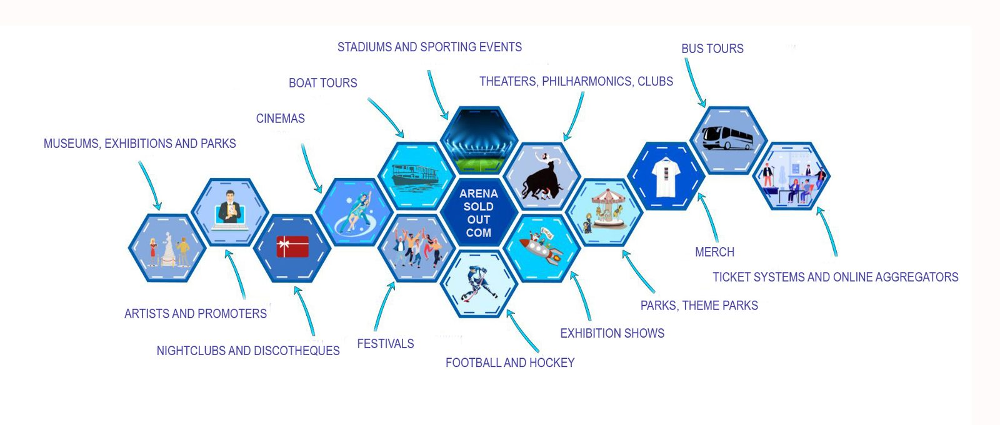
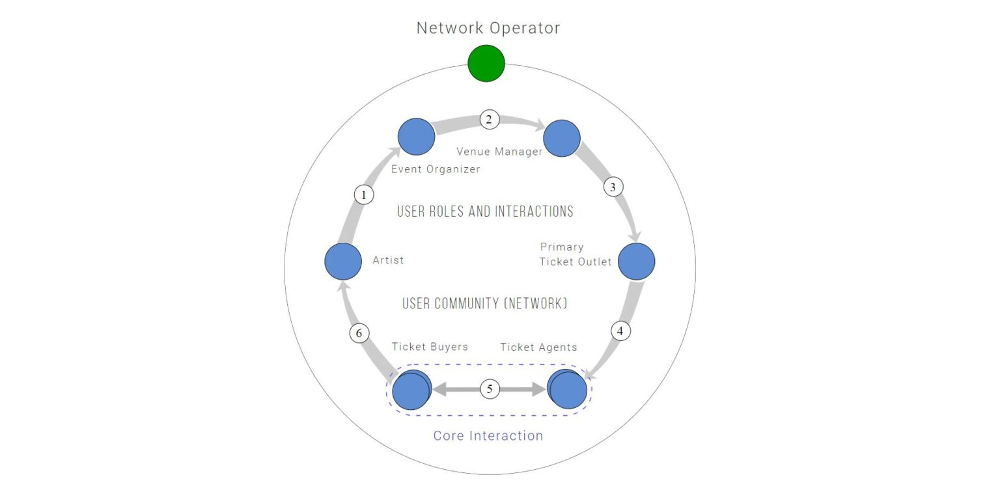
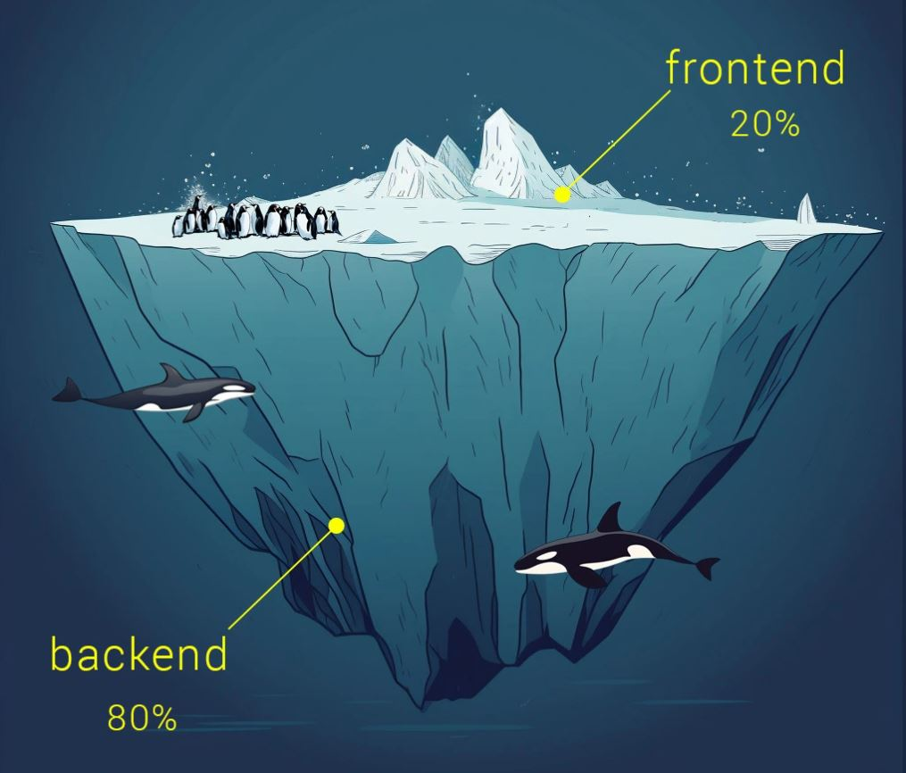

Professionals across various industries can now access a unique service – their very own platform based on PaaS (Platform as a Service) and White Label concepts. They understand precisely what solution they need, can configure and operate the platform under their own brand.

From organizing ticketing systems, events, tours, selling tickets, goods, and services — a custom platform is necessary to gather users of different roles and unite them in one ecosystem. It’s better to obtain a ready-made platform than to spend time and money inventing and developing another solution from scratch. Developing a platform with a “quick and cheap” mindset often leads to financial losses.

 Learn more in the article [“Make own ticketing platform for 1000 USD. Myth or reality?”](/blog/make-own-ticketing-platform-for-1000-usd-myth-or-reality)

The “Custom Platform” service offers a full-fledged solution where the recipient of the service has Operator status (maximum rights) and can attract users to their platform: Organizers, Agents, Buyers. Such a platform is a network under full control of the Operator, who manages and develops it as an ecosystem for all market participants.

It’s worth noting that the platform is suitable for use in various markets. Here are some examples:

### **PLATFORM AS A SERVICE (PaaS)**

The concept of “Platform as a Service” proves its effectiveness in many business areas. Under this concept, the central server ArenaSoldOut.com is located with the platform provider (supervisor). As a consumer of the “Custom Platform” service, the network Operator does not need to install any software or hardware. Moreover, all users see the platform as the Operator’s system with Operator’s brand. All Operators always use its latest, well-tested, reliable version. The Operator receives technical support from ArenaSoldOut.com and does not have to maintain its own IT infrastructure: developers, various IT specialists. Thanks to this approach, the Operator can focus on business management and development issues, without spending resources on the technical side of things.

### **WHITE LABEL CONCEPT**

The “White Label” concept involves using the ArenaSoldOut.com platform under the network operator’s brand. The operator can connect organizers and agents who will upload and sell their own events, goods, and services, perceiving the platform as the operator’s proprietary system.

Sales can be made either through the operator’s single internet acquiring or through multiple agents’ acquiring. The platform’s rules are set by the operator, who also monitors their execution.

### **PLATFORM BUSINESS MODEL**

The platform business model creates an ecosystem for market participants’ interaction. This is fully relevant for the operator network, where the standard interaction cycle for ArenaSoldOut.com operates:

The platform allows combining user roles. For example, a festival organizer, artist, tour organizer, museum, exhibition organizer, park, or any other service provider can organize and sell everything independently. In this case, they simultaneously act as the organizer, sales organizer, and agent.

### **WHY IT’S BENEFICIAL?**

The ArenaSoldOut.com platform has undergone a long journey of evolutionary development and stands as a convenient, efficient, and balanced solution for the ticketing market. The platform developers have accumulated vast experience in automating business processes for such solutions. They continue to evolve and refine ArenaSoldOut.com.

It’s evident that there’s no point in “reinventing the wheel,” creating your own system with the same functionality, hoping it will be noticeably better, more convenient, faster, and more reliable than existing ones. At the very least, it’s expensive and time-consuming. It’s far more practical to take advantage of the “Own Platform” service and obtain a solution here and now. If the goal is to make money, it’s economically unjustifiable to hire a team of developers and retain them in a long-term project. It’s much simpler, faster, and more efficient to use a ready-made platform, becoming the network operator.

The platform serves as the backend for its users’ websites and applications, the foundation for integration with other systems. By receiving their own platform as a service, the Operator and its users can focus their efforts and resources on creating websites and applications, integrating with various systems through APIs. They all gain an advantage in creating their solutions and bringing them to market.

### **REPORTS AND PAYMENTS**

The network Operator can connect one or several internet acquirers through which its agents will sell tickets. The Operator establishes rules for how users of its platform will operate, including setting up automatic reporting, stipulating its use in standard contracts, configuring email notifications, establishing rules for events’ blacklists, and much more.

The Reporter application allows obtaining data on ticket sales and platform performance indicators in real-time.

### **BECOMING A NETWORK OPERATOR**

The platform business model creates an ecosystem for all users: Organizers, Agents, and even Operators. One of the main tasks of any platform is to avoid negative effects associated with market manipulation and destructive competition among users.

A quote from the book “Platform Revolution” (Geoffrey G. Parker, Marshall W. Van Alstyne, Sangeet Paul Choudary):

“The competitive strategy of a platform resembles the strategies of traditional companies roughly as three-dimensional chess resembles ordinary chess. Within the ecosystem, the leading company competes for dynamic advantages, including competition on three levels: platform versus platform, platform versus partner, and partner versus partner.”

Undoubtedly, effectively utilizing the platform as an Operator can only be achieved by a few experienced market participants who possess the knowledge and resources to create, maintain, and develop an ecosystem for everyone else. If your company has the resources, competencies, and the desire to use the platform as its own system, please send an application with your details and information about your company to support@arenasoldout.com.

##### **For more insights into how ticket sales websites are structured, read the following articles:**

– [“Into the Future: tour sales automation – exploring new frontiers in the travel industry’”](/blog/into-the-future-tour-sales-automation-exploring-new-frontiers-in-the-travel-industry)

– [“Make own ticketing platform for 1000 USD. Myth or reality?”](/blog/make-own-ticketing-platform-for-1000-usd-myth-or-reality)

– “[I Want My Own Website for Ticket Sales”](/blog/i-want-my-own-website-for-selling-tickets)

– “[How to create a website for ticket sales, concerts, cinemas, theaters, ticket services, exhibitions, museums, tours, excursions, goods, boat-tours and parks](/blog/how-to-create-a-website-for-ticket-sales-concerts-cinemas-theaters-ticket-services-exhibitions-museums-tours-excursions-goods-boat-tours-and-parks)“

– [Mastering ticket sales: a Guide to building your ticketing website](/blog/mastering-ticket-sales-a-guide-to-building-your-ticketing-website)

**These articles delve deeper into the intricacies of setting up websites for ticket sales and provide valuable insights into the process.**

##### If you’re looking to create a ticketing platform or system, you might find the following information interesting:

[Special offer and essential features for ticketing plarforms, ticketing systems and event listings](/solutions/venues)

[Ticket Platform vs. Ticket System: understanding the difference](/blog/ticket-platform-vs-ticket-system-understanding-the-difference-2)
