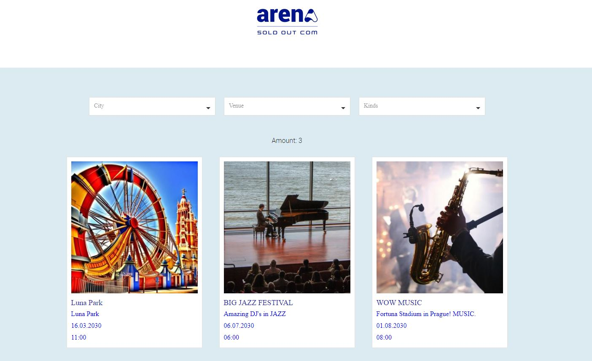
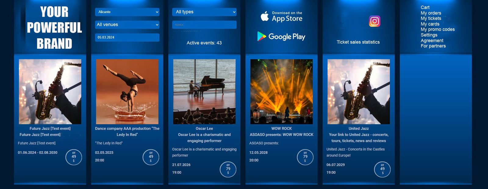
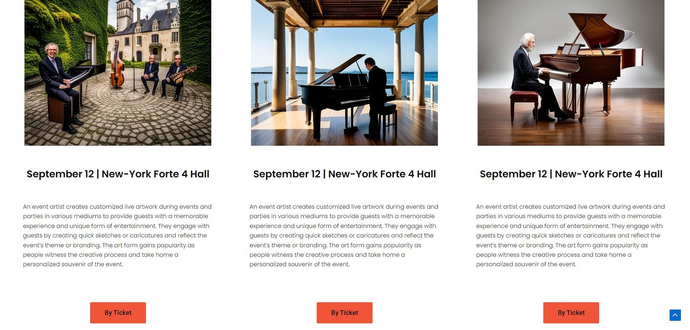

There are numerous websites for ticket sales, with the best ones enabling users to swiftly select events and venues and easily purchase tickets. Despite the outward simplicity of these websites, they are supported by complex interconnected systems: ticket processing, API gateways, online payment processing, reporting systems, online checkout, and many other features. This backend infrastructure remains hidden from ticket buyers, and the apparent simplicity of existing websites often misleads both clients and developers of new solutions.

Regardless of the choice of CMS or framework for website creation (client-side), it is crucial to recognize the presence of complex functionality on its server-side. The backend comprises the bulk of the ticket sales system. Ideally, one of the many ticketing platforms should handle the backend functions.

To avoid taking the difficult path, making mistakes, or reinventing the wheel, it is advisable to study the accumulated experience of creating websites for ticket sales by clients of the ArenaSoldOut.com platform on this page.

### **ARTICLES ON WEBSITE CREATION**

**We recommend reading articles on creating websites for ticket sales:**

“Quickly Create Your Own Ticketing Platform. Is it Possible?”

[“Ticket platforms. Five generations.”](/blog/ticket-platforms-five-generations)

[“Mastering ticket sales: a Guide to building your ticketing website”](/blog/mastering-ticket-sales-a-guide-to-building-your-ticketing-website)

[“The Essential Functionality of a Ticket System'”](/blog/the-essential-functionality-of-a-ticket-system)

[“I want my own website for selling tickets.”](/blog/i-want-my-own-website-for-selling-tickets)

[“Selling Tour Tickets: Methods, Tools, Step-by-Step Instructions”](/blog/selling-tour-tickets)

[“Into the Future: tour sales automation – exploring new frontiers in the travel industry”](/blog/into-the-future-tour-sales-automation-exploring-new-frontiers-in-the-travel-industry)

[“Make own ticketing platform for 1000 USD. Myth or reality?”](/blog/make-own-ticketing-platform-for-1000-usd-myth-or-reality)

The platform provides all the tools for creating events and managing ticket sales. This saves time and money in any website project for ticket sales. For instance, there is no need to implement: seating chart management, shopping cart functionality, online payment processing, administrative dashboard, reporting system, and much more. All of these features are already available in the ticketing platform.

**ArenaSoldOut.com offers two zones: Testing and Live**. All platform applications, including the Editor, connect to both the Testing and Live zones. This allows for the creation of events in both zones, and numerous events in the testing zone of the platform are available for website development purposes.

## **SOLD-OUT WEBSITE BUILDER**

The Sold-out website builder allows you to generate a website for selling tickets, goods, and services uploaded to the ArenaSoldOut.com platform in a matter of minutes. The website is created from a template with a simple design and can be installed either as a standalone site (in the root directory) or as a subdirectory, becoming a subsection of an existing site.

OR

Utilizing Sold-OUT is the simplest and quickest way to start selling tickets, goods, or services, as described in the guide “How to Start Selling Tickets to Events from Scratch.”

## **AN OPTIMAL PATHWAY TO WEBSITE CREATION**

The most straightforward and effective method to create a website for ticket sales is to utilize a ticketing platform as the backend. ArenaSoldOut.com offers the following options for this purpose (from simple to complex):

**1\. Create a website using the Sold-Out project.**

To create a site, fill out the form, download the archive, deploy it on your own hosting, and start selling tickets, goods, or services. The quickest start to ticket sales.

**2\.** Later you can **Utilize Integration Scripts with WordPress** for disign .

Some examples of a websites using integration scripts with WordPress and connected to the platform’s test zone:

.

Or

.

One more example:

You can also see some examples using this link

***Designe your website in any way you like, using WordPress features, and change it at any time with your designer.***

**3, Integrate a widget for ticket sales** into the created website.

**4\. Implement the ArenaSoldOut.com API into the created website independently**, creating a custom solution from start to finish.

## **CONNECTING PAYMENT PROCESSING**

Having your own internet payment gateway makes selling tickets, goods, and services simpler, safer, and more efficient. In many ticketing systems, it is necessary to use a “common” internet payment gateway registered under the system operator. Through this gateway, all tickets are sold, and organizers and agents must wait for the operator to transfer the money earned from sales to them. This process is inconvenient and not profitable.

On the ArenaSoldOut.com platform, it is necessary to connect your own payment gateway. In this case, all revenue from ticket sales goes directly to your account.

Currently, the following integrated solutions are implemented on the ArenaSoldOut.com platform:

-   Stripe (Acquiring bank), which operates practically worldwide

-   Payment gateway (Acquiring ) of one of the Armenian banks (Currently undergoing operational checks)

-   Payment gateway (Acquiring) of one of the banks in Uzbekistan. For information, please contact ArenaSoldOut.com support

We can implement other payment gateways, which is a separate and serious task that requires discussion.

## **USING WIDGETS**

Widgets of the platform are essential for selling tickets. Most often, when creating a website, a link to the widget is set on the “Buy Tickets” button. After clicking this button, the ticket buyer is directed to the widget, where they can select seats and make payment for the tickets.

## **WHITE LABEL CONCEPT**

The “White Label” concept involves the possibility of using the ArenaSoldOut.com platform under your brand. You can upload and sell your own events, goods, and services, perceiving the platform as your own ticketing system. At the same time, you can connect various partners and agents to sales, assigning them different roles under contractual terms.

## **ROLES ON THE PLATFORM**

The platform allows for combining user roles. For example, a promoter, festival organizer, or artist, an excursion organizer, or a provider of any other service can organize and sell everything independently. In this case, they simultaneously act as the Organizer, the Sales Organizer, and the Sales Agent. They can also assign necessary roles to other participants in the ticketing market.

## **WHY IS IT BENEFICIAL?**

The ArenaSoldOut.com platform has undergone a long journey of evolutionary development and is a convenient, efficient, and well-balanced solution for the ticketing market. The platform developers have accumulated vast experience in automating business processes for such solutions and continue to enhance ArenaSoldOut.com.

It’s evident that there’s no point in reinventing the wheel, creating your own system with the same functionality, hoping it will be noticeably better, more convenient, faster, and more reliable than the existing one. At the very least, it’s expensive and time-consuming. It’s much more practical to use the “Own Platform” service and get a solution here and now. If the goal is to make money, then it’s economically unjustified to hire a team of developers and keep them in a long-term project. It’s much simpler, faster, and more efficient to use a ready-made platform and start earning money considering its capabilities, your experience, resources, and goals.

The platform serves as the backend for the websites and applications of its users, the basis for integration with other systems. Also, when you can obtain your own platform as a service, you can focus efforts and resources on creating websites and applications, integrating with various systems through APIs. In this case, you gain a significant advantage in creating your solutions and bringing them to the market.

*Alexander Orlov, Software architect and team lead at TixGear — ArenaSoldOut.com*

*and*

*Marina Bakanova, Co-founder of ArenaSoldOut.com ticketing platform for event organizers*

*ArenaSoldOut.com – Worldwide representative of TixGear*

#### **For more insights into how ticketing websites are structured, read the articles:**

[“Custom ticketing platform: how to build your own”](/blog/custom-ticketing-platform-how-to-build-your-own)

[“Ticket platforms. Five generations.”](/blog/ticket-platforms-five-generations)

[“Mastering ticket sales: a Guide to building your ticketing website”](/blog/mastering-ticket-sales-a-guide-to-building-your-ticketing-website)

[“The Essential Functionality of a Ticket System’”](/blog/the-essential-functionality-of-a-ticket-system)

[“I want my own website for selling tickets.”](/blog/i-want-my-own-website-for-selling-tickets)

[“Selling Tour Tickets: Methods, Tools, Step-by-Step Instructions”](/blog/selling-tour-tickets)

[“Into the Future: tour sales automation – exploring new frontiers in the travel industry”](/blog/into-the-future-tour-sales-automation-exploring-new-frontiers-in-the-travel-industry)

[“Make own ticketing platform for 1000 USD. Myth or reality?”](/blog/make-own-ticketing-platform-for-1000-usd-myth-or-reality)

#### **You might also find these articles interesting:**

– [Tools for events from 5,000 to 100K+ participants: functional features of ticketing platforms](/blog/tools-for-events-from-5000-to-100k-participants-functional-features-of-ticketing-platforms)

– [STRESS TESTING: Technical Report 2023](/blog/stress-testing-technical-report)

– [Why STRESS Testing Ticket Platforms Matters: Benefits for Organizers and Buyers](/blog/why-stress-testing-ticket-platforms-matters-benefits-for-organizers-and-buyers)

– [Ticket platforms. Five generations.](/blog/ticket-platforms-five-generations)
