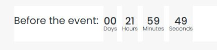
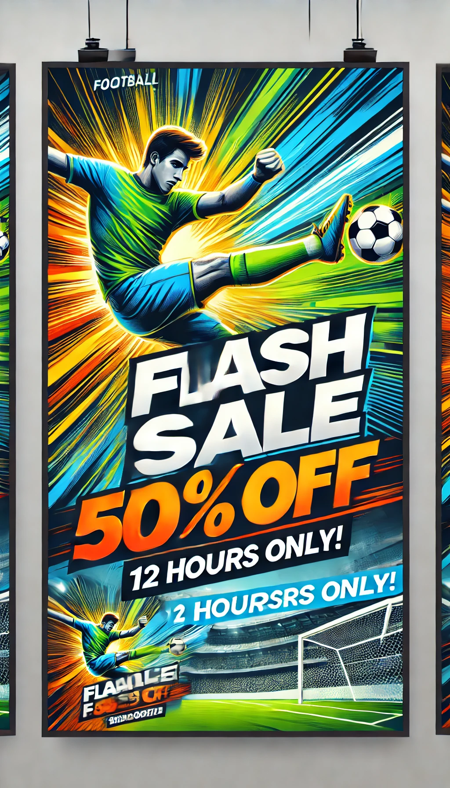

Successful marketers often use the concept of scarcity to stimulate sales. Every time we emphasize the limited availability of a resource, we’re employing this psychological technique. Let’s break down which specific triggers work and how to skillfully leverage the feeling of time scarcity in marketing strategies for selling event tickets.

## Main Points:

## – Countdown Timers

## – “Flash Sales” and One-Day Offers

## – Gradual Price Increases

.

Limited time frames, depleting stock, and messages like “only a few seats left”… Sound familiar? Recent studies have shown several effective ways to implement the principle of scarcity, from demonstrating high demand to creating time constraints.

Event organizers and business owners know that time is a valuable resource. When combined with an attractive offer that could soon disappear, time scarcity becomes an excellent incentive for decision-making. In a nutshell: the lack of time creates urgency and pushes buyers to act, reducing the likelihood of postponement.

For instance, imagine you open a streaming platform and find out that a particular match will only be available for a few days. Maybe this match wasn’t on your watch list, but the news of its impending disappearance urges you to watch it immediately, so you don’t miss out. This example perfectly illustrates how time scarcity influences consumer behavior.

## 1\. Countdown Timers

A countdown timer creates a powerful sense of urgency. It’s one thing to tell a potential buyer that time is running out, but visually showing the minutes and seconds ticking away is entirely different.

Consider placing timers on ticket sales pages. For example, during a pre-sale for a major music festival, a timer can display how long the special offer will last, prompting people to take immediate action. This method is commonly used by large marketplaces and has proven effective due to the creation of FOMO (fear of missing out).

Example: If you’re organizing a cultural event, add a timer on your website showing how much time is left before the discount campaign ends. This will encourage art enthusiasts to buy tickets early while special conditions apply.

## 2\. Flash Sales and Limited-Time Offers

Sudden sales and limited-time offers are another proven way to create urgency. For this approach to work, use it at unexpected moments rather than only during traditional sales periods like Black Friday. Open short windows of opportunity spontaneously to boost interest and activate your audience’s desire to act immediately.

Some airlines, for instance, hold unexpected 24-hour ticket sales to make customers act quickly. Their marketing strategies are well-thought-out and worth learning from, as they leverage tried-and-tested tactics from major companies. Similarly, for events, you can organize special offers on a limited number of tickets or for a short duration.

Imagine you are promoting a football match and announce a “Flash Sale” on Thursday evening, where tickets are sold at a significant discount for only a few hours. Advertise the sale through email campaigns or social media to maximize attention.

**Here’s a practical example for event promotions:** 

***Flamenco Star Gala Concert is just around the corner! Today only, we’re offering an exclusive 24-hour deal: buy your tickets at the lowest price and experience the passion and magic of Flamenco live! Hurry, these prices won’t last!***

For sports events, you could announce a similar flash sale: 

***The ultimate football showdown is approaching! Today only, for the fastest fans: a flash sale with 50% off match tickets! Offer valid for 12 hours only! Tickets are running out fast, claim your spot in the stadium now!***

—

## 3\. Gradual Price Increases

A time-based pricing system adds pressure on buyers. The longer they delay their purchase, the higher the ticket price becomes. This is a classic strategy rooted in time scarcity.

How can you apply this? When launching a new event, offer discounted tickets for early buyers. Then, gradually increase the price, notifying your audience in advance. Publishing a price schedule can motivate people to buy tickets sooner to save money.

Example: If you’re organizing a festival, set up multiple pricing tiers: the first batch of tickets sells at the lowest price, the next at a higher price, and so on. This approach encourages attendees to act quickly to get the best deal.

—

## Combining Scarcity with Loyalty Programs

To amplify the effect, combine time scarcity methods with loyalty programs. For instance, give your loyal customers early access to special offers. This will not only boost sales but also strengthen your audience base.

***Using time scarcity is a powerful way to drive ticket sales. ArenaSoldOut.com provides event organizers with tools to integrate these strategies seamlessly. Whether it’s countdown timers, flash sales, or dynamic pricing, you have the opportunity to create urgency, spark interest, and increase sales. Apply modern methods and ensure the success of your event!***

## For more insights read ArenaSoldOut.com articles :

## [All Articles](/blog)
