### Why merchandise matters and how it works for event organizers

Merchandise for artists, theaters, and events is more than just branded t-shirts and caps. It’s a strategic tool that can increase revenue while enhancing brand visibility. For organizers of concerts, festivals, theater performances, sports events, or conferences, selling merchandise can elevate your business and create a deeper connection with your audience.

In the past, fans would create their own memorabilia to showcase their loyalty and identify with their community. Today, merchandise has evolved into a commercial product, yet it still carries the essence of belonging. It’s a way for fans to express their admiration for an artist, brand, or event and serves as a potent marketing tool that connects the audience to something larger.

### Merchandise as a Revenue Stream: how much are stars earning?

Examples from the music industry show the lucrative potential of merchandise. In 2020, physical products often earned musicians more than streaming revenues. For instance:

– \*Metallica\* made $122 million from merchandise sales in 2020, significantly supplementing their tour income.

– For many artists, selling physical items, like branded clothing and memorabilia, brings in more revenue than streaming. Bands like \*While She Sleeps\* highlight this difference by selling t-shirts that humorously read, “One T-Shirt = 5000 Spotify Streams.”

These numbers make it clear: merchandise isn’t just an additional income but a strategic revenue tool that every event organizer and brand should consider.

### How merchandise promotes events and brands

When people wear merchandise with the logos of concerts, theater performances, conferences, or festivals, they become ambassadors for your brand. This grassroots promotion works across all types of events, from music to sports. Friends and acquaintances see the logo, remember it, and may become curious about the brand. This strengthens community bonds and fosters new social and business connections.

Merchandise also acts as a tangible memento of the event, embedding positive emotions and reminding the wearer of the brand. A single shirt, cap, or notebook can initiate a long-term relationship with your brand.

### Merchandise ideas: surprise and engage your audience

Popular items that are always in demand include:

– T-shirts, hoodies, tote bags, caps.

– Notebooks, pens, pins, and magnets.

**However, to truly stand out, consider more original and creative options:**

– Rammstein released branded bicycles.

– Bloc Party\* surprised fans with logo-branded condoms.

– Mark Knopfler created exclusive USB drives shaped like his iconic red Fender Stratocaster.

– Treemen promoted eco-friendly values with branded tree seeds.

– GWAR offered GWAR-B-Q sauce, while Chicago band “OK Go” created air fresheners shaped like band members’ heads.

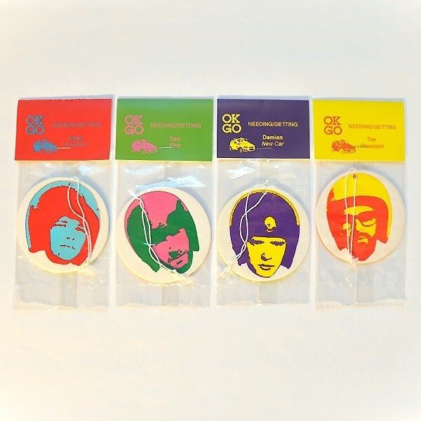

Modern fans are looking for more practical items. For example, “Fall Out Boy” launched a line of home goods, allowing fans to integrate the brand into their daily lives.

### Where and how to sell merchandise

To maximize merchandise revenue at events, effective sales channels and organization are essential. Here are some options:

1\. Your Website: Create an online shop for merchandise with delivery options.

2\. Marketplaces: Expanding to online marketplaces increases visibility and simplifies logistics.

3\. At Events: Selling directly at events provides an immediate purchase opportunity.

### Overcoming common merchandise sales challenges

**Event organizers face several challenges when selling merchandise at events:**

– Production Quantity: Produce too little, and you miss revenue opportunities; too much, and you’re left with unsold stock that incurs storage and logistical costs.

– Venue Restrictions: Some venues don’t allow merchandise sales.

– Queues and Cash Issues: Long lines can deter buyers, and some attendees may not have cash on hand.

**Solutions:**

1\. Presales with Tickets: Offer exclusive collections as part of ticket sales. This allows you to forecast demand and produce items based on pre-orders.

2\. Limited Editions: Creating scarcity drives interest and urgency.

For example, after a ticket purchase, users can be directed to a confirmation page offering exclusive merchandise. They can then receive a second digital ticket for their merchandise to collect at the event.

### Quality as a Trend

Today’s consumers are discerning; cheap, low-quality merchandise no longer excites them. Fans want t-shirts and hoodies that retain color and shape, with durable materials. Artists like \*Beyoncé\* and \*Kanye West\* release high-quality clothing collections, creating a sense of exclusivity.

Invest in quality and tell your brand’s story through your merchandise, and fans will be willing to pay for the experience.

### Why every event organizer needs merchandise

Merchandise is not just a revenue boost—it’s a way to make your event unforgettable. It creates emotional connections, instills a sense of belonging, and continues to promote your brand long after the event ends. In a world where experiences and memories hold increasing value, merchandise is a powerful tool for building connections with attendees, audiences, and fans.

Don’t miss the opportunity to strengthen your bond with your audience and increase your profits!

### **For a Creativity Boost in your hearts and minds: more examples of unique merch**

Here are some extraordinary merch ideas that have captivated fans with their creativity and uniqueness:

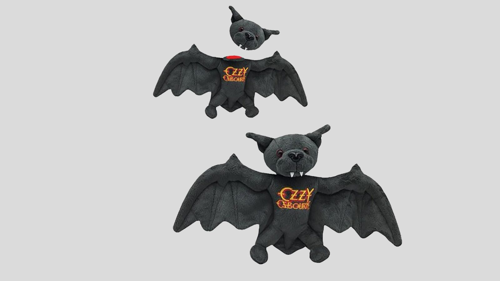

**Ozzy Osbourne and the Bat Plushie**  
Inspired by the infamous moment when Ozzy Osbourne bit the head off a bat on stage, this plush toy from the “Prince of Darkness” is a quirky and memorable keepsake that fans love.

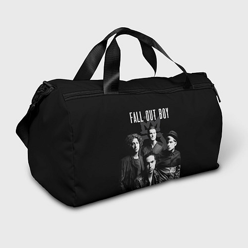

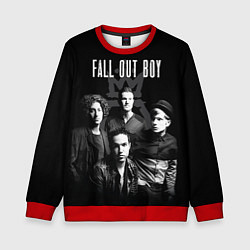

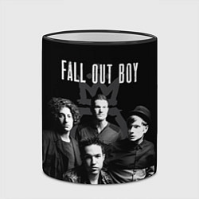

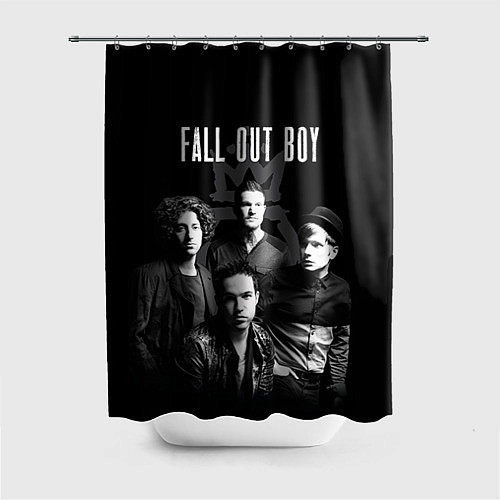

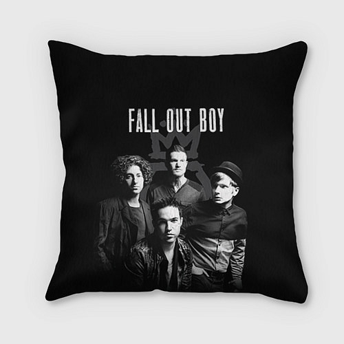

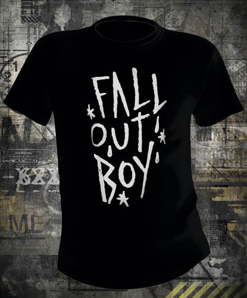

**Fall Out Boy’s home goods line**  
Fall Out Boy offers a line of home and everyday items like pillows, shower curtains, bags, hoodies, and even bath bombs. “They smell great, but don’t eat them!” warns lead singer Patrick Stump. These lavender-scented bath bombs are the perfect way for rockers to unwind after long tours.

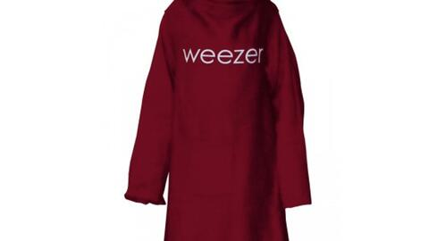

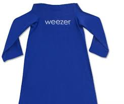

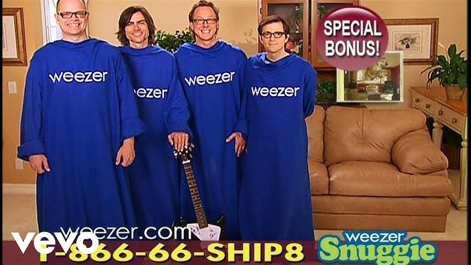

**Weezer’s Snuggie**  
Weezer created an unusual piece that’s part blanket, part loungewear. They even filmed an infomercial-style ad to promote it, which adds a humorous, retro vibe. It’s a practical item that fans can actually use.

**Tenacious D’s Pick of Destiny**

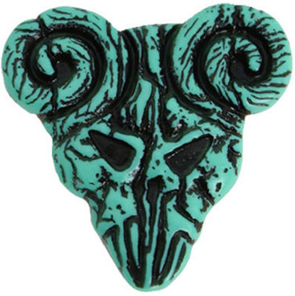

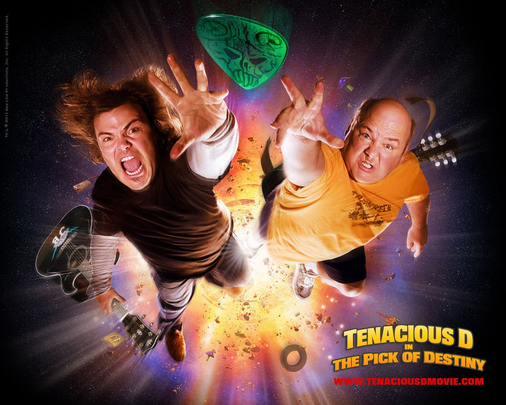

While it’s uncertain how practical this “Pick of Destiny” is for guitar playing, it’s a mystical item with a fan base that believes it can open chakras and unlock new abilities.

**Alice Cooper’s chocolate milk**

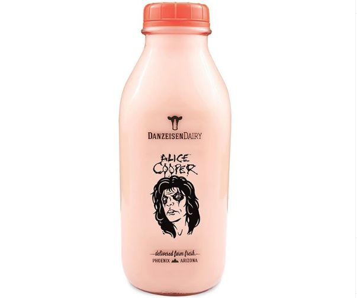

**Pet Pouch hoodie**

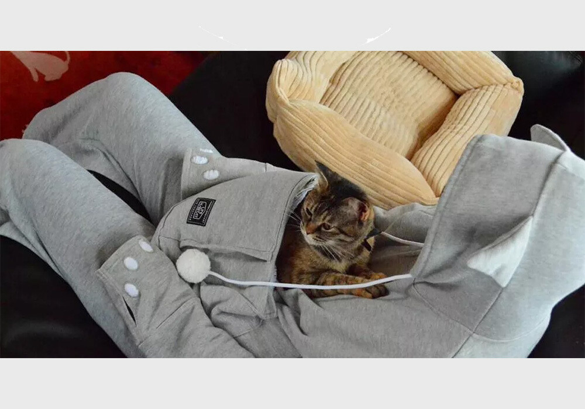

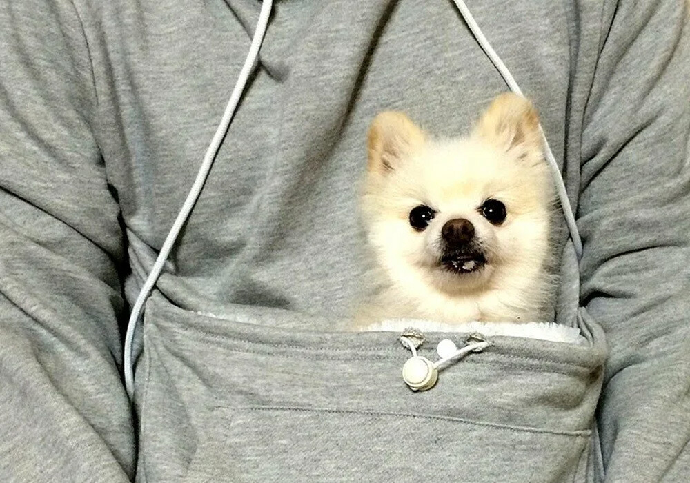

For fans who spend a lot of time at their desks, a hoodie with a built-in pocket for a pet is both functional and adorable. Pets can stay cozy in the pouch without interrupting their owner’s work.

**Merch with swappable patches**

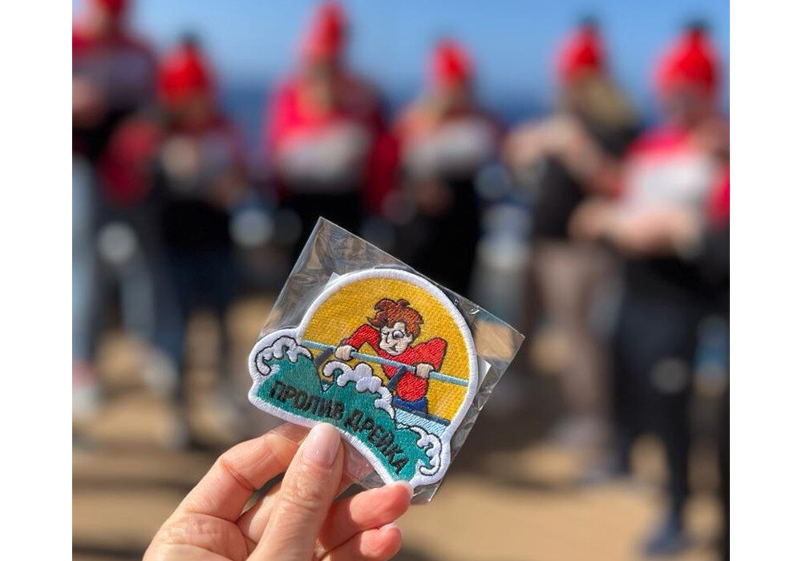

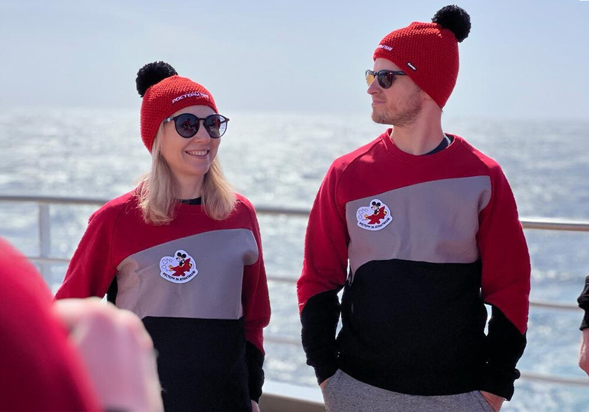

Swappable patches give fans the freedom to customize items like hoodies, T-shirts, caps, and fanny packs. The patches can feature different messages or brand logos, tailored for various events or celebrations.

**Meme merch**

Merch featuring memes is a fun way for fans to stand out and express their personality. Memes also allow fans to share their opinions or emotions regarding current events.

**Deadmau5 cat headphones**

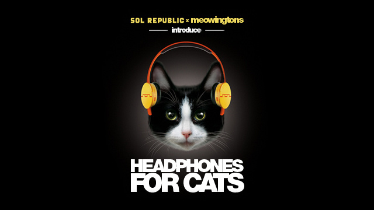

While Deadmau5 might not be everyone’s taste, this DJ’s limited-edition cat headphones show his love for pets, allowing cats to enjoy music alongside their owners.

**AC/DC Suitcase**

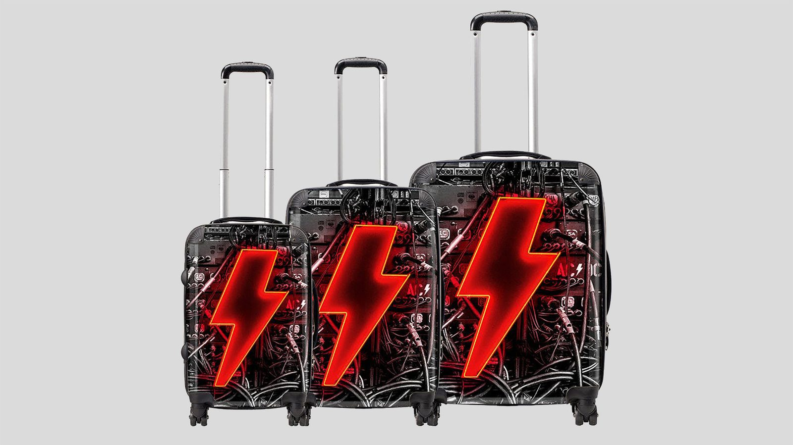

Simple item like a suitcase becomes unique when branded with AC/DC’s style, making it a functional and stylish choice for fans who travel.

### More inspiring Merch ideas

The WOW factor of a stylish, original, or witty gift makes it irresistibly shareable! It’s the kind of surprise that begs to be shown off in social media feeds and sent to every group chat. With a clever twist, these gifts don’t just make people smile—they spread like wildfire!

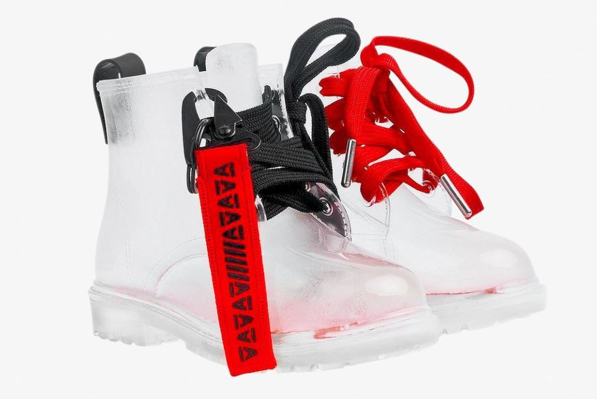

Transparent boots and rain ponchos were a top-seller for one festival organizer, providing practicality with a stylish twist.

**Event-Themed merch**

**For yoga festivals,** branded yoga mats, essential oils, and bath salts were popular among attendees, adding value to their event experience.

**For a flamenco tour**, fans had the option to buy shawls, castanets, fans, and costume pieces right along with their tickets. Imagine how many photos flooded the internet from those who got their hands on these beautiful items! Women, children, and even men couldn’t resist snapping a picture with these iconic accessories. Thankfully, the organizer had accurate pre-sale data for each item, so they knew exactly how many to bring to each tour city. The pre-sales of this merch almost matched ticket sales, bringing in significant extra revenue for the organizer. That additional income is always a valuable boost!

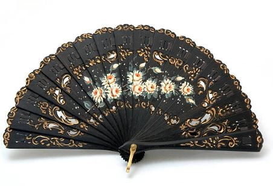

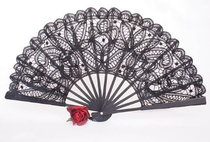

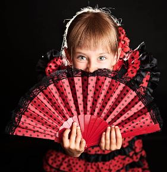

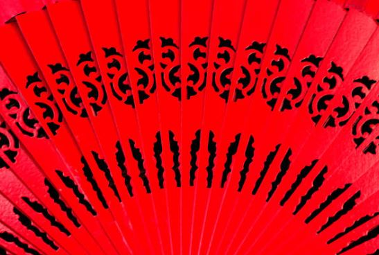

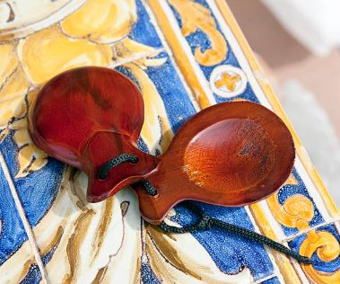

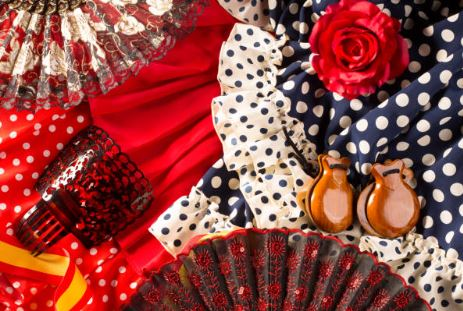

**Eco-friendly merch**

With the “green” trend, sustainable items like recycled notebooks, canvas tote bags, reusable water bottles, and metal mugs with lids are more in demand.

**Temporary Tattoos**

Temporary tattoos are a fun way for fans to show their interests without a permanent commitment.

**Merch with witty phrases**

Items featuring humorous or ironic phrases are always a hit, allowing fans to express themselves in a playful way.

* * *

**With these creative ideas, you can not only boost your sales but also leave your attendees with a memorable experience and lasting impression of your event.**

If you work with the ticketing platform ArenaSoldOut.com, you can easily implement these strategies. Alongside ticket sales, you can offer merchandise and other products, creating a seamless experience for your attendees.

If you have any questions, contact us via the form on our website.

Marina Bakanova, Co-Founder ArenaSoldOut.com

**YOU MIGHT ALSO LIKE:**

[Ticket service fee: cost and customer loyalty management](/blog/ticket-service-fee-cost-and-customer-loyalty-management)

[How to Effectively Attract Buyers Using Time Scarcity](/blog/how-to-effectively-attract-buyers-using-time-scarcity)
