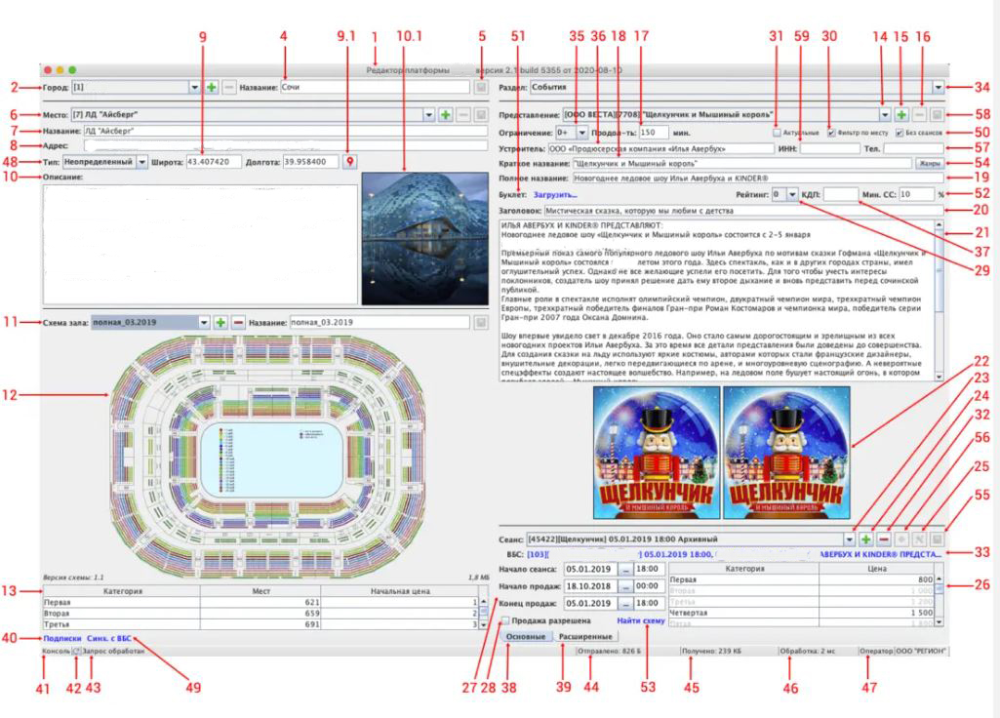

*I often see projects to create websites and mobile applications for selling tickets to various events, including those hosted on freelance exchanges. Thanks to my work, I know a lot of implementations of such projects, including those that disappointed both customers and contractors. This article is a short guide on the topic of creating such sites, written on the basis of personal experience*.

#### Who are the Customers?

**Firstly, the site for the sale of tickets is necessary for event organizers.** The reason is simple – why should you pay remuneration to ticket agents and operators, if you can sell most of the tickets yourself. The economy of the organizers is quite tough, there are a lot of expenses: artist’s fee, venue rent, advertising, equipment, hotels, transport, etc. And the income is only the sale of tickets.

**Secondly, these are SEO-specialists and Internet marketers** who decided to apply their experience and try their hand in this area. Since the sale of tickets is highly dependent on the position in the Google search results.

**Thirdly, the owners of venues**, venues for various events who want to earn money from ticket sales as well.

**Fourth, these are artists** who want to sell tickets on their own website.

**All customers can be divided into two unequal parts:** those who already have experience with various ticket systems, and those who have a vague idea of what it is. Interestingly, there are more of the latter than of the former today.

#### Who carries out such orders?

In the vast majority of cases, web studios, digital agencies, freelancers, etc. take on the production of such sites. There are many names – the essence is the same: this is a team or one web developer who are focused on making the “front-end” part (a beautiful web site like a cover) and try not to get involved in the development of the “back-end”. Often, this is their first site of this type of business.

#### Formulation of the problem

I can simplify it like this: The customer says: “… I want a website for selling tickets, there should be event cards, a description of the event, posters, descriptions and schemes of venue where the buyer can select seats and pay for them with a bank card, and I also need an admin panel to start these activities and manage them. I want to receive sales reports. I want to see my site in the top of Google search results. Also, I need to be able to open ticket sales to other ticket operators and agents, in real time, from a single source, without using quotas.”

Well, sometimes customers simply describe: “I want a site for selling tickets to events, and you figure out what site should be made and all the details there”

It is surprising that we see order executors who take on such work as creating a website, and not as creating a ticket system. At the same time, they agree to implement the project for time and money that are inadequate to the amount of work. Almost no one thinks about the backend and ticket processing at this moment. It is implied with such an order that “we will do everything ourselves.”

#### What do you need to sell tickets?

1.  Scheme of the venue, with or without seats (tickets without seats). Seats in the diagram, as a rule, with different price categories and tariffs (adult, child, etc.). Based on the schema, you need to create an event with sessions that have a start date and time. Save everything in the database.

*TixGear - ArenaSoldOut.com Platform Event Editor*

2\. Ticket processing, which will accept and process the orders of ticket buyers, control payment, issue and send tickets to the buyer in electronic form, with barcodes and QR codes that will be needed at the entrance control. If necessary, return tickets, with the return of seats for sale. Processing manages the statuses of orders, seats and tickets.

3\. Additional services: reporting system, analytics, functionality for uploading tickets to the Access Control System (ACS) of the venue, issuing and selling promo codes, etc.

  
About 80% of the code for the above functionality is implemented on the server (backend), and not on the website (frontend). At this point, the do-it-yourself approach turns a website project into a ticketing system project, with the inevitable conversations with the customer about money. Why? – because the customer needed a website, and did not need new ticket system, and the customer is not ready to finance the “reinvention of the bicycle”.

#### Optimal Approach

Most successful websites and mobile ticketing applications have a ticketing system\\ticketing platform as a backend and work with it via API. In this case, the event is created in the ticketing system\\ticketing platform, its processing, acquiring, and reporting are used. Modern ticketing systems\\ticketing platforms have gateways to other systems, which makes it possible to open ticket sales to a wide range of ticket operators and agents.

When working with the ticketing system via API, the executor of the order\\web developers is not limited in the choice of design solutions for the web site, he can create his own user-friendly interface and navigation. But the most important and difficult part of this approach is the correct and optimal implementation of the ticket system API. And not all web developers can do this, as practice shows.

#### How to choose a ticket system and web\\app developers

The customer will enter his events into the ticket system, and a lot depends on its functionality and convenience. You should look at systems with the following features:

-   Using an open and developed API
-   Possibility for the customer to use their own Internet acquiring
-   Ability to use gateways to other ticketing systems

When choosing a contractor to create a site, you should pay special attention to whether he has experience in implementing the API, not necessarily a “ticket” one. For many website developers, implementing an API is difficult and prohibitively expensive. If you go beyond the standard template development of a website and need to implement even the simplest API, the price of the project can increase significantly, and the quality of the final product will leave you unsatisfied.

#### Summary

Developing a website or a mobile application for selling tickets is a simple task, but with nuances. To solve it, it is important to choose a convenient ticketing system\\ ticketing platform and implement its API in a quality manner. All other issues are less significant and are resolved fairly quickly.

Alex Orlov  
Software architect and team lead TixGear – ArenaSoldOut.com

[Contact Us](/contact)
