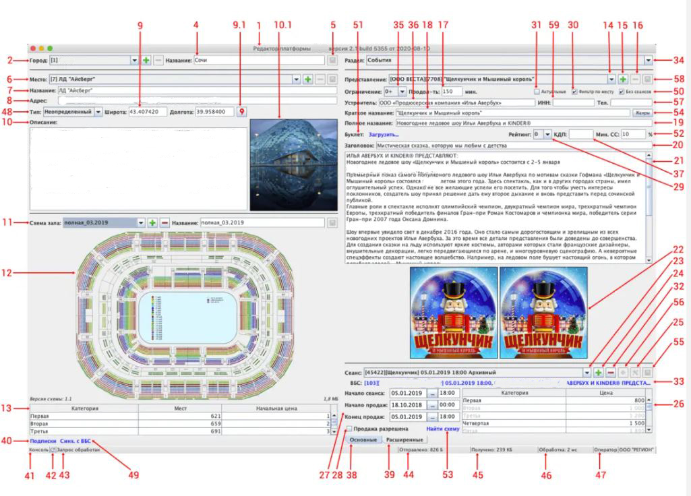
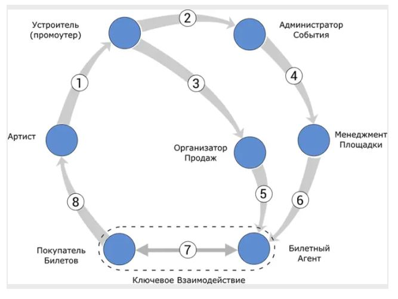

# Make own ticketing platform for 1000 USD. Myth or reality?

I see a lot of the same type of orders on freelance work marketplaces, which can be described something like this: “I need my own ticketing platform like Eventbrite or Ticketmaster, $1,000 budget.”  
Such requests are placed almost daily and they do not differ very much from each other. Sometimes the difference is in the amount of money, sometimes in the description of the functionality, very often the request says that this needs to be done quickly, most requests indicate that applications are asked to be created needs to be created by specific application builder, for example, on WordPress, or on Bubble, or on another application builder.

#### Why am I writing this article?

I think that customers who want to develop their own platform for themselves are mostly professionals with experience in organizing events and selling tickets through their own and other sites, mobile applications, social media. They were already using the systems of the major market participants and this experience led them to want to create their own event management and ticket’s sales platform. As a rule, they understand well how everything is work organizationally, but they do not realize how everything works technically. And this is the reason for the misjudgment of the work of creating a platform at the beginning of the project, and frustration at the end.

To warn and prevent, and also, in order not to tell the same thing verbally many times, I decided to write this article.

**The Secret to a Happy Home \\ Life is a series of choices \\ Money often costs too much \\ «In the middle of difficulty lies opportunity.» (Albert Einstein) \\**

Let’s compare, at least approximately, the creation of websites (frontend) and platforms (backend) with the construction of houses in the city. We will assume that a professional developer already has several buildings (sites) successfully built and connected to communications such as electricity, heat, water, sewerage. These houses are profitable, but behind the communications you can see the Power Plant and the electric company (platform), which must be constantly paid.

  
At some point, the developer decides that he needs his own Power Plant in order to receive money from energy payments to his account, increase turnover by receiving payments not only from his own residents, but also from residents of other houses built by other developers (customers ). He thinks like this: “This will be cool and a great development! Who else but me, experienced and knowing everything about the construction and organization of the city, deserves to have my own Power Plant!»  
Adding fuel to the fire is that from the street Power Plant looks like just a “box”, even smaller than the buildings that the customer has already built. So, according to the appearance of the Power Plant building, its price is determined – that price of a thousand dollars, for example.

*Power Plant как backend*

What was not taken into account by the customer?  
The entire content of Power Plant was not considered, which is much more complicated, more technologically advanced, and, as a result, more expensive than its buildings (sites). The customer is not embarrassed that buildings (sites) were assembled on one of the popular CMS in a week, and Power Plant is being built for a long time and by specialized companies. It didn’t matter to him that Power Plant was constantly evolving in the hands of experienced developers. The customer is smart, and will find a “free mason” on a freelance exchange, who in a couple of weeks will build him “exactly the same Power Plant, only smaller and different.”

#### Continuing the metaphor. What's under the hood?

An ordinary tenant of the house is completely invisible and absolutely not interested in where the heat, hot water and electricity come from in his apartment. Obviously, the average user has near-zero knowledge of both the internal structure of the Power Plant and how “electricity” enters his apartment via the API. The main thing for the tenant is that it is uninterruptedly warm, light and dry, so that the TV, computers and all household appliances work. In the same way, the ticket buyers needs buy tickets quickly and with a minimum of clicks for the seats they like, without studying the internal structure of the platform.

  
The problem is that the “thousand-dollar customer” looks at the platform like a regular ticket buyer, mistakenly believing that the site (frontend) is the most part of the platform, and thinking that the fewer clicks, the simpler the system. And this is not so at all. First, the frontend usually makes up no more than 20% of the project, while the backend is 80% or more.

And secondly, the fewer clicks a user makes, the more actions the platform does for him. As a result, it turns out that the central server of the platform is a complex thing that tries to do everything by itself, reducing the number of actions of users of all roles to the minimum possible.

-   I will outline in large strokes some of the processes in the ticketing platform that should be implemented for 1000 USD:

**Selling a ticket** is the key interaction of the platform, that’s what everything was started for. To sell even one, the smallest ticket, you need to allow the user to select an event and a session, show him the venue plan, where each seat has coordinates (sector, row number, seat number), status (free, reserved, sold), price category, tariffs (for example, adult or child). To clearly understand how many parameters and settings you need to set and save (in a fast-working database) to display an event for sale using the screenshot of the main window of the TixGear Platform Event Editor – ArenaSoldOut.com.  
You can clearly understand how many parameters and settings you need to set and save (in a fast database) to display an event for sale by the screenshot of the main window of the TixGear – ArenaSoldOut.com Event Editor.

*TixGear Platform Editor - ArenaSoldOut.com*

The central server of the platform should be able to send the current seating plan via API to hundreds, and even thousands of ticket buyers at the same time. At the same time, buyers will competitively reserve the desired seats at the time of the purchase, place them in an order and pay for it through Internet acquiring. To do this, the server must have powerful processing that correctly executes and, if necessary, rolls back the transactions of many buyers acting at the same time. This is a technologically difficult task, and there are many opportunities to do everything badly.  
After successful payment, it is necessary to issue a ticket according to the template created by the organizer, place a barcode and / or QR code on it for the access control system. It often happens that the ticket data, barcode and QR code need to be received from an external system in a timely manner. After the ticket is generated, it must be sent to the buyer by email or mobile messenger. And if the user wants to return the ticket, then the system must assign the status “returned” to the ticket and return the seat for which it was purchased, for sale.

#### User roles and their interaction.

Any platform is, first of all, about the roles of users, their interaction in the ecosystem and network effects. The main user roles in the platform for the ticket market are Organizer, Agent and Ticket Buyer.

*The interaction cycle of platform users.*

**The platform should have tools for organizers** to allow or prohibit agents from selling tickets to events through their own Internet acquiring and cash desks.  
**Agents need** sales management tools: interface settings, acquiring, service fees, etc.  
**Ticket buyers** need a personal account.

**The API economy** is the most important part of the world of platforms, or vice versa (as you like). With the help of the API, ticketing platforms both receive information about events, sessions, schemes, seats and prices, and give it back. Creating a modern platform without its own API and implementing many APIs from third-party systems is a pretty pointless exercise.

All the above processes cannot be pushed into 1000 USD. And even in 3000, and even in 5000. In this sense, doing for a thousand is almost the same as doing for free. But you should understand that there will always be alternatively gifted freelancers who will promise, and even make some kind of platform for such a price. But the customer will definitely not like it, and, in fact, it will not be a platform, since it is impossible to create a well-functioning product in this business segment for such amounts.

#### How we create a platform and how much we have already spent

We, as a development team, have been creating the TixGear – ArenaSoldOut.com Ticketing Platform since 2015. About 40,000 standard hours have already been spent, and the platform continues to evolve at an accelerating rate. Based on the market value of the standard hour of an experienced developer, you can estimate how much it really costs to create (not operate) such a platform.

**You really want to have your own platform. How to do it?**

Using the service PAAS (PLATFORM as a SERVICE), you can immediately start working, connect clients and hone business processes, skipping the long and costly development stage. With this service, the developer (customer) immediately receives his own “virtual Power Plant”, and connects his own and other houses (event businesses) to it. With full technical support. Quite convenient, to be honest.

Alex Orlov  
Software architect and team lead TixGear – ArenaSoldOut.com

##### **For more insights into how ticketing websites are structured, read the articles:**

[“Custom ticketing platform: how to build your own”](/blog/custom-ticketing-platform-how-to-build-your-own)

[“Ticket platforms. Five generations.”](/blog/ticket-platforms-five-generations)

[“Mastering ticket sales: a Guide to building your ticketing website”](/blog/mastering-ticket-sales-a-guide-to-building-your-ticketing-website)

[“The Essential Functionality of a Ticket System’”](/blog/the-essential-functionality-of-a-ticket-system)

[“I want my own website for selling tickets.”](/blog/i-want-my-own-website-for-selling-tickets)

[“Selling Tour Tickets: Methods, Tools, Step-by-Step Instructions”](/blog/selling-tour-tickets)

[“Into the Future: tour sales automation – exploring new frontiers in the travel industry”](/blog/into-the-future-tour-sales-automation-exploring-new-frontiers-in-the-travel-industry)

[“Make own ticketing platform for 1000 USD. Myth or reality?”](/blog/make-own-ticketing-platform-for-1000-usd-myth-or-reality)

##### **You might also find these articles interesting:**

– [Tools for events from 5,000 to 100K+ participants: functional features of ticketing platforms](/blog/tools-for-events-from-5000-to-100k-participants-functional-features-of-ticketing-platforms)

– [STRESS TESTING: Technical Report 2023](/blog/stress-testing-technical-report)

– [Why STRESS Testing Ticket Platforms Matters: Benefits for Organizers and Buyers](/blog/why-stress-testing-ticket-platforms-matters-benefits-for-organizers-and-buyers)

– [Ticket platforms. Five generations.](/blog/ticket-platforms-five-generations)

##### If you’re looking to create a ticketing platform or system, you might find the following information interesting:

[Special offer and essential features for ticketing plarforms, ticketing systems and event listings](/solutions/venues)

[Связаться с Нами](#elementor-action%3Aaction%3Dpopup%3Aopen%26settings%3DeyJpZCI6MTM0LCJ0b2dnbGUiOmZhbHNlfQ%3D%3D)
