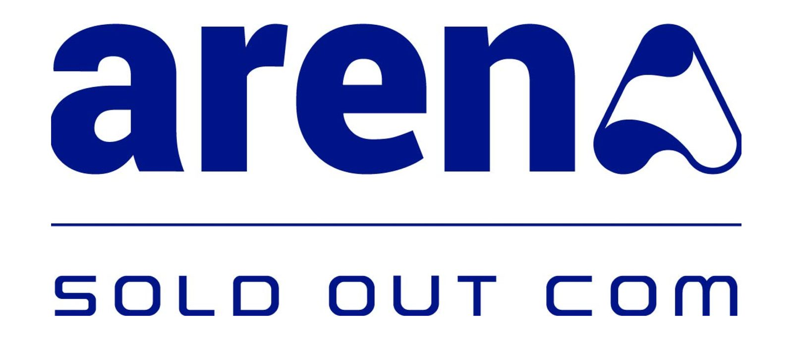
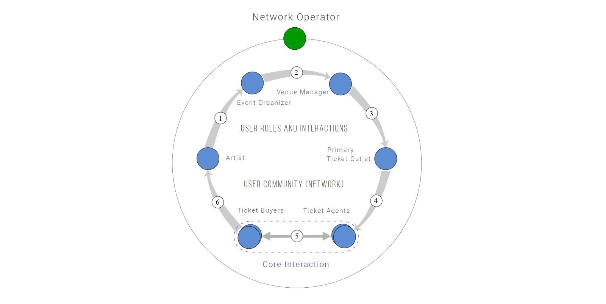

# PLATFORM as a SERVICE (PaaS)

Platform is a business model that creates value by facilitating transactions between buyers and sellers in an ecosystem. TixGear is a “true platform”, which creates community and market with network effects that allow users to interact and transact. Network Operator holds full rights to control, supervise and manage this community. As a PaaS customer, you get your own platform and play the role of the Network Operator. Platform’s users play different roles under the full control of you.

So you have your own platform with full control over ticketing operations, data, brand and communications. You can develop the platform as an ecosystem for everyone in the ticket market. You could get event organizers and ticket agents drawn into your platform orbit.

You know best what you need in a ticketing solution – make it a reality with your own platform. We offer Platform as a Service (PaaS) and a custom white-labeling for enterprise customers.

**We recommend reading article on creating platforms for ticket sales:**

[“Custom ticketing platform: how to build your own”](/blog/custom-ticketing-platform-how-to-build-your-own)

**If you’re looking to create a ticketing platform or system, you might find the following information interesting:**

[Special offer and essential features for ticketing plarforms, ticketing systems and event listings](/solutions/venues)

Customer Support: support@arenasoldout.com  
New Business: support@arenasoldout.com

[Contact Us](/contact)
