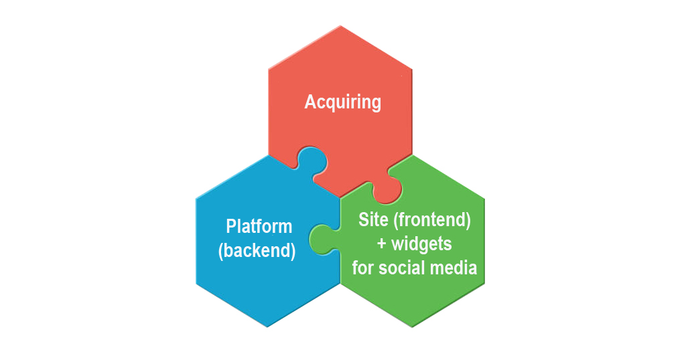
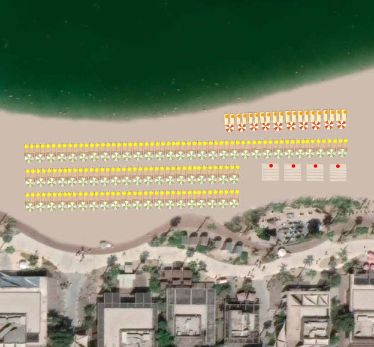
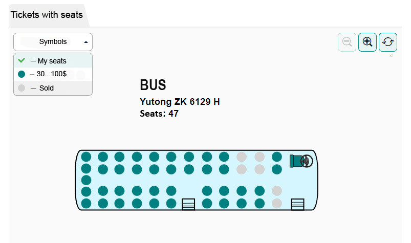
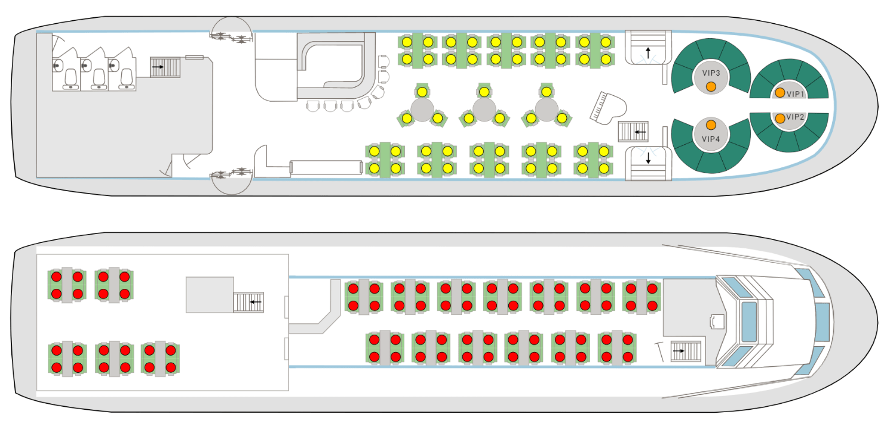

# Selling Tour Tickets

#### The system of starting multiple sales tours and excursions: methods, tools, step-by-step instructions

Many sites and mobile applications that offer tours of different types do not provide for payment for tours with a bank card, through online acquiring. These Services do not provide for payment, where the entire process is automated and occurs without human involvement. Probably the creators of these sites and applications have many reasons to force the customer to leave an application, order a call, burden employees with communication with each client, but there is a feeling that this sales technology is outdated. If you can offer a website visitor to immediately pay for a tour they like, as well as additional products and services, then why not do it? Why do you need all these requests and calls? It’s okay to take money BEFORE the tour, there is no tendency in the world to take money AFTER the tour.  
One more thing about the important stuff. It’s great when you can sell related goods and services like food, drinks, souvenirs and merch at the same time as selling tours. Offer tourists everything and more. To do this, it’s a good idea to know how much “shish kebab and t-shirts” will be needed. And prepare everything in the right quantity, at the right time, after prepayment.

Further in the article I will describe with examples and instructions how to create and output for sale excursions using the ArenaSoldOut.com- TixGear platform

### Ways to put tours on sale: Fast and Correct

**The fast** way to put an excursion on sale is suitable for “testing a hypothesis” in order to understand how the excursion will sell and how popular it will become. The fast way minimizes the time it takes to prepare and sell the excursion. If the tour, for one reason or another, will not be popular, you can easily stop this project. You will have to pay for saving time. o launch quickly, you need to use third-party infrastructure: payment systems, website, application, etc.

  
**The right way** is suitable for “massive” sales of excursions. In this case you need to choose a payment system by yourself to accept credit card payments, or use those services, which are recommended by third-party professional platform, which will provide you with all operations and service with all necessary functions. Then upload the excursion to the ArenaSoldOut.com- TixGear platform and put all the excursions on sale on your website and in social media, as well as, on patron’s and blogger’s websites and in social media.

  
To sell excursions, you need to put together a puzzle: platform (backend) + acquiring + site (frontend) + widgets for social media.

##### Platform tools: what can be done?

In the test area of the ArenaSoldOut.com- TixGear platform you will find several examples of events created especially for you. You can sell events similar to them and other events through Internet acquiring, without phone request and phone calls.  
Here are a few examples:

##### Trips to Lowry Falls in Altepra (platform test area).

Implemented ticket sales at different rates, payment for an additional service (lunch in the mountains) and related goods (t-shirts). For the organizer’s convenience, information about paid orders is sent to telegram chat. Thus, the organizer of the tour knows in advance how much food and t-shirts need to prepare.

##### Visit La MerMer Beach

A constant situation at this beach is overbooking. You can pay for admission right at the entrance, but that does not guarantee that you will have a free sun lounger. You may have to walk around the beach for a while waiting for some sun lounger to become free. And if it ever does. The scheme of the beach with sun beds and selling “tickets” for them solve this problem. You can pay for a particular sun lounger and take it. Additionally the visitor can order and pay for food and drinks.

##### EXCURSION "BEACHES AND WATERFALLS OF COSTA BLANCA" (Spain)

This excursion is an example of the implementation tour bus tickets with specific seats.

##### Simple, convenient, profitable

**Buyer of the tour/excursion** in one order pays for the tour, and what he wants to eat / drink, and what he wants to buy as souvenirs / gifts. Not something that will be offered to him “on the go”, but to buy what he himself has chosen in a quiet atmosphere for himself, for family and as a souvenir to his friends. In addition, the tourist can choose several excursions, create his own “package tour”, pay for it with one order and get discounts.

**For the organizer**, modern approach offers many advantages. Limitations on the capacity of buses, jeeps, and boats will not allow you to sell more tickets than necessary. 

Even if the boat sells children’s and adult’s “admission tickets” (no seats indicated), both price categories (children’s and adult) can be combined into one capacity limit, for example, 100 seats. In this case it is guaranteed that no more than 100 tickets will be sold, no matter what the adult/children proportion is.

The tools of the of the ArenaSoldOut.com- TixGear platform make it easy and flexible to combine different products and services in one package.

Widgets for selling tours can be placed everywhere: on websites, in social media, and in applications. The application allows sellers to sell tours anywhere: on beaches and embankments, at stands, in kiosks, in places of accumulation of potential buyers. All you need is a cell phone.  
You do not need to give out “quotas” to any of the agents and sellers, all sales are made competitively, in real time, from a single source, with all capacity constraints. The organizer manages the configuration of the tours online. For example, if you change prices in the Platform Editor, the prices will change immediately on the site, at the box office, and at all sellers. With such sales, you can eliminate difficult phone calls and a paper notebook as a means of doing business, as a management and reporting tool.

And for the main organizer, this system will increase the transparency of all operations and allow you to see all analytics and sales online.  
Purchased tickets and receipts for payment are sent to the customer’s email in pdf format and contain a secure QR code. These tickets and receipts can be checked with the admission ticket checking application. There is no need to print them out, the customer only needs to show them on the screen of a cell phone. Whatever channels are used to sell tours, the Ticket Checker App will eliminate the mess and abuse. Only those who paid will get on the tour.

##### Summary

It’s impossible to describe all the platform tools and options for organizing sales of both tours and related products in one article. The travel business is very individual and has many peculiarities and nuances. I can only hope that the examples given will lead market participants to the idea of how to improve and automate business, increase its profitability and efficiency.

*Alex Orlov*

*Software architect and team lead ArenaSoldOut.com*

##### **For more insights into how it works, read the articles:**

[“Selling Tour Tickets: Methods, Tools, Step-by-Step Instructions”](/blog/selling-tour-tickets)

[Excursions and boat tours. Special offer and essential features for excursions and boat tours organizers](/solutions/master-classes)

[ALL FEATURES](/product/sell)

[GET STARTED TODAY](/start)
