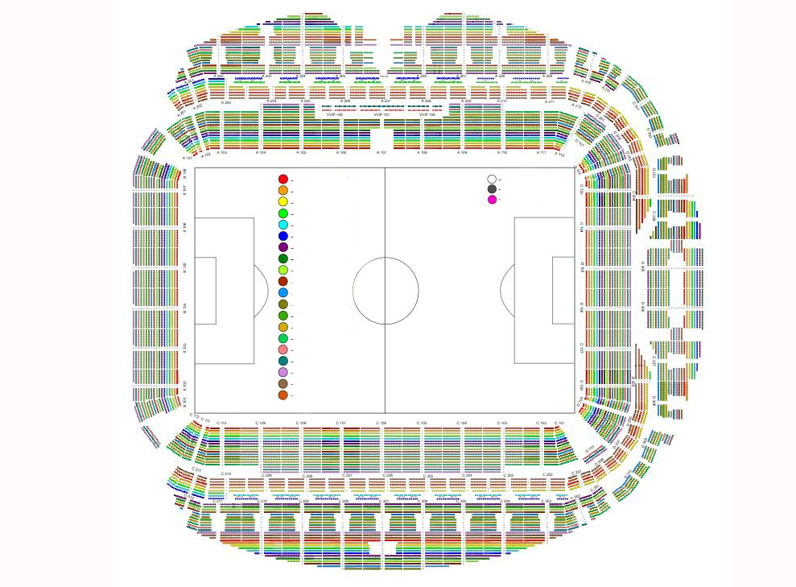
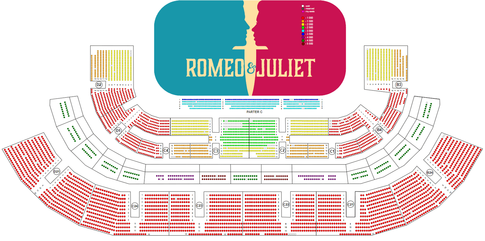

Testing Methodology

Testing Utility

Test Results

Optimization and Acceleration

Full Ticket Sales Cycle

Testing for a Specific Event

Complete Report in docx Format

For the stress testing of the platform, the following methodology was chosen: emulating a situation where the date and time of ticket sales opening for a popular event at a large stadium are known. It is assumed that at the moment of sales opening, a multitude of people will attempt to purchase tickets simultaneously. To do this, they need to obtain the stadium layout with up-to-date seat statuses. The stadium layout is the heaviest part of the purchase process, directly impacting the ability to buy tickets and the UX|UI. Thus, the test determines the maximum number of users that can load the layout with up-to-date seat statuses (hereafter referred to as the “Current Layout”) within the platform’s standard timeout of 30 seconds.

For the stress testing, an event was created at Stadium 1 in the platform’s testing zone. The total number of seats in the stadium is as follows:

Seats with assigned placement (in the stands): 25,841

Seats without assigned placement (Fan Zone, Dance Floor): 6,000

Total: 31,841

A utility was developed specifically for the stress testing, which emulates simultaneous activity from a specified number of buyers. During the initial tests, it was discovered that the platform’s behavior for venues with a large number of seats fundamentally differs from its behavior for smaller venue (less than 5,000 seats). Based on this finding, further tests were conducted solely with the layout of this sufficiently large stadium. As a result of the tests, optimization and acceleration mechanisms were added to the platform, which are triggered during sales for venues with a capacity of over 5,000 people, as these mechanisms are not efficient for venues with smaller capacities.

## **Testing Methodology**

The first and most crucial step in ticket sales is the need to show the buyer a stadium layout with the CURRENT seat statuses (available, occupied, reserved) at the given moment. The buyer can reserve seats on the layout and purchase tickets for them only if they can see the seating plan. Preparing and delivering the stadium layout to a large number of buyers is the most resource-intensive task for the server. Testing the platform’s capabilities for simultaneously sending the Current Layout data to a large number of buyers became the main focus of the testing.

Obtaining the Current Layout via the API can be done in two ways:

1\. Obtaining the Current Layout via a link (placementUrl). The Current Layout, in SVG format, is prepared by the central server ArenaSoldOut.com, ready for ticket buyers to view.

2\. Obtaining it using two commands:

   – GET\_SCHEMA: This method returns information about all seats with placement, including the x, y coordinates of each seat. This method allows for building a custom seating plan.

   – GET\_SEAT\_LIST: This command retrieves a list of seats based on the session ID. This method does NOT involve transferring the Current Layout in SVG format and assumes that the external client ticketing system will independently build such a layout using the responses from these commands.

Further testing was conducted separately for each of the aforementioned methods. All experiments were performed without using External Ticketing Systems (the event was loaded into ArenaSoldOut.com) as these systems operate slower than ArenaSoldOut.com, and measuring their performance was not the objective of these tests.

For Stadium 1, the response size for the GET\_SCHEMA command is 2.25 MB uncompressed and 307 KB compressed. The response size for the GET\_SEAT\_LIST command is 4 MB uncompressed and 180 KB compressed. The size of the SVG format layout is 4.8 MB uncompressed and 435 KB compressed. Testing with just two hundred buyers from a single computer already results in the full utilization of the network channel with a bandwidth of 100 Mbps. It is evident that in real-life scenarios, one thousand buyers would utilize one thousand channels and one thousand computers. To bypass the network speed limitation and create maximum server load, further testing was conducted over a local network where the server was located. This does not exclude the possibility of running the testing utility on multiple computers within the internet network.

By default, the ArenaSoldOut.com platform utilizes data compression with gzip. This efficiently compresses JSON format data. However, when selling tickets for stadiums to the largest number of buyers, compression quickly leads to 100% utilization of all server processor cores. To overcome this issue, pre-compressed cache is used when receiving the response for GET\_SCHEMA (compression occurs once). Otherwise, gzip compression continues to be a performance limiter for the server.

## **Testing Utility**

A special testing program, called the testing utility, was created for the tests. The utility establishes a specified number of connections with the central server ArenaSoldOut.com (emulating the number of concurrent buyers), and tests the server’s ability to show them the Current Layout using either the first or second method. The test results are output to the console. Here is an example of the console output for a test using the first method (transferring the layout in SVG format) after applying optimization and acceleration mechanisms in the platform’s test environment:

Zone: test

FID: 1264

ActionEventId: 3914

Preparing…

Free seats: 25841

Clients: 1000

Tickets per client: 4

Request timeout: 30 s

Value | Create user | Loading SVG | Booking | Create order| Pay order

success | 0 | 1000 | 0 | 0 | 0

timeouts | 0 | 0 | 0 | 0 | 0

wait min | | 0.191 ms | | |

wait avg | | 8734 ms | | |

wait max | | 16192 ms | | |

exec min | | 72.4 ms | | |

exec avg | | 234 ms | | |

exec max | | 1194 ms | | |

total min| | 1944 ms | | |

total avg| | 18076 ms | | |

total max| | 29579 ms | | |

Total time: 30.93 s

From the console data, we can infer the following:

-   The test was conducted in the platform’s test environment under the following conditions: session ID 3914, 25,841 available seats for sale, 1,000 concurrent users initiating ticket purchases, each user buying 4 tickets, and a timeout of 30 seconds.

-   The test was completed in 30.93 seconds. All 1,000 users received the Current Layout in SVG format.

-   The test results include several parameters – wait, exec, total – along with their minimum, average, and maximum values in seconds. To explain these parameters, let’s use an analogy. Imagine ticket buyers forming multiple queues leading to several ticket counters. The time each buyer spends waiting in the queue corresponds to the wait parameter. The time spent servicing the buyer at the ticket counter corresponds to the exec parameter. The total parameter represents the overall time spent serving the customers. During the tests, the optimal number of ticket counters (threads) was determined to serve the customers in the shortest possible time based on the available system resources.

**The results of this test indicate that within 30.93 seconds, one thousand buyers are guaranteed to receive the Current Layout for a large stadium**.

## **Testing Results**

During the initial runs of the testing utility, the platform was able to handle only around 130 users within 30 seconds. However, after applying the optimization and acceleration mechanisms developed during the tests, the following performance indicators were achieved:

#### **First Method (SVG Layout Delivery)**

Zone: test

FID: 1264

ActionEventId: 3914

Preparing…

Free seats: 25841

Clients: 1000

Tickets per client: 4

Request timeout: 30 sv

Time| Create user | Loading SVG | Booking | Create order | Pay order 1 | 0% | 0% | 0% | 0% | 0%

2 | 0% | 0% | 0% | 0% | 0%

3 | 0% | 0% | 0% | 0% | 0%

4 | 0% | 1% | 0% | 0% | 0%

5 | 0% | 2% | 0% | 0% | 0%

6 | 0% | 2% | 0% | 0% | 0%

7 | 0% | 3% | 0% | 0% | 0%

8 | 0% | 5% | 0% | 0% | 0%

9 | 0% | 9% | 0% | 0% | 0%

10 | 0% | 12% | 0% | 0% | 0%

11 | 0% | 16% | 0% | 0% | 0%

12 | 0% | 19% | 0% | 0% | 0%

13 | 0% | 22% | 0% | 0% | 0%

14 | 0% | 27% | 0% | 0% | 0%

15 | 0% | 32% | 0% | 0% | 0%

16 | 0% | 37% | 0% | 0% | 0%

17 | 0% | 41% | 0% | 0% | 0%

18 | 0% | 46% | 0% | 0% | 0%

19 | 0% | 50% | 0% | 0% | 0%

20 | 0% | 54% | 0% | 0% | 0%

21 | 0% | 58% | 0% | 0% | 0%

22 | 0% | 63% | 0% | 0% | 0%

23 | 0% | 67% | 0% | 0% | 0%

24 | 0% | 71% | 0% | 0% | 0%

25 | 0% | 75% | 0% | 0% | 0%

26 | 0% | 79% | 0% | 0% | 0%

27 | 0% | 83% | 0% | 0% | 0%

28 | 0% | 87% | 0% | 0% | 0%

29 | 0% | 92% | 0% | 0% | 0%

30 | 0% | 95% | 0% | 0% | 0%

30 | 0% | 100% | 0% | 0% | 0%

Value | Create user | Loading SVG | Booking | Create order| Pay order

success | 0 | 1000 | 0 | 0 | 0

timeouts | 0 | 0 | 0 | 0 | 0

wait min | | 0.191 ms | | |

wait avg | | 8734 ms | | |

wait max | | 16192 ms | | |

exec min | | 72.4 ms | | |

exec avg | | 234 ms | | |

exec max | | 1194 ms | | |

total min| | 1944 ms | | |

total avg| | 18076 ms | | |

total max| | 29579 ms | | |

Total time: 30.93 s

#### **Second Method (GET\_SCHEMA and GET\_SEAT\_LIST Commands’ Responses)**

Zone: test

FID: 1264

ActionEventId: 3914

Preparing…

Free seats: 25841

Clients: 1800

Tickets per client: 4

Request timeout: 30 s

Time|Create user| Schema | Seat list | Booking | Order | Pay order

1 | 0% | 0% | 0% | 0% | 0% | 0%

2 | 0% | 0% | 0% | 0% | 0% | 0%

3 | 0% | 0% | 0% | 0% | 0% | 0%

4 | 0% | 1% | 0% | 0% | 0% | 0%

5 | 0% | 3% | 0% | 0% | 0% | 0%

6 | 0% | 3% | 0% | 0% | 0% | 0%

7 | 0% | 5% | 0% | 0% | 0% | 0%

8 | 0% | 5% | 0% | 0% | 0% | 0%

9 | 0% | 6% | 0% | 0% | 0% | 0%

10 | 0% | 6% | 0% | 0% | 0% | 0%

11 | 0% | 7% | 0% | 0% | 0% | 0%

12 | 0% | 8% | 0% | 0% | 0% | 0%

13 | 0% | 8% | 0% | 0% | 0% | 0%

14 | 0% | 8% | 0% | 0% | 0% | 0%

15 | 0% | 8% | 0% | 0% | 0% | 0%

16 | 0% | 9% | 0% | 0% | 0% | 0%

17 | 0% | 11% | 0% | 0% | 0% | 0%

18 | 0% | 12% | 0% | 0% | 0% | 0%

19 | 0% | 13% | 1% | 0% | 0% | 0%

20 | 0% | 15% | 3% | 0% | 0% | 0%

21 | 0% | 17% | 5% | 0% | 0% | 0%

22 | 0% | 21% | 6% | 0% | 0% | 0%

23 | 0% | 24% | 7% | 0% | 0% | 0%

24 | 0% | 31% | 8% | 0% | 0% | 0%

25 | 0% | 42% | 9% | 0% | 0% | 0%

26 | 0% | 53% | 11% | 0% | 0% | 0%

27 | 0% | 63% | 12% | 0% | 0% | 0%

28 | 0% | 70% | 13% | 0% | 0% | 0%

29 | 0% | 81% | 15% | 0% | 0% | 0%

30 | 0% | 90% | 17% | 0% | 0% | 0%

31 | 0% | 96% | 20% | 0% | 0% | 0%

32 | 0% | 98% | 23% | 0% | 0% | 0%

33 | 0% | 99% | 33% | 0% | 0% | 0%

34 | 0% | 99% | 56% | 0% | 0% | 0%

34 | 0% | 99% | 99% | 0% | 0% | 0%

Value | User | Schema | Seat list| Booking | Order | Pay order

success | 0 | 1793 | 1793 | 0 | 0 | 0

timeouts | 0 | 7 | 0 | 0 | 0 | 0

wait min | | 0.012 ms | 0.014 ms | | |

wait avg | | 1453 ms | 511 ms | | |

wait max | | 4575 ms | 4551 ms | | |

exec min | | 1.22 ms | 5.58 ms | | |

exec avg | | 6.64 ms | 22.3 ms | | |

exec max | | 319 ms | 281 ms | | |

total min| | 2393 ms | 343 ms | | |

total avg| | 22576 ms | 7775 ms | | |

total max| | 32361 ms | 21073 ms | | |

Total time: 34.80 s

**Results:**

**In the first method (SVG schema delivery), 1000 out of 1000 customers successfully received the Actual schema within 30.93 seconds. In the second method (using GET\_SCHEMA and GET\_SEAT\_LIST commands), 1793 of 1800 customers successfully obtained the data of the Actual schema within 34.80 seconds.**

It is worth noting that the testing was conducted under more stringent conditions (simultaneous user access, local network) than the conditions that occur during real high-demand scenarios, where customers are spread out in time and space. It can be assumed that under real sales conditions, the server will serve a slightly larger number of customers than in the described tests.

## **Optimization and Acceleration**

The utilization of the load testing utility promptly identified system overload points (bottlenecks), which were systematically overcome through the implementation of the following optimization and acceleration mechanisms:

1\. Dynamic caching of GET\_SEAT\_LIST enabled the cache to maintain up-to-date seat statuses and instantly deliver them to clients. This is achieved by allowing “point” changes to the statuses of specific seats at the same moment they are modified within the platform. Thus, unlike static caching, dynamic cache can provide the most current data on available, sold, and reserved seats.

2\. Losses during object-to-JSON conversion were successfully mitigated by introducing a new, significantly faster JSON converter, as well as manual programming optimizations. The conversion speed of voluminous responses from GET\_SCHEMA and GET\_SEAT\_LIST commands increased by 3-4 times.

3\. Caching of pre-compressed data for responses to GET\_SCHEMA, GET\_FILTER, and GET\_ALL\_ACTIONS commands.

4\. Acceleration of processing (seat status population) for the stadium schema in SVG format through the use of the Streaming API for XML (StAX) API, replacing the slower DOM interface.

5\. Adoption of dynamic cache for GET\_SEAT\_LIST (point 1) as the data source for populating seat statuses in the Actual schema in SVG format, instead of relying on a DBMS.

**These mechanisms enabled a performance increase of approximately 10 times for the platform during high-demand scenarios and large schemas. When working with smaller schemas and in the absence of high-demand scenarios, the performance improvement predictably remained less significant but still noticeable**.

## **Full Ticket Sales Cycle**

In previous load tests, the platform’s ability to display the Actual schema to the maximum number of users was the primary focus. While this is a crucial part of the ticket purchase process, it is not the only aspect. The following commands are utilized for the complete ticket purchasing process:

RESERVATION (Booking) – a command to reserve seats during the purchase period, ensuring that the buyer can be confident that the chosen seats will not be acquired by someone else while they are placing their order.

CREATE\_ORDER\_EXT – a command to create an order from the reserved seats.

PAY\_ORDER – a command to pay for the order, and upon successful completion, tickets are issued for the selected seats.

Testing is performed using a “Ticketing System” type interface, which eliminates the need for internet acquiring processes, waiting for bank card data input, and payment processing through a bank.

The results of ticket sales for a test event at this stadium are as follows:

Zone: ext0  
FID: 1264  
ActionEventId: 3914  
Preparing…  
Free seats: 25833  
Clients: 1000  
Tickets per client: 4  
Request timeout: 30 s  
Time| Create user | Loading SVG | Booking | Create order | Pay order  
1 | 0% | 0% | 0% | 0% | 0%  
2 | 1% | 0% | 0% | 0% | 0%  
3 | 3% | 0% | 0% | 0% | 0%  
4 | 4% | 0% | 0% | 0% | 0%  
5 | 5% | 0% | 0% | 0% | 0%  
6 | 9% | 0% | 0% | 0% | 0%  
7 | 19% | 4% | 0% | 0% | 0%  
8 | 20% | 8% | 2% | 0% | 0%  
9 | 20% | 11% | 3% | 1% | 0%  
10 | 20% | 15% | 4% | 2% | 1%  
11 | 20% | 18% | 6% | 3% | 2%  
12 | 24% | 22% | 7% | 4% | 2%  
13 | 28% | 26% | 9% | 4% | 2%  
14 | 31% | 30% | 11% | 6% | 3%  
15 | 42% | 33% | 11% | 6% | 3%  
16 | 42% | 37% | 13% | 7% | 3%  
17 | 42% | 40% | 15% | 8% | 4%  
18 | 46% | 45% | 16% | 9% | 5%  
19 | 49% | 48% | 18% | 10% | 5%  
20 | 53% | 52% | 20% | 11% | 6%  
21 | 57% | 56% | 22% | 12% | 6%  
22 | 63% | 60% | 23% | 13% | 6%  
23 | 65% | 64% | 25% | 13% | 7%  
24 | 69% | 68% | 26% | 14% | 7%  
25 | 72% | 71% | 28% | 15% | 7%  
26 | 77% | 75% | 29% | 15% | 8%  
27 | 80% | 79% | 31% | 16% | 8%  
28 | 84% | 83% | 33% | 17% | 8%  
29 | 88% | 87% | 34% | 18% | 9%  
30 | 100% | 89% | 38% | 19% | 9%  
31 | 100% | 93% | 41% | 21% | 10%  
32 | 100% | 97% | 43% | 22% | 11%  
33 | 100% | 100% | 56% | 26% | 13%  
34 | 100% | 100% | 71% | 30% | 16%  
35 | 100% | 100% | 88% | 36% | 19%  
36 | 100% | 100% | 99% | 44% | 22%  
37 | 100% | 100% | 100% | 56% | 26%  
38 | 100% | 100% | 100% | 70% | 30%  
39 | 100% | 100% | 100% | 83% | 34%  
40 | 100% | 100% | 100% | 93% | 38%  
41 | 100% | 100% | 100% | 98% | 43%  
42 | 100% | 100% | 100% | 100% | 49%  
43 | 100% | 100% | 100% | 100% | 54%  
44 | 100% | 100% | 100% | 100% | 59%  
45 | 100% | 100% | 100% | 100% | 64%  
46 | 100% | 100% | 100% | 100% | 69%  
47 | 100% | 100% | 100% | 100% | 73%  
48 | 100% | 100% | 100% | 100% | 78%  
49 | 100% | 100% | 100% | 100% | 82%  
50 | 100% | 100% | 100% | 100% | 86%  
51 | 100% | 100% | 100% | 100% | 90%  
52 | 100% | 100% | 100% | 100% | 94%  
53 | 100% | 100% | 100% | 100% | 98%  
53 | 100% | 100% | 100% | 100% | 100%  
Value | Create user | Loading SVG | Booking | Create order| Pay order  
success | 1000 | 1000 | 1000 | 1000 | 1000  
timeouts | 0 | 0 | 0 | 0 | 0  
wait min | 0.038 ms | 0.020 ms | 0.034 ms | 0.245 ms | 0.064 ms  
wait avg | 13250 ms | 589 ms | 8860 ms | 5068 ms | 7129 ms  
wait max | 23372 ms | 3736 ms | 24710 ms | 24606 ms | 24505 ms  
exec min | 1.42 ms | 74.8 ms | 7.88 ms | 7.34 ms | 13.3 ms  
exec avg | 57.2 ms | 149 ms | 50.7 ms | 53.7 ms | 121 ms  
exec max | 642 ms | 468 ms | 367 ms | 305 ms | 372 ms  
total min| 517 ms | 192 ms | 19.5 ms | 21.1 ms | 47.4 ms  
total avg| 17314 ms | 1128 ms | 8945 ms | 5136 ms | 7262 ms  
total max| 29311 ms | 5070 ms | 24747 ms | 24650 ms | 24559 ms  
  
**Total time: 53.62 s**  
  
  

## **Results:**

**In 53.62 seconds, 1000 users were able to purchase 4000 tickets. Thus, with an average of 4 tickets per order and high demand, a 25,000-seat stadium would be sold out in approximately 6 minutes after the start of sales**.

**Testing at Event Stadium 2**

As mentioned earlier, the optimization and acceleration mechanisms developed as a result of the tests apply to venues with a capacity of over 5000 seats. For the purpose of example and testing, we selected another stadium (Stadium 2). In this configuration, the stadium has 5261 seats for the event. For testing purposes, an event was created at this stadium with 5137 available seats.

## **Results of Testing the Display of the Current Scheme:**

## **Method 1 (Transmitting the Scheme in SVG Format)**

Zone: test  
FID: 1264  
ActionEventId: 2571  
Preparing…  
Free seats: 5137  
Clients: 2800  
Tickets per client: 1  
Request timeout: 30 s  
  
Time| Create user | Loading SVG | Booking | Create order | Pay order  
1 | 0% | 1% | 0% | 0% | 0%  
2 | 0% | 3% | 0% | 0% | 0%  
3 | 0% | 4% | 0% | 0% | 0%  
4 | 0% | 5% | 0% | 0% | 0%  
5 | 0% | 7% | 0% | 0% | 0%  
6 | 0% | 12% | 0% | 0% | 0%  
7 | 0% | 12% | 0% | 0% | 0%  
8 | 0% | 13% | 0% | 0% | 0%  
9 | 0% | 13% | 0% | 0% | 0%  
10 | 0% | 14% | 0% | 0% | 0%  
11 | 0% | 14% | 0% | 0% | 0%  
13 | 0% | 14% | 0% | 0% | 0%  
13 | 0% | 14% | 0% | 0% | 0%  
14 | 0% | 14% | 0% | 0% | 0%  
15 | 0% | 14% | 0% | 0% | 0%  
16 | 0% | 28% | 0% | 0% | 0%  
17 | 0% | 31% | 0% | 0% | 0%  
18 | 0% | 31% | 0% | 0% | 0%  
19 | 0% | 31% | 0% | 0% | 0%  
20 | 0% | 36% | 0% | 0% | 0%  
21 | 0% | 42% | 0% | 0% | 0%  
22 | 0% | 49% | 0% | 0% | 0%  
23 | 0% | 50% | 0% | 0% | 0%  
24 | 0% | 53% | 0% | 0% | 0%  
25 | 0% | 59% | 0% | 0% | 0%  
26 | 0% | 64% | 0% | 0% | 0%  
27 | 0% | 73% | 0% | 0% | 0%  
28 | 0% | 78% | 0% | 0% | 0%  
29 | 0% | 86% | 0% | 0% | 0%  
30 | 0% | 94% | 0% | 0% | 0%  
31 | 0% | 99% | 0% | 0% | 0%  
31 | 0% | 99% | 0% | 0% | 0%  
Value | Create user | Loading SVG | Booking | Create order| Pay order  
success | 0 | 2782 | 0 | 0 | 0  
timeouts | 0 | 18 | 0 | 0 | 0  
wait min | | 0.006 ms | | |  
wait avg | | 475 ms | | |  
wait max | | 2090 ms | | |  
exec min | | 18.0 ms | | |  
exec avg | | 59.6 ms | | |  
exec max | | 504 ms | | |  
total min| | 219 ms | | |  
total avg| | 17831 ms | | |  
total max| | 27790 ms | | |  
  
Total time: 31.21 s  
  

## **Method 2 (GET\_SCHEMA and GET\_SEAT\_LIST Command Responses)**

Zone: test  
FID: 1264  
ActionEventId: 2571  
Preparing…  
Free seats: 5137  
Clients: 3200  
Tickets per client: 1  
Request timeout: 30 s  
  
Time|Create user| Schema | Seat list | Booking | Order | Pay order  
1 | 0% | 1% | 0% | 0% | 0% | 0%  
2 | 0% | 6% | 3% | 0% | 0% | 0%  
3 | 0% | 9% | 7% | 0% | 0% | 0%  
4 | 0% | 11% | 8% | 0% | 0% | 0%  
5 | 0% | 11% | 8% | 0% | 0% | 0%  
6 | 0% | 14% | 9% | 0% | 0% | 0%  
7 | 0% | 14% | 9% | 0% | 0% | 0%  
9 | 0% | 14% | 9% | 0% | 0% | 0%  
9 | 0% | 14% | 9% | 0% | 0% | 0%  
10 | 0% | 14% | 10% | 0% | 0% | 0%  
11 | 0% | 15% | 10% | 0% | 0% | 0%  
12 | 0% | 19% | 11% | 0% | 0% | 0%  
13 | 0% | 19% | 11% | 0% | 0% | 0%  
14 | 0% | 20% | 11% | 0% | 0% | 0%  
15 | 0% | 20% | 13% | 0% | 0% | 0%  
16 | 0% | 26% | 14% | 0% | 0% | 0%  
17 | 0% | 26% | 14% | 0% | 0% | 0%  
18 | 0% | 26% | 14% | 0% | 0% | 0%  
19 | 0% | 26% | 14% | 0% | 0% | 0%  
20 | 0% | 26% | 14% | 0% | 0% | 0%  
21 | 0% | 27% | 14% | 0% | 0% | 0%  
22 | 0% | 27% | 15% | 0% | 0% | 0%  
23 | 0% | 28% | 17% | 0% | 0% | 0%  
24 | 0% | 32% | 19% | 0% | 0% | 0%  
25 | 0% | 41% | 24% | 0% | 0% | 0%  
26 | 0% | 56% | 26% | 0% | 0% | 0%  
27 | 0% | 73% | 26% | 0% | 0% | 0%  
28 | 0% | 87% | 26% | 0% | 0% | 0%  
29 | 0% | 95% | 27% | 0% | 0% | 0%  
30 | 0% | 98% | 27% | 0% | 0% | 0%  
31 | 0% | 99% | 27% | 0% | 0% | 0%  
32 | 0% | 99% | 27% | 0% | 0% | 0%  
33 | 0% | 99% | 28% | 0% | 0% | 0%  
34 | 0% | 99% | 30% | 0% | 0% | 0%  
35 | 0% | 99% | 34% | 0% | 0% | 0%  
36 | 0% | 99% | 42% | 0% | 0% | 0%  
37 | 0% | 99% | 61% | 0% | 0% | 0%  
37 | 0% | 99% | 99% | 0% | 0% | 0%  
Value | User | Schema | Seat list| Booking | Order | Pay order  
success | 0 | 3199 | 3199 | 0 | 0 | 0  
timeouts | 0 | 1 | 0 | 0 | 0 | 0  
wait min | | 0.015 ms | 0.005 ms | | |  
wait avg | | 1904 ms | 356 ms | | |  
wait max | | 5641 ms | 5634 ms | | |  
exec min | | 1.17 ms | 2.18 ms | | |  
exec avg | | 5.20 ms | 6.64 ms | | |  
exec max | | 181 ms | 182 ms | | |  
total min| | 73.3 ms | 18.5 ms | | |  
total avg| | 17407 ms | 9163 ms | | |  
total max| | 29827 ms | 15186 ms | | |  
  
Total time: 37.71 s

## **Let’s compare the test results for an event at Stadium 1 (25,841 seats) and an event at Stadium 2 (5,137 seats).**

**Method 1 (Obtaining SVG Scheme):**

**Stadium 1 – 30.93 seconds. Out of 1,000 buyers, 1000 successfully received the current scheme.**

**Stadium 2 – 31.21 seconds. Out of 3,000 buyers, 2,782 successfully received the current scheme.**

**Method 2 (GET\_SCHEMA and GET\_SEAT\_LIST Command Responses):**

**Stadium 1 – 34.80 seconds. Out of 1,800 buyers, 1,793 successfully received the current scheme data.**

**Stadium 2 – 37.71 seconds. Out of 3,200 buyers, 3,199 successfully received the current scheme data.**

## YOU MIGHT ALSO LIKE:

[Why STRESS Testing Ticket Platforms Matters: Benefits for Organizers and Buyers](/blog/why-stress-testing-ticket-platforms-matters-benefits-for-organizers-and-buyers)

[Empowering organizers: the game-changing shift towards direct revenue access](/blog/empowering-organizers-the-game-changing-shift-towards-direct-revenue-access)

[Increasing ticket sales: Guide for event organizers](/blog/increasing-ticket-sales-guide-for-event-organizers)

[Ticket platforms. Five generations.](/blog/ticket-platforms-five-generations)

[Make own ticketing platform for 1000 USD. Myth or reality?](/blog/make-own-ticketing-platform-for-1000-usd-myth-or-reality)

[Ticket Platforms: key features for organizers of Top events](/blog/ticket-platforms-key-features-for-organizers-of-top-events)

[Tools for events from 5,000 to 100K+ participants: functional features of ticketing platforms](/blog/tools-for-events-from-5000-to-100k-participants-functional-features-of-ticketing-platforms)
