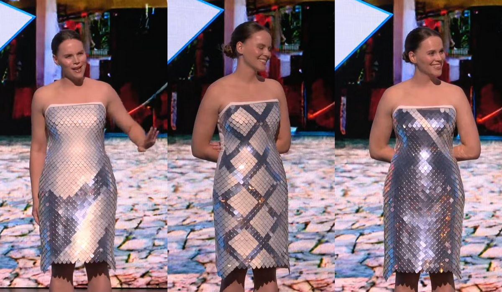
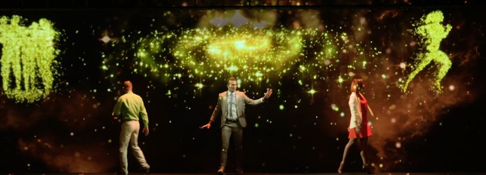
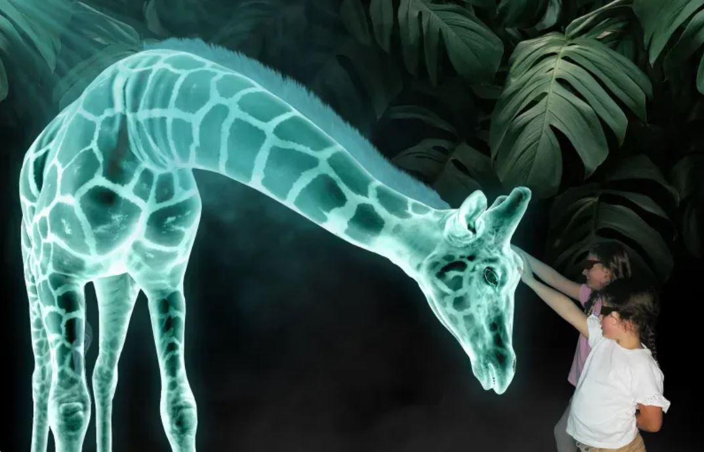

From interactive dresses to 4D holograms: revolutionary technologies elevating events to unprecedented heights.

### **Interactive Textile Designs by Adobe**

*Dress for the Future: Project Primrose*

At the Adobe Max conference, the unveiling of “Project Primrose,” featuring flexible textile displays, took center stage. This technology utilizes scale-like LEDs to craft interactive images on fabric. Adobe’s applications transform the dress into a canvas with animations, unlocking new possibilities for artists, directors, and event organizers.

### **Honor’s phone bag**

*Mobility in Every Move*

Honor introduces the innovative foldable phone, Honor V Purse, with a clip-on strap, embodying functionality and stylish design. This gadget ensures that you not only have a phone at your fingertips but also a trendy accessory that can change its color.

### **4D Holograms: realistic 3D imagery**

*EventWorks4D leading the technological charge*

EventWorks 4D’s holographic performances create a stunning 4D effect. 4D holograms offer an interactive experience with three-dimensional images, making them an ideal choice for stage design, creating new creative spaces, theaters, and amusement parks.

### **Virtual Zoo: holograms in the wild**

*Australia’s holographic Zoo*

Brisbane’s Holographic Zoo provides a unique interaction with wildlife. Utilizing hologram technology, realistic images of animals have been created, offering the public a chance to see and learn about wildlife without confining animals in captivity.

### **In the rhythm of technology: Fun for Fans**

A T-shirt with a built-in screen capable of displaying videos from your phone has been developed. Yes, you can wash it, but there’s a catch: the screen only operates for 2-4 hours. An incredible realm for creativity, fan interaction, and acquiring new audiences for artists, artist managers, concert organizers, festival planners, and sports managers.

#### Technological innovations open new horizons for event organizers, event spaces and creative entertainment market participants
