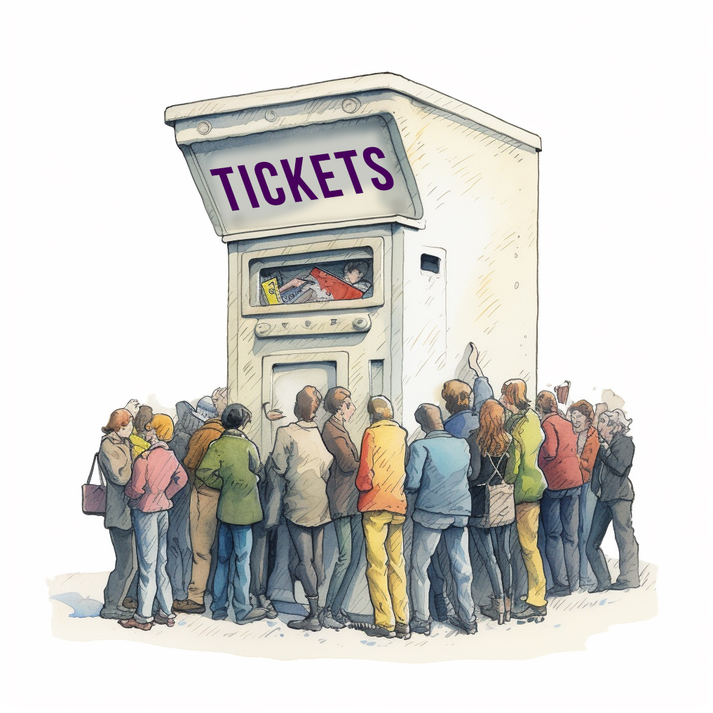
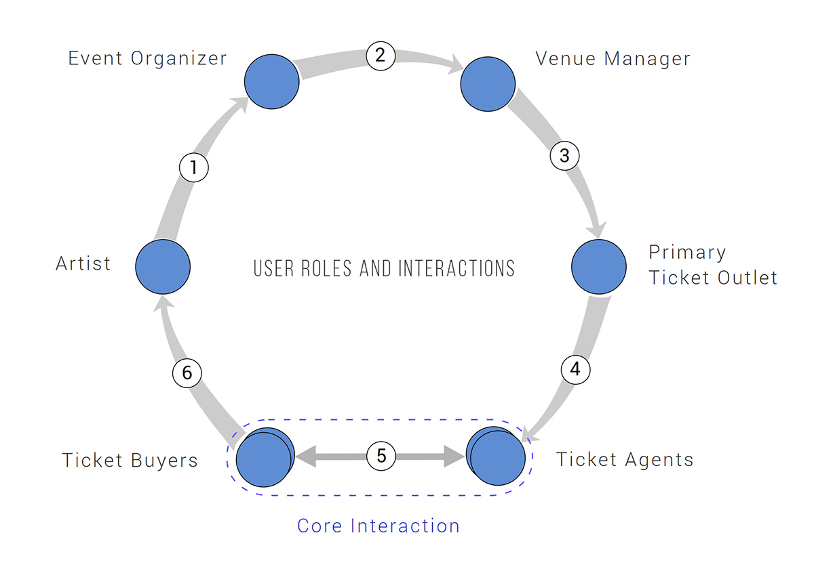
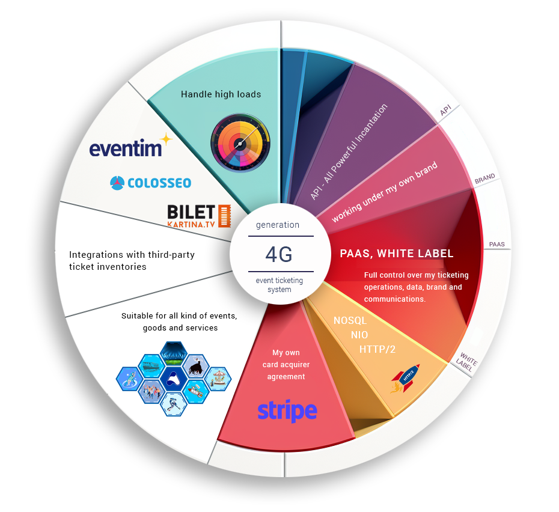

The inception of ticketing systems coincided with the advent of personal computers, local networks, and the internet. Today’s ticketing platforms are born into a vastly transformed world, radically distinct from the early systems. Examining the developmental journey of ticketing software reveals five generations of systems with similar functionality, architecture, and characteristics. The design timeline aligns with the global progression of information technology.

The classification into generations is somewhat arbitrary, as individual systems may encompass features from different generations, with their development cycles extending beyond clear temporal boundaries. For instance, a second-generation system might have been under construction during the existence of third-generation systems. Some first-generation systems, continually refined, persist with functionalities accumulated from various time periods, carrying legacy elements and technological debt into the present.

#### First Generation, 1990s

Examples: Basis Computer Ticket System, Ticketron

First-generation systems emerged in an era where online ticket purchases were not yet prevalent. These systems were designed for ticket sales at physical box offices, focusing on offline order processing. They employed architecture typical of that period and were developed using tools such as Borland Delphi. First-generation systems did not adhere to open architecture principles, lacking the capability for easy addition, update, or replacement of components.

#### Second Generation, 2000s

Example: TicketSoft, Eventim

Second-generation systems were commonly installed locally at event venues (theaters, concert halls, stadiums) and city box offices. Due to unreliable internet channels at the time, systems were installed on-site for seamless ticket sales. Object-oriented systems were often integrated with Access Control Systems . These systems primarily served venue and/or box office staff rather than ticket buyers. While most sales occurred through physical box offices, the emergence of websites marked an alternative channel for ticket sales.

#### Third Generation, Early 2010s

Examples: Ticketscloud, Radario, Intickets, Unified Field, Tixly, Eventix, Ticketebox

The third generation of ticketing systems represents web platforms, embodying various degrees of a platform business model. Platforms introduced roles for users, including event organizers, ticket agents, ticket buyers, and more. This generation is focused on selling tickets through websites and mobile applications, witnessing a significant decline in offline box office sales. With the increasing reliability and speed of internet channels, venues and box offices shifted towards utilizing platforms as cloud-based rather than on-site solutions.

Platforms of this generation incorporated APIs and gateways to integrate with other ticketing systems. The concept of competitive ticket sales through multiple agents via API gateways from the ‘Unified Ticket Field’ in real-time emerged, rendering quota-based ticket sales a thing of the past. These web platforms streamlined ticket payment processes using a unified internet acquiring system. A defining characteristic of this generation is the inclusion of internet marketing tools and SEO strategies.

The development of third-generation platforms heavily relied on web development tools and free relational databases for both frontend and backend. As a result, these platforms encounter challenges in terms of performance, scalability, and reliability during peak loads.

#### Generation 'Three Plus,' 2010s

Example: Eventbrite

While officially falling under the third generation of ticketing systems as a web platform, Eventbrite incorporates industrial solutions and processing more characteristic of full-featured fourth-generation platforms.

#### Fourth Generation, Late 2010s

Examples: ArenaSoldOut.com, VBotickets

The fourth generation of ticketing systems introduces fully-featured platforms developed using modern software development tools and technologies, including industrial NoSQL databases. A distinctive feature of these platforms is the presence of fast and reliable multithreaded processing capable of handling high loads, a capability unavailable to most web platforms of the previous generation.

Fourth-generation platforms were originally designed to utilize a large number of bidirectional gateways to other ticketing systems. Organizers and agents could apply a variety of their internet acquiring solutions. The design approach for these platforms was radical compared to enhancing existing systems from previous generations. Consequently, fourth-generation platforms are free from legacy issues, technological debt, and errors of past systems. The high performance, speed, and reliability of these platforms are confirmed by load testing.

Technological distinctions of fourth-generation platforms include the use of more modern technologies: asynchronous network models (buffer-oriented, non-blocking (asynchronous) I/O, NIO), HTTP/2 protocol (multiplexing of requests and responses), concepts of Platform as a Service (PaaS), and White Label (Figure 3). These platforms are characterized by a high level of self-service.

#### Fifth Generation, 2020s

Platforms of the fifth generation are currently in the early stages of development, yet their distinctive features are already becoming apparent. For instance, the real-time status updates of seat availability on venue maps and stadium layouts without refreshing the entire scheme (known as ‘live maps’). Additionally, there’s a trend towards incorporating built-in no-code website and application builders for ticket sales, facilitating a swift and cost-effective event listing.

In this generation, there’s an increase in both the quantity and quality of integrations with external systems, such as CRM, online accounting, and analytics systems. The ecosystem is evolving, introducing new user roles within the platforms, including insurance companies, vendors of related event products and services (HoReCa, merchandise, catering, etc.), and the development of tools for package deals.

*Alex Orlov, Software architect and team lead ArenaSoldOut.com*

**We recommend reading article on creating platforms for ticket sales:**

[“Custom ticketing platform: how to build your own”](/blog/custom-ticketing-platform-how-to-build-your-own)

[Contact Us](/contact)
