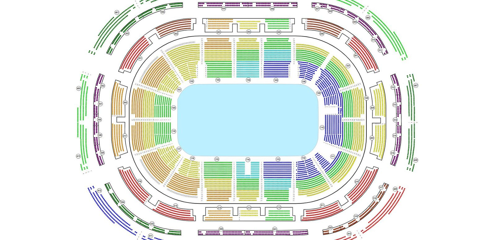
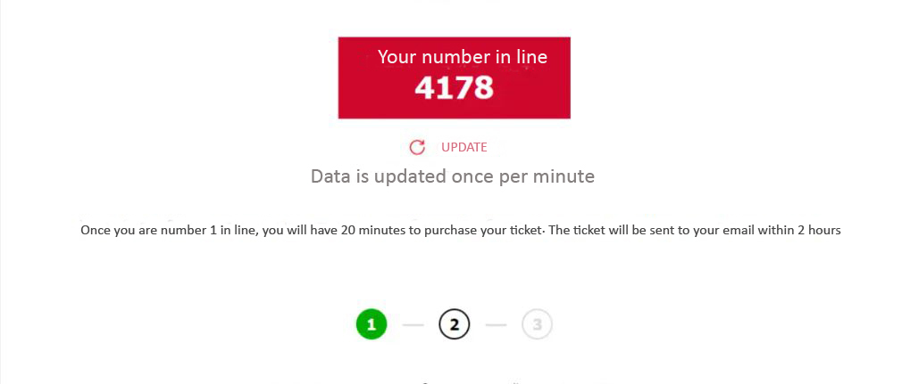
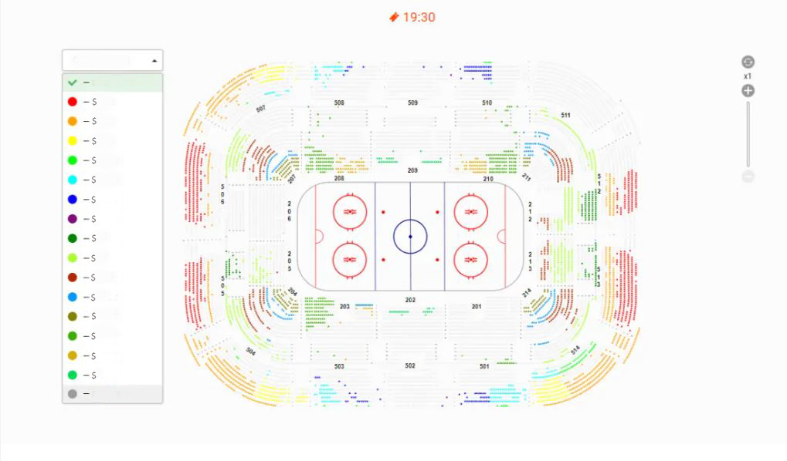

Organizers of events held at large venues – in venues with a large number of seats, at stadiums, and other expansive locations – face a range of significant challenges in their work that can impact ticket sales.

We’ve put together a brief guide on addressing these challenges so that your grand and vibrant events can always be maximally successful and profitable.

*“If the internet didn’t exist, it would be worth inventing it just to sell tickets online quickly by the hundreds of thousands.”* Marina Bakanova, Co-Founder of ArenaSoldOut.com

Today, more than 80% of concert events worldwide are held at large venues, and the reasons behind this are extremely pragmatic.

Certainly, large venues are centers of attraction.

They also possess the necessary infrastructure for organizers to create a variety of offerings for their customers.

Most such venues can be transformed to meet the needs of a specific organizer.

In many cases, these venues are characterized by convenient transportation access, have an ample number of parking spaces nearby, and have experience hosting a wide range of events.

However, despite this, organizers often encounter challenges when hosting events. What are the most in-demand features for organizers of large-scale events? Read on to find out in our article below:

### **Mastering ticketing: the significance of a high-quality seating chart for complex venues**

Contemporary ticketing standards underscore the pivotal role of a seamlessly functioning and visually appealing seating chart in driving successful ticket sales. When prospective attendees peruse the seating chart, they should effortlessly navigate, select seats with ease, and derive satisfaction from the ticket-purchasing process.

This aspect assumes paramount importance, particularly in the organization of events at sprawling auditoriums and stadiums, replete with multifarious sections, rows, and tiers. The seating chart must be meticulously designed, operating with precision and efficiency.

An abstruse, cumbersome, or malfunctioning seating chart can significantly impede ticket sales and tarnish the event’s reputation. Dispensing tickets in “textual format” or furnishing unclear seating charts is deemed unacceptable. Such shortcomings may stem from inadequate proficiency in ticketing practices or subpar venue visualization within the ticketing system.

When orchestrating an event, meticulous attention should be directed towards crafting a superior seating chart — a foundational stride toward achieving ticketing success and bolstering attendee satisfaction.

To ensure that the seating chart for your event venue is meticulously delineated and operates seamlessly, the ArenaSoldOut.com team stands ready to assist. This constitutes one of the fundamental features of the ArenaSoldOut.com platform. You need only furnish us with the pertinent seating plan for your event, and our specialists will undertake its visualization, verifying the precise and accurate functioning of all features.

### **Efficient venue layout and peak demand management**

It’s no secret that ticketing systems often face challenges during peak demand periods. It’s not uncommon to read reports about ticketing systems “crashing” due to an overwhelming volume of requests, or experiencing delays in issuing venue layouts during peak times, sometimes for up to half an hour or more. While I won’t delve into specific examples, if you’ve organized large events with high demand, you’ve likely encountered these issues yourself, or a quick search will reveal numerous instances. However, I’ll share an example below depicting a queue in one of the ticketing systems:

Sometimes ticketing systems incorporate queue functionality, while others simply freeze.

**The question arises: why invest in queue functionality when you can operate without one, using a reliable and robust platform?**

Media frequently report on such situations and issues, especially when it concerns prominent sports competitions, festivals, or concerts featuring renowned artists. These scenarios are often discussed and debated in forums and chat rooms.

One rare yet highly sought-after quality of any ticketing platform is its speed and ability to sell tickets without queues (online queues) during peak demand for events with a large number of seats.

It’s crucial for you that your customers don’t wait for half an hour in a queue to access the venue layout and available tickets. The platform should operate swiftly, efficiently, and handle any number of requests.

**At ArenaSoldOut.com, we not only manage hundreds of thousands of tickets simultaneously but also conduct peak load testing to showcase our platform’s speed.** For instance, in a July 2023 test, a 26,000-seat stadium was sold out in 6 minutes, with the first thousand buyers gaining access to the stadium layout and seat selection within 30 seconds, all without interrupting the platform’s operation for the millions of other tickets being sold concurrently. We’re pleased to report that the platform’s speed has significantly improved even after this test. Regular system upgrades are part of our standard operating procedure.

If you partner with ArenaSoldOut.com, you won’t need to activate various peculiar features like “online queues.” All functions operate swiftly, ensuring your events sell smoothly, quickly, and conveniently for your target audience.

You can read our [Why STRESS Testing Ticket Platforms Matters: Benefits for Organizers and Buyers](/blog/why-stress-testing-ticket-platforms-matters-benefits-for-organizers-and-buyers)

[STRESS TESTING: Technical Report](/blog/stress-testing-technical-report)

### **Price categories**

It’s evident that when dealing with large venues, a ticketing platform/system must have the capability to manage multiple price categories.

Many nuances regarding this aspect can be found below:

### **Desktop: the reliable choice**

Many ticketing platforms and services offer the option to set prices online directly through their web interfaces. Yes, it’s convenient when you have a very small venue or only a few tickets without assigned seats.

But imagine the frustration when you’re trying to set up an event on a ticketing platform and assign prices to seats in the venue, and suddenly your internet connection becomes weaker, or nothing gets published, or your computer keeps saying “too many requests, please wait,” forcing you to wait each time to assign prices to the next categories of seats! It’s even more frustrating if you’re working with a venue, allocating seats, setting prices, but then those changes… oops, didn’t get saved due to the volume of requests or internet glitches. And you have to start over each time.

As organizers start working with venues that have assigned seating, complex configurations, and very large capacities, the reliability, speed, and convenience of working with seats in all price categories become critically important.

**To ensure you don’t encounter such difficulties, we’ve developed desktop applications for you.** You can manage venues, seats, tickets, and other platform functions using desktop applications, and with a simple click of the “save” button, your changes are instantly sent to the platform. Everything works quickly and precisely, your computer performs excellently, and you’re not dependent on current internet connection issues.

### **Price adjustments, managing changes**

The pricing strategy significantly impacts the success of an event. Most event organizers adjust ticket prices several times throughout the sales cycle.

Some organizers employ scarcity tactics and do not immediately release all seats for sale.

As an organizer, you often need to close sales for certain seats regularly, whether you allocate them for sponsors, media partners, or other categories of guests.

**In any case, seat management occurs regularly throughout the entire sales cycle.**

ArenaSoldOut.com desktop applications enable you to swiftly manage seats, sections, and venues. You can reevaluate prices, reintroduce previously closed seats into sales, withdraw specific seats from sale, create marketing campaigns, and utilize many other features outlined below.

You are not reliant on internet fluctuations, and you can be confident that after clicking “Save,” all changes will be both saved and immediately reflected in the sales widget.

### **Adding staff, access levels**

The ArenaSoldOut.com ticketing platform allows you to add staff members and customize their access rights flexibly.

### **Ticket sales through partners, kiosks, agents, aggregators, bloggers.**

You can integrate an unlimited number of partners and bloggers into ticket sales for each event.

**For each event, you can connect:**

**1\. Trusted agents,** allowing them to collect payments for sold tickets, and they will settle with you according to your contracts and agreements.

2\. **Agents**. In this case, money for tickets sold by agents will go to your account, and you will settle with these agents according to your contracts and agreements.

3\. **Agents who sell tickets for cash** and settle with you according to your contracts and agreements (**Cash Box**).

You determine the terms of your cooperation with each agent, including any service fees your agents may additionally charge for sales, each for every event.

Additionally, you can create individual sales widgets for each agent, partner, or blogger and track how many sales each of them generates using the Reporter app. This makes your settlements with partners clear and transparent.

All agents will have access to the complete ticket inventory; there is no need to allocate quotas. All connected agents can sell competitively to their clients.

We strive to help you boost your sales.

**ArenaSoldOut.com allows combining user roles:**

-   For example, an artist can independently organize their performance and sell tickets on their own website. In this case, they simultaneously act as the Organizer, Sales Manager, and Ticket Agent. This role combination does not prevent them from additionally opening this event for ticket sales, for example, through their partners or various agents.

-   Or a promoter can simultaneously organize concerts, acting as the Organizer, and sell tickets on their website, integrating their partners into sales.

-   A sports club can act as both the Organizer and the Ticket Sales Agent.

### **API Integration**

You can embed ArenaSoldOut.com functionality into your external systems.

You can create your websites, posters, ticketing systems, and use ArenaSoldOut.com with all the necessary functionality as a backend, interacting with it via API.

### **Special features, Promo Codes, Season tickets**

For many organizers, venues, sports clubs, theaters, museums, and other organizations, the special features available on the ArenaSoldOut.com platform are highly relevant.

With the platform’s functionality, you can create subscriptions, seasonal tickets, and promo codes. The platform allows flexible ticket segmentation by price categories and grouping them by tariffs (for example, “adult,” “child,” etc.). Ticket buyers can choose the tickets that best suit them.

### **Protection against bots and mass reservations**

The ArenaSoldOut.com platform implements protection against bots, mass reservations, and double bookings of available seats.

Learn more about **[Protection Against bots and Mass Reservations](/blog/defense-against-bot-activities-and-bulk-reservations)**

### **Service fee**

A service fee may be charged for ticket sales. The service fee can be set for various interfaces (sales channels). In addition, organizers can set zero service fee.

### **Ticket templates**

ArenaSoldOut.com allows you to create and apply ticket templates in DOCX and SVG formats. A simple anchor system allows you to fill the template with the necessary data. The platform does not limit designers’ imagination in creating bright and colorful tickets.

Tickets can be colorful and contain text and images, including logos. Tickets can be multilingual.

You can also create tickets of different size for each event, filling them with the necessary additional information, such as a travel map when necessary, or information about partners, sponsors, marketing, and advertising campaigns.

### **Customer dashboard**

Wherever tickets are purchased, they land in a simple and convenient Customer Dashboard created for ticket buyers on Flutter. A useful feature of the dashboard is the ability to display the ticket to the controller from the mobile device screen.

### **SOLD-OUT Website Builder**

The Sold-out website builder allows you to generate a website for selling tickets, goods, and services loaded into the ArenaSoldOut.com platform in a matter of minutes. The site is created from a template, with a simple design, and can be installed as a ready-made standalone website (in the root directory) or in any subdirectory, becoming a subsection of an existing site.

Using Sold-out is the easiest and fastest way to start selling tickets, goods, or services. You can start with a standard design, and customize the website at any time, working with your own designers.

### **Selling through social media**

Social media and ticket sales go hand in hand. Selling directly through social media can boost sales. The number of tickets sold through social media is constantly growing, and we cannot stop it.

Good news: You can create sales widgets for each sales channel, including social media, such as for each channel in Facebook. And in this case, you can see how many sales each of the channels brought to you in the Reporter app.

This allows you to choose the most effective sales channels.

### **Customer Database**

Working on ArenaSoldOut.com, every organizer receives not only a tool for effective ticket sales for events of any scale but also the preservation of a complete database of their event attendees. This means that carefully accumulated data is not transferred to third parties and remains the property of each organizer.

You can build long-term and effective relationships with your customers!

More about working with customer databases can be read later: [Customer Database: key asset for event organizers on ticketing platforms](/blog/customer-database-key-asset-for-event-organizers-on-ticketing-platforms)

### **Online Analytics. Reporter app**

The Reporter App by ArenaSoldOut.com is designed to gather and analyze data on ticket sales, generate various reports, and handle ticket refunds. The application displays data in real-time.

### **Sale of goods and services**

The sale of tickets to events of any kind can be accompanied by the sale of related goods and services, such as merchandise, gifts, and catering services. Additionally, ArenaSoldOut.com allows the sale of goods and services “as is,” separately from any events.

### **Forget about payment delays**!

Working with ArenaSoldOut.com ensures that revenue from ticket sales goes directly to your account (acquiring). ArenaSoldOut.com does not hold funds from ticket sales in its account.

Organizers settle payments with ArenaSoldOut.com in two stages – several days before the event and the second payment occurs after the event based on the additional tickets sold since the first invoice was issued.

At a strategic level, direct access to financial flows solves a number of problems related to event financial management. This access allows organizers to promptly receive and efficiently distribute funds, minimizing potential cash gaps. It also ensures the smooth running of events, eliminating payment delays and related concerns. Thanks to this capability, organizers can confidently meet financial obligations to suppliers and carry out marketing initiatives, ultimately enhancing the quality of events and ensuring smoother operations.

### **Mobile access control system**

The Mobile Access Control System (MACS) application is designed for ticket validation for tickets sold through the ArenaSoldOut.com ticketing platform. MACS is used by controllers at event entrances and exits to validate tickets. To use MACS, you need a mobile device equipped with a camera with autofocus and running the Android operating system version 4.0 and above (this can be a mobile device or professional scanners), as well as internet access to communicate with the central ArenaSoldOut.com server.

###### **In this article, I have attempted to describe the most useful/necessary features of the ticketing system/platform for organizers of large-scale events.**

###### **We wish you the most successful events, and may they always be Sold Out!**

##### ***Sincerely yours, Marina Bakanova and ArenaSoldOut.com team***

### YOU MIGHT ALSO LIKE:

[Empowering organizers: the game-changing shift towards direct revenue access](/blog/empowering-organizers-the-game-changing-shift-towards-direct-revenue-access)

[Increasing ticket sales: Guide for event organizers](/blog/increasing-ticket-sales-guide-for-event-organizers)

[Ticket platforms. Five generations.](/blog/ticket-platforms-five-generations)

[Make own ticketing platform for 1000 USD. Myth or reality?](/blog/make-own-ticketing-platform-for-1000-usd-myth-or-reality)

[Ticket Platforms: key features for organizers of Top events](/blog/ticket-platforms-key-features-for-organizers-of-top-events)
