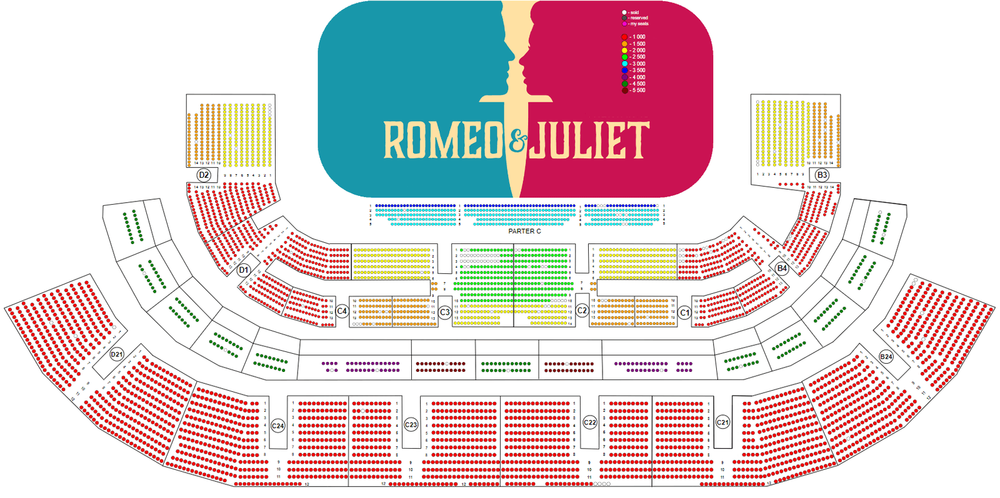

**With the advancement of technology and the increasing popularity of online purchases, ticket platforms have become an integral part of event organization and ticket sales. However, to ensure a high-quality and uninterrupted experience for a large number of users, conducting STRESS testing is crucial. In this article, we will explore why STRESS testing ticket platforms is beneficial for both event organizers and ticket buyers, and why showcasing real results from this testing is important.**

## **For event organizers, STRESS testing ticket platforms provides several significant advantages**.  

**Firstly**, it helps evaluate the system’s readiness to handle a high volume of requests. Ticket platforms must be capable of processing simultaneous requests from thousands or even millions of users to provide quick access to tickets and prevent potential technical glitches during popular events. STRESS testing helps identify any bottlenecks in the system and enables proactive measures to address them.

**Secondly**, STRESS testing allows organizers to determine the platform’s maximum capacity. This helps them choose the appropriate equipment and infrastructure that will deliver the desired level of performance and scalability. Planning for resource scaling and system expansion in advance helps prevent issues in the future and ensures seamless platform operation, even as the number of users grows.

## **Ticket buyers also reap clear benefits from STRESS testing.**  

**Firstly**, it ensures platform stability and availability. Nothing disappoints users more than being unable to purchase tickets due to system failures or poor performance. STRESS testing helps identify potential issues in advance, preventing negative situations and providing buyers with confidence that the platform will operate reliably and without problems.

**Secondly**, STRESS testing contributes to improved platform speed. Swift request processing enables users to quickly access information about available tickets, choose the most convenient seats, and make purchases without unnecessary delays. This is especially crucial for events with limited seating or high ticket demand, where every second counts.

Lastly, showcasing real results from STRESS testing holds significant value for all stakeholders. Sharing performance data and the platform’s ability to handle a high volume of users fosters transparency and trust in the system. **Event organizers and ticket buyers can be confident in the platform’s reliability and efficiency, ultimately enhancing user satisfaction and attracting new customers**.

***In conclusion, STRESS testing for ticket platforms is a critical component in ensuring high-quality service for event organizers and meeting the needs of ticket buyers. This process helps identify and address potential issues, ensures platform stability and availability, improves performance speed, and instills trust in the system through the public presentation of real stress testing results.***

**[STRESS TESTING: ArenaSoldOut.com Technical Report](/blog)**
