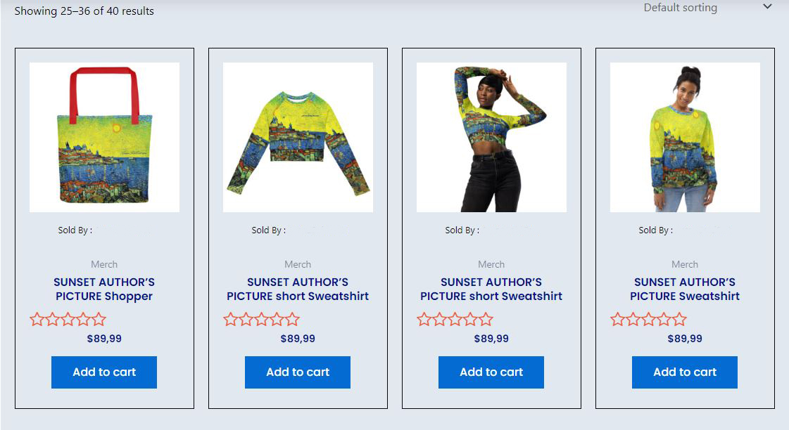
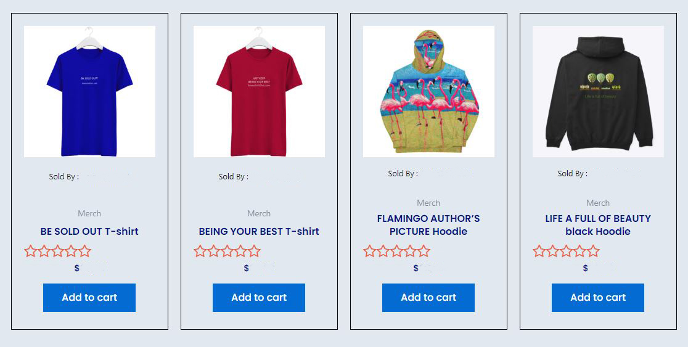

Мы в ArenaSoldOut.com видим множество разных страниц наших клиентов каждый день. И мы точно любим видеть как растут ваши продажи, как растут ваши доходы. Это самое приятное и радостное для всей нашей команды.

Поэтому мы создали для вас этот документ. Итак, как сделать продающую страницу и зарабатывать максимум на своих мероприятиях:

#### 1\. **Предлагайте дополнительные продажи на странице покупки билетов**

Если вы не предлагаете дополнительные продажи, вы оставляете деньги соседям ))

15 % и более купят дополнительные товары, если вы это предложите.

Продавайте товары, VIP услуги, еду, напитки, впечатления и многое другое, чтобы сделать ваши мероприятия самыми интересными для ваших посетителей.

Покупатели уже пришли на вашу страницу, значит, большая их часть заинтересована в вашем мероприятии и уже готовы тратить деньги.

Предложите им кроме билетов дополнительные опции, например, купить забавные, или философские футболки, толстовки, сумочки, или пледы ))

Вы также можете продать билеты на фотосессию со знаменитость, или билеты на парковку, это не ограничено ничем, кроме вашей фантазии и возможностей организации.

Вы также можете продать пару бокалов пива, или шампанского, пирожные, или попкорн для того, чтобы сократить очереди на месте.

Получить дополнительную предоплату всегда приятно, не так ли? Тем более, что, например, футболки вы можете произвести Limited edition, что с одной стороны повысит их ценность для покупателей, а с другой не даст вам потратить на производство больше, чем нужно.

Посетители также более щедры на покупки на самом мероприятии после того, как они у вас что-то купили ранее. Психологически для посетителя вашего мероприятия это с одной стороны становится менее затратно в день мероприятия, а с другой, получение на мероприятии того, что оплачено заранее, повышает интерес купить на мероприятии еще что-либо.

#### 2\. **Продумайте цены на билеты и используйте возможность ставить комиссии.**

В организации мероприятий каждый цент важен. У организатора много расходов и вы можете увеличить и свой доход. На сегодня покупатели билетов привыкли платить сервис сбор, не забывайте использовать это.

ArenaSoldOut.com позволяет вам устанавливать сервисный сбор при продаже билетов индивидуально для каждого мероприятия и каждого партнёра по продаже.

При продаже через ваш сайт вы также можете ставить сервис сбор. Покупатели привыкли к этому, большинство билетных сервисов взимают этот сервисный сбор за обработку и оформление билетов онлайн.

Используя нашу низкую стоимость для клиентов и, зная стоимость эквайринга, вы можете делать комиссию, которая позволит вам не только окупать это, но и заработать дополнительно.

Вы продаете билеты, чтобы заработать прибыль.

Дополнительный заработок может стать разницей между организатором, который будет продолжать эффективно работать и организатором, который будет вынужден уйти с рынка.

Разумно увеличивайте размер сервис сбора.

Не обязательно становиться похожим на билетные системы, которые завышают цену на билеты на 100%, устанавливайте разумный сервис сбор, который увеличит ваш доход, удерживая при этом ваших покупателей с вами

#### 3\. **Предложите временной стимул**

Кому не нравится старомодный обратный отсчет? Чувство безотлагательности является мощным стимулом для покупателей билетов.

Просто предложите скидку при раннем бронировании, отображая обратный отсчет, показывающий, когда билеты по полной цене поступят в продажу.

Временные стимулы затрагивают человеческую психологию, побуждая покупателей билетов совершить покупку заранее.

#### 4\. **Сделайте страницу, адаптированную для мобильных девайсов.**

Мобильные устройства генерируют 64% мирового трафика веб-сайтов. Мы видим, что более 80% покупателей покупают билеты на мероприятия, используя мобильный телефон.

Сделайте красивую и удобную страницу о вашем мероприятии, адаптированную под мобильные устройства, чтобы купитиь билет у вас мог любой человек, который едет в транспорте, сидит в кафе, или лежит дома на диване.

Покупка билетов на мероприятия = эмоциональная покупка, вашим посетителям должно быть удобно читать о вашем мероприятии с мобильного телефона.

#### 5\. **Стимулируйте посетителей ваших прошлых мероприятий**

Всегда дешевле вернуть существующих покупателей, чем найти новых.

ArenaSoldOut.com позволяет вам накапливать информацию о посетителях всех ваших прошедших мероприятий, даже если вы проводите мероприятия в разных локациях, городах и странах.

Вы можете делать рассылки и информировать предыдущих покупателей о своих новых мероприятиях

Вы можете рассмотреть вопрос скидок и промокодов для ваших постоянных посетителей

Если вы проводите мероприятия регулярно, вы можете создать сезонные, или специальные абонементы для своих постоянных покупателей

[Прочитать позже о базе покупателей вы можете здесь](/ru/blog/baza-pokupatelej-klyuchevoj-aktiv-organizatorov-meropriyatij-na-biletnyh-platformah)

#### 6\. **Используйте Facebook**

В реальном мире профессионалы в организации мероприятий активно используют Facebook для продвижения своего мероприятия среди целевой аудитории.

Есть несколько вариантов как повышать продажи:

**Платная реклама в Фейсбук**. Если вы сделаете рекламное объявление, которое привлекает внимание вашей аудитории, то можете либо направлять своих потенциальных покупателей на страницу сайта, где они могут прочитать все необходимоле о вашем мероприятии, либо можете сразу отправить их на виджет продаж билетов.

Ниже я опишу плюсы и минусы каждого из вариантов

**Свои каналы – страницы в Фейсбук**. Конечно, чем более популярная у вас страница, тем больше продаж.

**Каналы партнеров и блогеров**. Об этом следующий информационный блок.

##### **Итак, что лучше – перенаправлять на свой сайт, или сразу на виджет продаж билетов**:

В каждом из сценариев есть свои плюсы.

-   Если потенциальные посетители мероприятия переходят на сайт, то они могут прочитать всю информацию и многообразие ваших предложений. Но… их может что-то отвлечь и они не купят билеты. Зато они могут «поймать вашу волну» и воодушевиться максимально.

-   Минимум переходов для покупателя – это то, что ценится в мире онлайн продаж. Для этого есть возможность сделать переход с вашей рекламы сразу на виджет продаж билетов. Мы считаем, что для мероприятий с продажей билетов без мест и для мероприятий с однозначно трактуемой программой во многих случаях это является наиболее предпочтительным.

Вы можете выбрать любой из этих вариантов в зависимости от вашего мероприятия, количества ваших предложений для вашей аудитории

#### 7\. **Подключайте к продажам партнеров и блогеров**

Вы можете подключить к продажам нелимитированное количество партнеров и блогеров

Вы можете подключить к каждому мероприятию:

1.  **Доверенных агентов**, позволить им собирать оплату за проданные билеты, и они будут расплачиваться с вами согласно вашим контрактам и договоренностям.
2.  **Простых агентов**. В этом случае деньги за проданные агентами билеты будут поступать на ваш счет, и вы сами будете расплачиваться агентами этого типа согласно вашим контрактам и договоренностям.
3.  Агентов, которые будут продавать за наличные и расплачиваться с вами согласно вашим контрактам и договоренностям (**Онлайн касса**). 

Вы можете сами определять какие и сервис сборы могут дополнительно ставить ваши партнёры по продажам, каждый партнер для каждого вашего мероприятия.

Также вы можете создавать индивидуальные виджеты продаж для каждого вашего партнера, или блогера и видеть сколько продаж принес вам каждый их них. Это сделает ваши расчеты с партнерами понятными и прозрачными.

[Прочитать позже о работе с партнерами вы можете здесь](/ru/blog/kak-uvelichivat-prodazhi-biletov-rukovodstvo-dlya-organizatorov-meropriyatij)

#### 8\. **Выбирайте самые выгодные для вас каналы продаж**

«Вишенка на торте»  – вы видите все источники продаж. Не конверсий, не переходов, а именно продаж. Это важно вам, как организатору. Нагнать трафик на ваши страницы, как предлагают многие рекламные инструменты – не большая проблема, отслеживание трафика есть на многих билетных системах.

Вам же нужно знать что стало источником продаж. У ArenaSoldOut.com для этого есть все необходимые инструменты. В приложении Репортер вы будете видеть все источники продаж, если создадите отдельные виджеты для каждого партнера и каждого канала продаж.

#### 9\. **Сделайте красивые понятные билеты**

ArenaSoldOut.com позволяет вам делать мультиязычные, или необычные билеты. Используйте это, чтобы вашим посетителям было приятно и удобно.

А также – вы можете анонсировать последующие акции для тех, кто соберет нужное количество необычных билетов ваших прошедших мероприятий.

Люди любят участвовать в акциях, люди любят, когда их привлекают к различным активностям.

***Радуйте и развлекайте свою аудиторию!***

#### 10\. **Не закрывайте продажу билетов**

Одна из самых больших ошибок, которую можно совершить, — это закрытие онлайн-продаж накануне мероприятия. Есть еще люди, и их больше, чем вы думаете, которые выбегают с работы и решают купить билеты в день вашего события.

Причина того, что многие билетные системы закрывают рано онлайн продажи билетов в том, что им необходимо экспортировать и синхронизировать данные о продажах билетов со сканерами заранее, перед их событием. С ArenaSoldOut.com вы можете поддерживать продажи в течение всего дня в день вашего мероприятия. Так как каждый новый заказ на билет поступает в систему сканирования билетов незамедлительно после покупки.

Не упустите возможность заработать на этом доходе в последнюю минуту.

Также мы рекомендуем закрывать продажи через 30 минут после начала мероприятия, так как часто видим как люди, выходя с работы, мчатся к нашим клиентам и покупают билеты онлайн, даже если мероприятие уже началось.

#### 11\. **Приглашайте посетителей на ваши следующие мероприятия**

На проходящих мероприятиях вы можете начать анонсировать ваши последующие события. Продавайте билеты пока завершаете текущее мероприятие.

Часть клиентов ArenaSoldOut.com делают это великолепно.

Два примера:

-   Один из них в каждом городе, где он проводит мероприятие, ставит в холле анонсы следующих со ссылками на покупки билетов.

-   Другой начинает продавать билеты на фестиваль следующего года в последние 2 дня проходящего фестиваля, и делает это крайне успешно!

**Не забывайте – восторженные посетители покупают билеты легче, они же только что получили от вас заряд энергии и адреналина и всегда рады начать мечтать о ваших следующих событиях**.

#### **И последнее – сделайте интересную, красивую страницу продаж, ведь ваши клиенты покупают эмоции!**

Искренне ваша,

Марина, ArenaSoldOut.com

### **Вам** **также** **может** **быть** **интересно****:**

[Организуете событие? 7 слагаемых успешной продажи билетов](/ru/blog/organizuete-sobytie-7-slagaemyh-uspeshnoj-prodazhi-biletov)

[Организаторы мероприятий в центре событий: блестящий переход к прямому доступу к выручке](/ru/blog/organizatory-meropriyatij-v-czentre-sobytij-blestyashhij-perehod-k-pryamomu-dostupu-k-vyruchke)

[Ценовые стратегии мероприятий: Тактики и Практики](/ru/blog/czenovye-strategii-meropriyatij-taktiki-i-praktiki)

[Не очевидные, но эффективные методы увеличения выручки и продаж организаторами мероприятий](/ru/blog/ne-ochevidnye-no-effektivnye-metody-uvelicheniya-vyruchki-i-prodazh-organizatorami-meropriyatij)

[Работа с клиентами – залог успешности вашего бизнеса, или зачем и как поддерживать связь с клиентами](/ru/blog/rabota-s-klientami-zalog-uspeshnosti-vashego-biznesa-ili-zachem-i-kak-podderzhivat-svyaz-s-klientami)

[Защита от ботов и массового бронирования](/ru/blog/zashhita-ot-botov-i-massovogo-bronirovaniya)

[8 шагов для запуска ранних продаж](/ru/blog/8-shagov-dlya-zapuska-rannih-prodazh)

[Как начать продавать билеты на своем сайте. Пошаговый гайд](/ru/blog/kak-nachat-prodavat-bilety-na-svoem-sajte-poshagovyj-gajd)
