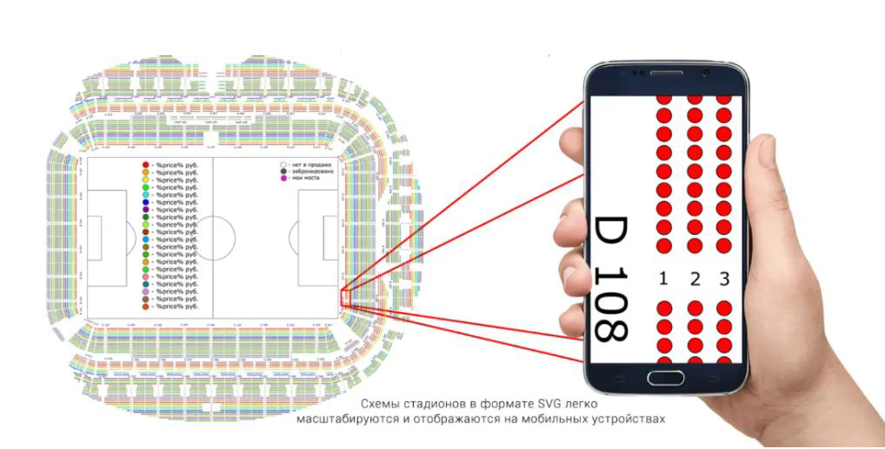

## Классика жанра или «Сделайте мне быстро сайт для продажи билетов»

Обычная постановка на создание сайта для продажи билетов (терминология, орфография и пунктуация автора):

  
*«Необходимо разработать одностраничный сайт с возможностью покупки билетов на мероприятие. По типу онлайн-покупки билетов в театр (есть даты, есть схема зала. Выбрал места, нажал на нужное количество квадратиков, внизу высветилась сумма, нажал оплатить, ввел номер карты, получил отбивку с билетами на введенную электронную почту)»*

Похожие тексты мне часто попадаются на различных фриланс биржах, на разных языках. Ничего не имею против ни таких текстов, ни заказчиков, их размещающих. Но, на основании большого опыта в этой сфере, хочу внести ясность в то, ЧТО в реальности стоит за словами этой постановки.

#### «По типу онлайн покупки билетов в театр…»

Онлайн покупка билетов потребует создания корзины с выбранными билетами, создания заказа, который будет отправлен в эквайринг банка, после оплаты билет должен быть отправлен покупателю и попасть в систему для проверки билетов на входе.

Весь этот функционал, должен работать на backend’е (сервере), а не на frontend’е (сайте). Например, корзина и заказ существуют на сервере, а сайт их просто отображает. Информацию о заказе отправляет в банк сервер, где реализован протокол эквайринга.

#### «…есть даты, есть схема зала.»

Очевидно, что для продажи билетов нужна информация о событии, его дате и месте проведения, о схеме зала с местами. Всю эту информацию надо ввести и сохранить в базе данных. Причем, схема зала в определенном формате (например SVG) )должна содержать места с координатами (сектор, ряд, место), ценовые категории и тарифы, например, взрослый, детский, льготный и т.д. Необходим функционал для управления доступностью мест, изменения ценовых категории и тарифов «на лету». Все это задачи для серверной части проекта.

*Схемы в платформе TixGear - ArenaSoldOut.com*

#### «…выбрал места, нажал на нужное количество квадратиков»

Схему нужно получить по API от сервера, показать покупателю, «оживить» ее скриптом, чтобы можно было выбрать места. Также по API необходимо забронировать места на время покупки (чтобы их не купил кто-то другой), сформировать из них заказ и подготовить его к отправке в эквайринг банка. Это основной функционал билетного процессинга — сложной штуки, которая, в том числе, управляет статусами мест (свободно, забронировано, продано), и статусами билетов (оформляется, оплачен, возвращается, возвращен). Здесь большой простор для того, чтобы сделать плохо, так как это сложные операции, которые могут одновременно проходить с сотнями разных залов и тысячами, если не десятками тысяч запросов от покупателей одновременно.  
Места и билеты – это разные сущности. На одно место, например, сектор партер, ряд 1, место 17, может быть продано несколько билетов (удивительно, да? Но мы читаем об этом ежедневно в соцсетях, что такое случается). У каждого билета должен быть свой уникальный номер. При этом действующим билетом гарантировано будет только один, только с ним можно будет пройти через Систему Контроля Доступа (СКД) в зал. Остальные билеты, как мы предполагаем, получаются в процессе неоднократных покупок и возвратов на некорректно работающих бекендах.

#### «….внизу высветилась сумма, нажал оплатить»

Обычно, это называется корзина, где представлены все места, выбранные покупателем. После нажатия оплатить будет сформирован заказ, который отправляется в банк по протоколу эквайринга. В случае успешной оплаты, на эти места будут выпущены билеты. Если оплаты не последует, транзакция откатится, и места будут возвращены в продажу.

#### «…получил отбивку с билетами на введенную электронную почту»

Вишенкой на торте успешной транзакции, проведенной билетным процессингом с эквайринга, является отправка сформированных для покупателя билетов через электронную почту или мобильные мессенджеры. Для этого нужно провести покупателя через простую регистрацию, например, подтвердив его электронную почту или телефонный номер. Естественно, большая часть этого функционала реализуется на сервере.

#### Что не вошло в постановку

Многие важные вещи не вошли в постановку, например, такие как: выгрузка билетов в Систему Контроля Доступа (СКД) площадки, личный кабинет покупателя билетов, интерфейс для возврата билетов, отчетность и статистика продаж, функционал для отмены и переносы событий, возможность открыть продажу билетов для других билетных агентов, варианты проведения различных промоакци и тп тп.

#### Вывод

В качестве вывода предложу две более верные постановки, прочнее связанные с реальностью, чем та, что приведена в начале статьи:

Необходимо разработать и внедрить новую билетную систему.

Необходимо создать сайт для продажи билетов, интегрированный с такой-то билетной системой или платформой, выступающей в качестве backend’а проекта.

Первый случай – это много времени, денег и рисков, о чем заказчик и исполнитель могут не догадываться в начале проекта. Второй случай — это оптимальное решение, почитать о котором можно в статье [«Хочу свой сайт для продажи билетов…»](/ru/blog/my-own-site-for-tickets-sold) 

Александр Орлов  
Software architect and team lead TixGear — ArenaSoldOut.com

ВАМ ТАКЖЕ МОЖЕТ БЫТЬ ИНТЕРЕСНО:

[Как начать продавать билеты на своем сайте. Пошаговый гайд](/ru/blog/kak-nachat-prodavat-bilety-na-svoem-sajte-poshagovyj-gajd) 

[Прочитать больше о том как сделать эффективный сайт для продажи билетов на мероприятия вы можете здесь](/ru/blog/11-sekretov-kak-sdelat-naibolee-privlekatelnuyu-i-prodayushhuyu-straniczu-vashego-meropriyatiya) 

Share this article with a friend

[Subscribe](#elementor-action%3Aaction%3Dpopup%3Aopen%26settings%3DeyJpZCI6MTM0LCJ0b2dnbGUiOmZhbHNlfQ%3D%3D)

[ПредПредставьте себе мир, где организация мероприятий становится более удобной, эффективной и прибыльной](/ru/blog/ticketingsystemsadvantagesarenasoldoutru)

[Эволюция технологий на сцене событий: новые горизонты для организаторов мероприятийСледующая](/ru/blog/evolyucziya-tehnologij-na-sczene-sobytij-novye-gorizonty-dlya-organizatorov-meropriyatij)
