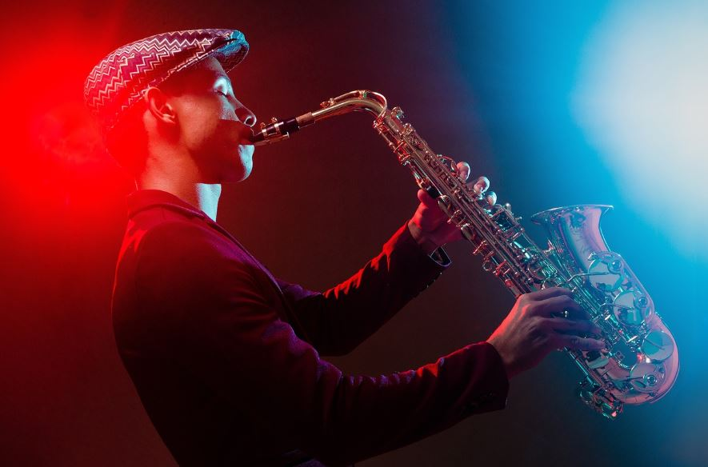

## **Глобальные Изменения Цен на Джазовые Фестивали**

В 2023 году джазовые фестивали по всему миру подверглись изменениям в ценах на билеты, отражая разнообразные факторы, такие как восстановление туристической индустрии, инфляция и влияние музыкальных трендов. В этой статье мы рассмотрим ключевые глобальные тенденции цен на джазовые фестивали в разных регионах и выявим, как они соотносятся с маркетинговыми стратегиями организаторов.

### **Европа – Золотая Эра Джаза и Повышение Цен**

Европа, исторически сильно связанная с джазовой музыкой, видит повышение цен на билеты в 2023 году. В столицах культуры, таких как Париж, Лондон и Берлин, цены выросли в среднем на 10–15%. Это может быть объяснено как востребованностью джаза, так и высокими культурными стандартами, что позволяет организаторам поднимать стоимость билетов без потери популярности.

##### **Пример 1: Montreux Jazz Festival в Швейцарии**

Montreux Jazz Festival в Швейцарии является ярким примером увеличения цен. Билеты на этот фестиваль подорожали на 12% по сравнению с предыдущим годом. Маркетинговые стратегии, такие как акцент на уникальных исполнителях и подчеркивание эксклюзивности события, помогли организаторам успешно продавать билеты даже при повышении стоимости.

### **Северная Америка. Американский Свинг**

В Северной Америке джазовые фестивали продолжают удивлять своей динамикой. На западном побережье, в Лос-Анджелесе и Сан-Франциско, цены выросли на 8–12%. В то время как на восточном побережье, например, в Нью-Йорке, повышение составило 10–15%. В Новом Орлеане и Чикаго цены выросли на 7–10%, подчеркивая важность джазовой культуры в этих регионах. Тенденция к дифференциации фестивалей и многообразие предложений дает организаторам возможность адаптироваться к различиям в предпочтениях аудитории.

##### **Пример** **2: New Orleans Jazz & Heritage Festival**

New Orleans Jazz & Heritage Festival увеличил цены на билеты на 10%, но сохраняет высокий уровень продаж. Организаторы акцентируют внимание на богатстве культурного наследия Нового Орлеана и планируют дополнительные мероприятия в рамках фестиваля, что стимулирует спрос и обеспечивает высокий уровень продаж.

### **Азия – Взлетающий Интерес и Конкуренция**

В Азии, где интерес к джазовой музыке постепенно растет, наблюдается повышение цен, хотя и в более умеренных масштабах. Города, такие как Токио, Сеул и Шанхай, далеко не всегда, но часто видят увеличение стоимости билетов на 5–8%. Здесь конкуренция с другими жанрами музыки и культурными событиями ставит перед организаторами задачу привлечения новой аудитории.

##### **Пример 3: Tokyo Jazz Festival**

Tokyo Jazz Festival увеличил цены на 7%, но уделяет большое внимание цифровому маркетингу и социальным медиа для привлечения молодежи. Успех фестиваля подтверждает, что эффективные маркетинговые стратегии могут переломить конкуренцию в свою пользу.

В среднем в Японии цены оставались стабильными, в то время как в Китае они увеличиваются на 8–12%..

### **Маркетинговые Стратегии: Как Продать Джазовый Ритм**

Самые успешные джазовые фестивали мира демонстрируют, что маркетинговые стратегии играют ключевую роль в привлечении внимания и увеличении продаж. Использование уникальных артистов, фокус на местной культуре, цифровой маркетинг и активное взаимодействие с аудиторией становятся главными катализаторами успеха.

##### **Интерактивные Промо-Кампании**

Самые успешные фестивали активно используют социальные сети и цифровые платформы для привлечения внимания аудитории. Интерактивные промо-кампании, включающие в себя онлайн-взаимодействие, конкурсы и розыгрыши билетов, создают ажиотаж вокруг события и способствуют быстрой продаже билетов.

##### **Эксклюзивные Бонусы для Покупателей**

Многие фестивали предлагают эксклюзивные бонусы и привилегии для тех, кто покупает билеты на ранних этапах. Это может включать в себя доступ к закрытым вечеринкам с артистами, аутентичные подарки или даже участие в мастер-классах. Такие акции создают дополнительный стимул для покупателей.

##### **Партнерства с Брендами**

Фестивали все чаще устанавливают партнерства с брендами, что помогает им привлекать спонсорскую поддержку и расширять свою аудиторию. Активное взаимодействие с брендами включает совместные рекламные кампании, что создает симбиоз интересов и способствует ускоренной продаже билетов.

### **Секрет Успеха в Гармонии С Музыкой и Маркетингом**

Джазовые фестивали 2023 года радовали поклонников этого удивительного жанра. Изменения в ценах обусловлены как региональными особенностями, так и стремлением организаторов к качественной программе. Успешные маркетинговые стратегии, включающие интерактивные кампании и бонусы, помогают фестивалям не только заполнить залы, но и создать уникальный опыт для своей аудитории. В гармонии с музыкой и креативностью, эти события продолжают вдохновлять и завоевывать сердца любителей джаза по всему миру.
