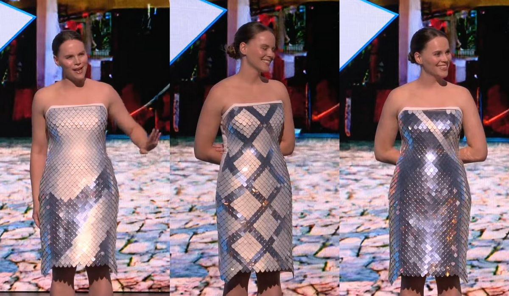
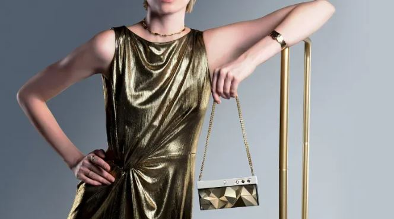
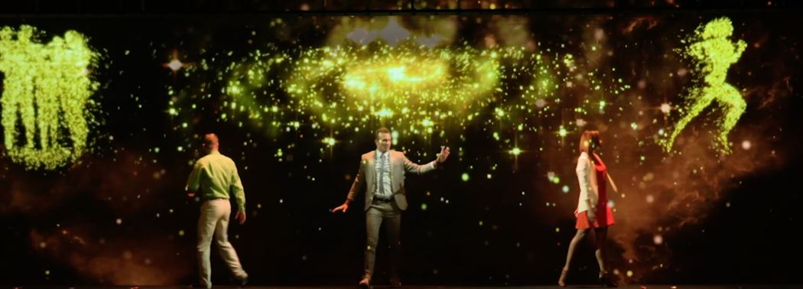
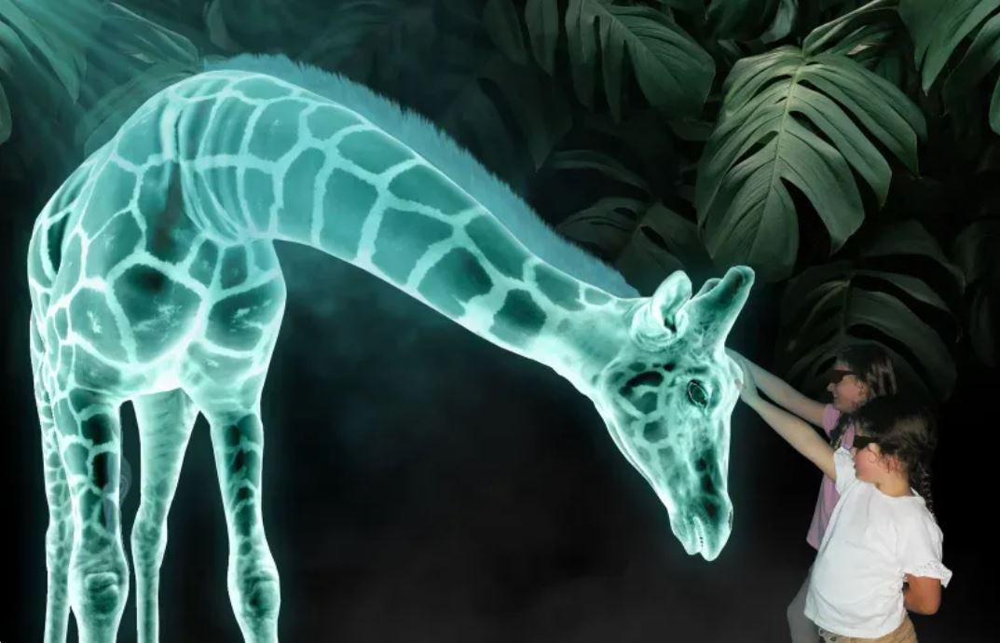
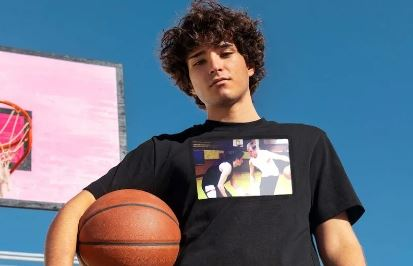

*От интерактивных платьев до голограмм 4D: революционные технологии, поднимающие мероприятия на новый уровень.*

## **Интерактивные Текстильные Дизайны от Adobe**

*Одевайте будущее: Project Primrose*

На конференции Max Adobe представила платье «Project Primrose» с гибкими текстильными дисплеями. Эта технология использует чешуек-светодиоды для создания интерактивных изображений на ткани.

Приложения Adobe превращают платье в холст с анимацией, открывая новые возможности для артистов, режиссеров и организаторов мероприятий.

## **Сумка-телефон от Honor**

*Мобильность в каждом движении*

Honor представляет инновационный телефон-раскладушку Honor V Purse с ремешком-клипсой, который несет в себе не только функциональность, но и стильный дизайн. С этим гаджетом у вас всегда под рукой не только телефон, но и стильный аксессуар, который может менять свой цвет.

## **Голограммы 4D: Реалистичное 3D-Изображение**

*EventWorks 4D на переднем крае технологий*

Голографические выступления от EventWorks 4D создают потрясающий 4D-эффект. Голограммы 4D предоставляют возможность взаимодействия с трехмерным изображением, делая их идеальным выбором для дизайна сцены, создания новых креативных пространств, театров, парков развлечений.

## **Виртуальный Зоопарк: Голограммы в Дикой Природе**

*Голограммный Зоопарк в Австралии*

Голограммный Зоопарк в Брисбене предоставляет уникальный опыт взаимодействия с дикой природой. С использованием технологии голограмм удалось создать реалистичные образы животных, предоставляя общественности возможность увидеть и узнать о дикой природе без содержания животных в неволе.

## **В ритме технологий: фанаты как плакаты**

*Ваши фанаты как ходячие рекламные плакаты. И это все* *Fun!*

Разработана футболка со встроенным экраном, на который можно выводить видео с телефона. И да, стирать ее тоже можно, но есть и минусы: экран работает только 2-4 часа.

Невероятное поле творчества, взаимодействия с фанатами и приобретения новых зрителей для артистов, менеджеров артистов, организаторов концертов, фестивалей, спорт менеджмента

Технологии на сцене событий открывают новые горизонты для организаторов мероприятий, предоставляя удивительные инструменты для создания неповторимых и захватывающих впечатлений, коммуникации и вовлечение зрителей во взаимодействие.
