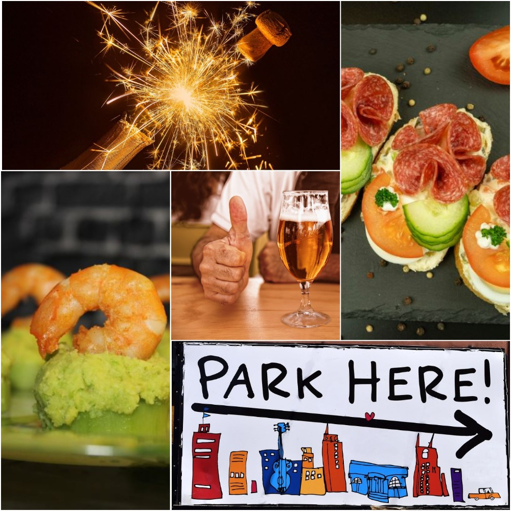

## Увеличение продаж на мероприятиях: инновационные шаги с ArenaSoldOut.com

*В организации фестивалей и концертных туров, эффективное управление продажами – залог успешного мероприятия. В статье рассмотрим, как платформа ArenaSoldOut.com предоставляет организаторам уникальные инструменты для увеличения продаж и улучшения общего опыта посетителей.*

#### Предзаказ мерча:

Одним из ключевых элементов повышения продаж является возможность предзаказа мерча. ArenaSoldOut.com позволяет посетителям делать заказы заранее, создавая предвкушение и укрепляя связь с фанатами еще до начала мероприятия.

Для организатора, или менеджмента артиста это означает, что он получает предоплату и может произвести необходимое количество мерча в локации каждого концерта, что убирает проблемы транспортировки и таможни. И раздавать уже мерч согласно билетам на мерч на каждом мероприятии.

Для того, чтобы исключить покупку мерча теми, кто не купил билет на мероприятие, мы рекомендуем делать предложение на мерч на странице удачной покупки билета. Таким образом только покупатели билетов на концерт смогут купить мерч для каждой локации.

Также хорошим маркетинговым ходом является Мерч Limited Edition, созданный именно для данного концерта, или концертного тура.

#### Предоплата за услуги:

Организаторы могут использовать платформу для предоплаты за парковку, напитки и еду. Эта инновационная функция не только обеспечивает дополнительный доход, но также оптимизирует обслуживание посетителей, избегая долгих очередей на мероприятии

#### Дополнительные каналы продаж

*TixGear Platform Editor - ArenaSoldOut.com*

ArenaSoldOut.com предоставляет возможность расширения каналов продаж через онлайн кассы у партнеров и размещение виджетов продаж у влиятельных блогеров. Это не только увеличит охват аудитории, но и создаст дополнительные точки доступа для приобретения билетов и услуг.

*Современные технологии, предоставленные ArenaSoldOut.com , предоставляют организаторам концертов и фестивалей мощные инструменты для увеличения продаж и улучшения взаимодействия с посетителями. Предзаказы мерча, предоплата за услуги и расширение каналов продаж — всё это способы повысить эффективность мероприятий, делая их более прибыльными и запоминающимися для участников*.

##### Вам также может быть интересно:

[Организаторы мероприятий в центре событий: блестящий переход к прямому доступу к выручке](/ru/blog/organizatory-meropriyatij-v-czentre-sobytij-blestyashhij-perehod-k-pryamomu-dostupu-k-vyruchke). *В динамичном мире управления событиями способы доступа организаторов к выручке от продажи билетов претерпевают существенные изменения.*

[Не очевидные, но эффективные методы увеличения выручки и продаж организаторами мероприятий](/ru/blog/ne-ochevidnye-no-effektivnye-metody-uvelicheniya-vyruchki-i-prodazh-organizatorami-meropriyatij) *Если фраза «увеличение выручки и продаж» заставляет ваше сердце биться быстрее, пришло время сосредоточиться на этом*

[Увеличение продаж на мероприятиях: инновационные шаги с ArenaSoldOut.com](/ru/blog/increasing-sales-at-events-innovative-steps-with-arenasoldout-com)

[11 секретов как сделать наиболее привлекательную и продающую страницу вашего мероприятия](/ru/blog/11-sekretov-kak-sdelat-naibolee-privlekatelnuyu-i-prodayushhuyu-straniczu-vashego-meropriyatiya)

[База Покупателей: ключевой актив организаторов мероприятий](/ru/blog/baza-pokupatelej-klyuchevoj-aktiv-organizatorov-meropriyatij-na-biletnyh-platformah)

Share this article with a friend

[Subscribe](#elementor-action%3Aaction%3Dpopup%3Aopen%26settings%3DeyJpZCI6MTM0LCJ0b2dnbGUiOmZhbHNlfQ%3D%3D)

[Пред«Хочу свой сайт для продажи билетов…»](/ru/blog/my-own-site-for-tickets-sold)

[Работа с клиентами – залог успешности вашего бизнеса, или зачем и как поддерживать связь с клиентамиСледующая](/ru/blog/rabota-s-klientami-zalog-uspeshnosti-vashego-biznesa-ili-zachem-i-kak-podderzhivat-svyaz-s-klientami)
