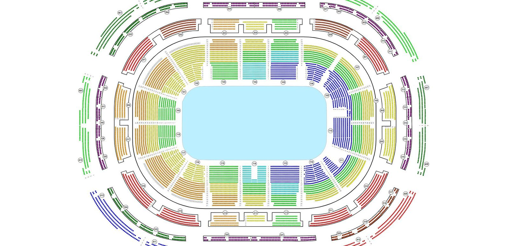
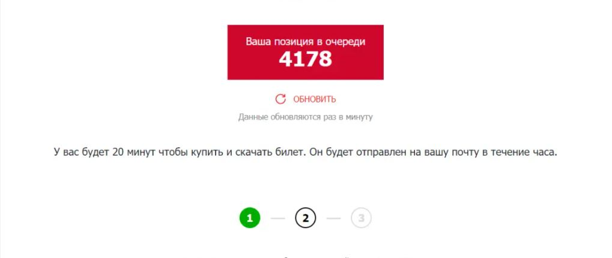
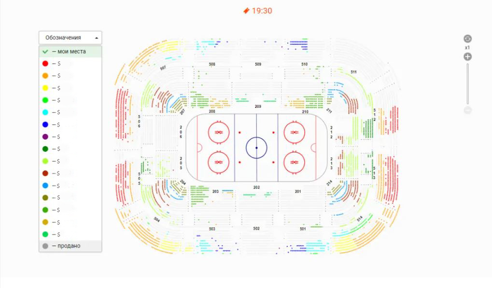

Организаторы мероприятий на больших площадках – в залах с большим количеством мест, на стадионах, на других больших площадках сталкиваются в своей работе с рядом существенных проблем, которые могут влиять на продажи.

Мы написали краткий гайд о вариантах решения этих проблем, чтобы ваши крупные и яркие события всегда были максимально успешны и прибыльны.

*«Если бы интернета не было, то его стоило бы придумать хотя бы для того, чтобы продавать билеты онлайн быстро сотнями тысяч» Марина Баканова, Co-Founder ArenaSoldOut.com*

Сегодня на больших площадках во всем мире проводится более 80% концертных мероприятий и причины этого крайне прагматичны.

Конечно, большие площадки – это центры притяжения.

Они также обладают необходимой инфраструктурой, чтобы организаторы могли создавать самые разные предложения для своих покупателей.

Большинство таких площадок может трансформироваться под задачи конкретного организатора.

Во многих случаях эти площадки характеризуются удобной транспортной доступностью, имеют достаточное количество парковочных мест неподалеку и имеют опыт проведения самых разных мероприятий.

Но, несмотря на это, организаторы часто сталкиваются с проблемами при проведении мероприятий. Каковы самые востребованные функции для организаторов брльших мероприятия? Об этом наша статья ниже:

## **Основы успешного тикетинга: значение качественной схемы сложного зала**

Современные стандарты тикетинга утверждают: одним из ключей к успешным продажам билетов является корректно работающая и привлекательная схема зала. Взглянув на схему, покупатель должен легко ориентироваться, выбирать места без труда и получать удовольствие от процесса покупки.

Особенно важно обратить внимание на этот аспект при организации мероприятий в больших залах и на стадионах, где существует множество секторов, рядов и ярусов. Вся схема должна быть продумана до мельчайших деталей, работать точно и эффективно.

Непонятная, неудобная, не четко работающая схема зала может серьезно навредить продажам билетов и репутации мероприятия. Продавать билеты «в текстовом виде» или предоставлять непонятные схемы зала — недопустимо. Это может быть вызвано как недостаточной квалификацией в области тикетинга, так и плохой отрисовкой площадок в билетной системе.

При планировании мероприятия следует уделить особое внимание созданию качественной схемы зала — это фундаментальный шаг к успеху в продажах билетов и удовлетворению покупателей.

Для того, чтобы вы были уверены, что схема зала, где вы планируете мероприятие, была отрисована и работала четко и без проблем, команда ArenaSoldOut.com всегда отрисовывает ее сами для вас.

Это одна из базовых функций платформы ArenaSoldOut.com, вам необходимо прислать нам актуальную для вашего мероприятия схему и наши специалисты отрисуют ее и проверят, что все функции работают точно и корректно.

## **Скорость выдачи схем площадок и работа при пиковом спросе**

Не открою секрет, если напишу о том, что очень часто мы читаем в прессе, что какая-то билетная система «легла» и не может продавать билеты, так как получает слишком много запросов, другая задерживает выдачу залов при пиковых запросах, иногда и на полчаса-час.. И так далее. Конкретные примеры приводить не буду, если у вас были большие мероприятия с пиковым спросом, часто вы сами сталкивались с этим, либо все это легко гуглится.  Но одну из картинок вывешу ниже, это пример очереди на одной из билетных систем:

Иногда билетные системы имеют функционал очереди. Другие просто зависают.

***Вопрос – зачем вкладывать в функционал очереди, если можно работать совсем без очереди и с надежной мощной платформой?***

О таких ситуациях и проблемах постоянно пишут СМИ, особенно если речь идет об известном спортивном соревновании, или фестивале, или концерте известной звезды,  эти ситуации часто комментируются и обсуждаются на форумах и в чатах.

Редким, но востребованным качеством любой билетной платформы является скорость работы и способность продавать без очередей (онлайн очередей) билеты при пиковых спросах на мероприятия с большим количеством мест.

Для вас важно, чтобы ваши клиенты не ждали по полчаса когда до них дойдет очередь и они смогут увидеть схему зала и свободные билеты. Платформа должна работать быстро и четко и любым количеством запросов.

**Для того, чтобы вы были уверены, мы, ArenaSoldOut.com не не только работаем с сотнями тысяч билетов одновременно, но и проводим пиковые нагрузочные тестирования, чтобы мы вы видели скорость работы**. Например, это результат одного из тестирований июль 2023, Стадион 26 000 мест был продан за 6 минут, а первая тысяча покупателей получила доступ к актуальной схеме стадиона и выбору мест за 30 секунд без остановки работы платформы с другими миллионами билетов, продающихся одновременно. Рады сообщить, что и после этого теста скорость работы уже сильно увеличена. Апгрейт системы производится регулярно.

Если вы сотрудничаете с ArenaSoldOut.com, вам нет необходимости подключать разные странные функционалы, типа «онлайн очередь, все функции работают быстро, чётко и ваши мероприятия могут продаваться гладко, быстро и удобно для целевых аудитории.

[Отчет об целях и задачах регулярного тестирования можно прочитать здесь](/ru/blog/why-the-tickets-platform-need-pay-load-tests-ru)

## **Количество ценовых категорий**

Очевидно, что для работы с большими площадками билетная платформа\\система должна иметь возможность работы со многими ценовыми категориями.

Многие нюансы вы можете прочитать ниже

## **Десктоп это надежно**

Многие билетные платформы и сервисы предлагают установку цен онлайн, прямо на их веб интерфейсах. Да, это удобно, когда у вас очень маленький зал, или не много билетов без мест.

Только представьте себе, что вы почувствуете, когда будете заводить мероприятие на билетную платформу и назначать цены на места в зале, а у вас то интернет стал слабее и ничего не публикуется, либо ваш компьютер постоянно пишет «слишком много запросов, подождите» и вы каждый раз ждете, чтобы назначить цены следующим категориям мест! Еще неприятнее, если вы работаете с залом, выделяете места, назначаете цены…. но эти изменения.. оп, и не сохранились в силу количества запросов на работу с каждым местом, или интернет сбоя. И вам все приходится раз за разом начинать начала.

Как только организаторы начинают работать с залами с местами, со сложной конфигурацией, а также с очень большими залами и с разными ценовыми категориями, надежность, скорость и удобство работы с местами во всех ценовых категориях, приобретает серьезное значение.

**Для того, чтобы у вас не было сложностей, мы создали для вас десктопные приложения**. Вы работаете с залами, местами, билетами и другими функциями платформы в десктопных приложениях и легким нажатием кнопки «сохранить» отправляете изменения одномоментно на платформу. Все работает быстро и четко, ваш компьютер справляется отлично, и вы не зависите от текущих сбоев интернет-соединения.

## **Изменения цен, вывод части билетов из продаж**

Ценовая стратегия сильно влияет на успех мероприятия. Большинство организаторов мероприятий изменяют цены на билеты в течение цикла продаж несколько раз.

Часть организаторов использует стратегии создания дефицита и не открывает сразу все места для продажи.

[Прочитайте позже о ценовых стратегиях подробнее здесь](/ru/blog/czenovye-strategii-meropriyatij-taktiki-i-praktiki)

Также вам, как организатору, чаще всего регулярно требуется закрывать продажи на некоторые места, которые вы либо выделяете для спонсоров, информационных партнёров, других категорий ваших гостей.

**В любом случае работа с местами происходит регулярно в течение всего цикла продаж.**

Десктопные аппликации ArenaSoldOut.com позволяют вам работать с местами, секторами, залами быстро. Делать переоценку, дополнять места в продажу, которые ранее были закрыты от продаж, выводить нужные вам места из продажи, создавать маркетинговые кампании и использовать многие другие функции, о которых вы можете прочитать ниже.

Вы не зависите от колебаний интернета, вы уверены в том, что после нажатия кнопок «Сохранить» все изменения будут и сохранены и сразу отразятся в виджете продаж и работе.

## **Добавление сотрудников, уровни доступа и роли**

Билетная платформа ArenaSoldOut.com позволяет добавлять сотрудников и гибко настраивать их права доступа

## **Вывод в продажи у партнеров, в киосках, у агентов, агрегаторов. Единое билетное поле**

Вы можете подключить к продажам билетов на каждое мероприятие нелимитированное количество партнеров и блогеров

Вы можете подключить к каждому мероприятию:

-   **Доверенных агентов**, позволить им собирать оплату за проданные билеты, и они будут расплачиваться с вами согласно вашим контрактам и договоренностям.

-   **Простых агентов**. В этом случае деньги за проданные агентами билеты будут поступать на ваш счет, и вы сами будете расплачиваться агентами этого типа согласно вашим контрактам и договоренностям.

-   Агентов, которые будут продавать за наличные и расплачиваться с вами согласно вашим контрактам и договоренностям (**Онлайн касса**).

Вы сами определяете ваши условия вашего сотрудничества с каждым агентом, а также, например, какие размеры сервис сборов могут дополнительно ставить ваши агенты по продажам, каждый для каждого вашего мероприятия.

Также вы можете создавать индивидуальные виджеты продаж для каждого вашего агента, партнера, или блогера и видеть в приложении Репортер сколько продаж принес вам каждый их них. Это сделает ваши расчеты с партнерами понятными и прозрачными.

Все агенты будут видеть полное полное билетное поле, не нужно выделять квоты, все подключенные агенты могут продавать в конкурентном режиме для своих клиентов.

Мы делаем все возможное, чтобы вы могли увеличивать продажи.

**ArenaSoldOut.com позволяет совмещать роли пользователей**:

-   Например, Артист может самостоятельно организовать свое выступление и продавать билеты на собственном сайте. В этом случае, он одновременно является и Устроителем, и Организатором продаж, и Билетным Агентом. Такое совмещение ролей не помешает ему дополнительно открыть это мероприятие для продажи билетов, например, через своих партнеров, или различных агентов.

-   Или промоутер может одновременно организовывать концерты, выступая в роли Организатор, а также продавать билеты на своем сайте, подключая к продажам и своих партнеров.

-   Спортивный клуб может являться одновременно и Организатором, и Агентом по продаже билетов.

## **API**

Вы можете встраивать функционал ArenaSoldOut.com в свои внешние системы.

А также создавать свои сайты, афиши, билетные системы и использовать ArenaSoldOut.com со всем необходимым вам функционалом в качестве бэкенда и работать с ней по API.

## **Специальные функции, промокоды, сезонные билеты**

Для многих организаторов, площадок, спорт клубов, театров, музеев и других организаций актуальны специальные функции, которые есть на платформе ArenaSoldOut.com

С помощью функционала платформы вы можете создавать абонементы, сезонные билеты, промокоды.  Платформа позволяет гибко разделять билеты по ценовым категориям и группировать их по тарифам (например, «взрослый», «детский» и т.д.). Покупатель билетов может выбрать, какие билеты ему больше подходят.

## **Защита от массового бронирования**

На платформе ArenaSoldOut.com реализована защита от ботов, массового бронирования и двойной резервации свободных мест

[Больше об этом вы можете прочитать здесь](/ru/blog/zashhita-ot-botov-i-massovogo-bronirovaniya)

## **Сервисный сбор**

При продаже билетов может взиматься сервисный сбор. Сервисный сбор может устанавливаться на различные интерфейсы (каналы продаж). Кроме этого, организатор может задавать минимально возможный сервисный сбор.

## **Шаблоны билетов**

ArenaSoldOut.com позволяет создавать и применять шаблоны билетов в форматах DOCX и SVG. Простая система якорей позволяет наполнить шаблон необходимыми данными. Платформа ничем не ограничивает фантазию дизайнеров при создании ярких и красочных билетов.

Билеты могут быть цветными, содержать тексты и изображения, в том числе логотипы. Билеты могут быть мультиязычными.

Также вы можете создавать билеты разных разметов для каждого мероприятия, наполняя их необходимой дополнительной информацией, например, картой проезда в случаях, когда это необходимо, или\\и информацией о партнерах, спонсорах, маркетинговых и рекламных акциях.

## **Личный кабинет покупателя**

Где бы ни приобретались билеты, они попадают в простой и удобный Личный кабинет, созданный для покупателей билетов на Flutter. Удобной функцией кабинета является показ билета контролеру с экрана мобильного устройства. Кабинет легко кастомизируется и встраивается в сайт агента.

## **Конструктор сайтов SOLD-OUT**

Конструктор сайтов Sold-out позволяет в считанные минуты сгенерировать сайт для продажи билетов, товаров и услуг, загруженных в платформу ArenaSoldOut.com. Сайт создается по шаблону, с простым дизайном, и может быть установлен как готовый отдельный сайт (в корневой каталог), так и в любой подкаталог, став подразделом уже имеющегося сайта.

Использование Sold-out – это самый простой и быстрый способ начать продавать билеты, товары или услуги. Вы можете начать со стандартного дизайна, кастомизировать сайт вы сможете в любой момент, работая уже со своими дизайнерами.

## **Продажа через соцсети**

Социальные сети и продажи билетов – это связанные темы. Если вы будете продавать прямо через соцсети, вы сможете увеличивать продажи. Число билетов, продаваемых через соцсети, постоянно растет, мы не можем это остановить

**Хорошая новость**: Вы можете создавать виджеты продаж для каждого канала продаж, в том числе, для соцсетей, например, для каждого канала в Фейсбук. И в этом случае видеть сколько продаж привел вам каждый из каналов в приложении Репортер.

Это позволит вам выбирать самые эффективные каналы продаж.

## **База покупателей**

Работая на ArenaSoldOut.com каждый организатор получает не только инструмент для эффективных продаж билетов на мероприятия любых масштабов, но и сохранение полной базы покупателей своих мероприятий. Это означает, что тщательно накопленные данные не передаются третьим сторонам и остаются собственностью каждого организатора.

Вы можете строить долговременные и эффективные взаимоотношения со своими покупателями!

[Больше о работе с базами покупателей вы можете позже прочитать здесь](/ru/blog/baza-pokupatelej-klyuchevoj-aktiv-organizatorov-meropriyatij-na-biletnyh-platformah)

[Также полезной является статья «Работа с клиентами – залог успешности вашего бизнеса, или зачем и как поддерживать связь с клиентами»](/ru/blog/rabota-s-klientami-zalog-uspeshnosti-vashego-biznesa-ili-zachem-i-kak-podderzhivat-svyaz-s-klientami)

## Онлайн аналитика. Приложение **Репортер**

Приложение Репортер  ArenaSoldOut.com предназначено для получения и анализа данных о продажах билетов, получения отчетов различных форм, возврата билетов. Приложение отображает данные в режиме реального времени.

## **Продажа товаров и услуг**

Продажа билетов на события любых видов может сопровождаться продажей сопутствующих товаров и услуг, например, атрибутики, подарков, услуг питания. Кроме этого, ArenaSoldOut.com позволяет продавать товары и услуги «как есть», отдельно от каких-либо событий.

## **Забудьте про задержки платежей**

Работая с ArenaSoldOut.com вы получаете выручку от продажи билетов сразу на свой счет (эквайринг). ArenaSoldOut.com не принимает на свой счет деньги от продажи билетов.

Организаторы расплачиваются с ArenaSoldOut.com по факту продаж, в 2 этапа – за несколько дней до мероприятия и второй платеж происходит после мероприятия по факту дополнительно проданных билетов с момента выставления первого счета.

На стратегическом уровне прямой доступ к финансовым потокам решает ряд проблем, связанных с финансовым управлением мероприятий. Этот доступ позволяет организаторам оперативно получать и эффективно распределять средства, минимизируя возможные кассовые разрывы. Он также обеспечивает бесперебойное проведение событий, исключая задержки в выплатах и связанные с ними тревоги. Благодаря этой возможности, организаторы могут уверенно исполнять финансовые обязательства перед поставщиками, а также осуществлять маркетинговые инициативы, что в конечном итоге способствует повышению качества проводимых мероприятий и обеспечивает более плавную операционную деятельность.

## **Мобильная система контроля доступа**

Приложение «Мобильная система контроля доступа» (МСКД) предназначено для проверки билетов, реализованных через билетную платформу ArenaSoldOut.com. МСКД применяется контролерами на входном контроле мероприятия и используется для проверки билетов, как при входе, так и при выходе. Для работы МСКД требуется оснащенное фотокамерой с автофокусом мобильное устройство с операционной системой Android версии 4.0 и выше (**это могут быть мобильные устройства, или профессиональные сканеры**), а так же доступ в Интернет для связи с центральным сервером ArenaSoldOut.com.

#### В этой статье я постаралась описать самые полезные\\необходимые функции билетной системы\\платформы для организаторов крупных мероприятий.

#### ***Желаем вам самых успешных ивентов и будьте всегда Sold Out!***

#### ***Искренне ваши, Марина Баканова и команда ArenaSoldOut.com***

### **Вам** **также** **может** **быть** **интересно****:**

[Организуете событие? 7 слагаемых успешной продажи билетов](/ru/blog/organizuete-sobytie-7-slagaemyh-uspeshnoj-prodazhi-biletov)

[Организаторы мероприятий в центре событий: блестящий переход к прямому доступу к выручке](/ru/blog/organizatory-meropriyatij-v-czentre-sobytij-blestyashhij-perehod-k-pryamomu-dostupu-k-vyruchke)

[11 секретов как сделать наиболее привлекательную и продающую страницу вашего мероприятия](/ru/blog/11-sekretov-kak-sdelat-naibolee-privlekatelnuyu-i-prodayushhuyu-straniczu-vashego-meropriyatiya)

[Не очевидные, но эффективные методы увеличения выручки и продаж организаторами мероприятий](/ru/blog/ne-ochevidnye-no-effektivnye-metody-uvelicheniya-vyruchki-i-prodazh-organizatorami-meropriyatij)

[Защита от ботов и массового бронирования](/ru/blog/zashhita-ot-botov-i-massovogo-bronirovaniya)

[8 шагов для запуска ранних продаж](/ru/blog/8-shagov-dlya-zapuska-rannih-prodazh)
