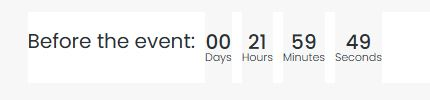
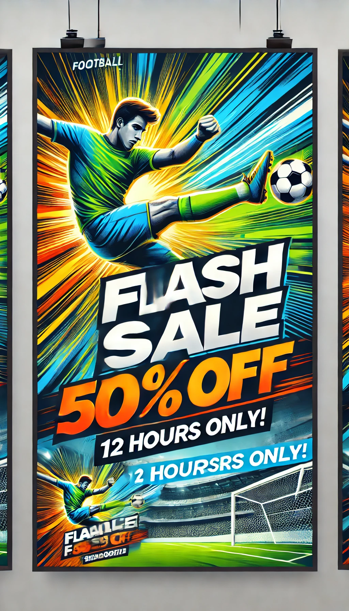

Успешные маркетологи нередко используют методику дефицита, чтобы стимулировать продажи. Всякий раз, когда мы делаем акцент на ограниченности ресурса, мы применяем этот психологический прием. Давайте разберемся, какие именно триггеры срабатывают и как грамотно использовать ощущение нехватки времени в маркетинговых стратегиях по продаже билетов на мероприятия.

##  Основные моменты:

.

## — Таймеры с отсчетом времени

## — «Молниеносные распродажи» и однодневные акции

## — Постепенное повышение цен

.

Ограниченные временные рамки, сокращающиеся запасы и сообщения вроде «осталось всего несколько мест»… Знакомая картина, не правда ли? Недавние исследования показали несколько эффективных способов использования принципа дефицита, начиная от демонстрации высокого спроса и заканчивая временными ограничениями.

Организаторы мероприятий и предприниматели знают, что время — это ценный ресурс. В сочетании с привлекательным предложением, которое скоро может исчезнуть, ограниченность времени становится отличным стимулом для принятия решения. В двух словах: нехватка времени создает срочность и подталкивает покупателей к действию, снижая вероятность откладывания.

Например, представьте себе, что вы зашли на стриминговую платформу и узнали, что определенный матч будет доступен только несколько дней. Может, этот матч не входил в ваш план на ближайшее время, но новость о его скором исчезновении заставляет вас посмотреть его прямо сейчас, чтобы не упустить возможность. Этот пример отлично демонстрирует, как дефицит времени влияет на поведение потребителей.

## 1\. Таймеры с обратным отсчетом

Обратный отсчет времени создает мощное ощущение срочности. Сказать потенциальному покупателю, что у него мало времени, — это одно, но визуально показать, как минуты и секунды утекают, — совершенно другое.

Рассмотрите вариант размещения таймеров на страницах продажи билетов. Например, во время предпродажи билетов на крупный музыкальный фестиваль таймер покажет, сколько времени осталось до окончания акции, подталкивая людей к немедленному действию. Этот метод часто используют крупные маркетплейсы, и он доказал свою эффективность за счет создания FOMO (страха упустить возможность).

Пример: Если вы организуете культурное мероприятие, добавьте таймер на сайте, показывающий, сколько времени осталось до конца скидочной кампании. Это побудит поклонников искусства купить билеты раньше, пока действуют специальные условия.

##  2. «Молниеносные распродажи» и кратковременные акции

Внезапные акции и ограниченные предложения — ещё один проверенный способ создать ощущение срочности. Чтобы этот метод сработал, используйте его в неожиданные моменты, а не только в периоды массовых распродаж вроде «черной пятницы». Открывайте короткие окна возможностей спонтанно, чтобы усилить интерес и активировать у аудитории желание действовать немедленно.

Некоторые авиакомпании устраивают неожиданные 24-часовые распродажи билетов, чтобы клиенты быстро принимали решения. У авиакомпаний отличный и сильно просчитанный маркетинг и всегда полезно использовать то, что разработано и отработано уже крупными компаними. В случае с мероприятиями можно организовать подобные акции, предложив специальные условия на ограниченное количество билетов, или ограниченное время.

.

## Примеры:

***Гала-концерт звезд фламенко уже совсем скоро! Только сегодня действует уникальная 24-часовая акция: купите билеты по самой низкой цене и почувствуйте страсть и магию фламенко вживую! Но спешите: таких цен больше не будет!***

Если вы продвигаете футбольный матч, объявите «Флэш-распродажу» на вечер четверга, где билеты будут продаваться со значительной скидкой только в течение нескольких часов. Сообщите об акции через рассылку или в социальных сетях, чтобы привлечь максимальное внимание.

***Настоящий футбольный бой уже близко! Только сегодня, и только для самых быстрых: молниеносная распродажа билетов на матч вашего любимого клуба со скидкой 50%! Действует всего 12 часов! Билеты заканчиваются, забирайте свое место на стадионе сейчас!***

Разрабатывайте плны таких акций, создавайте яркие тексты и изображения, вовлекайте целевую аудиторию. Люди любят, когда им интересно, когда к ним проявляют внимание, когда предлагают что-либо необычное и эксклюзивное! Придумывайте и вы сможете продавать больше билетов на свои события.

##  3. Постепенное повышение цен

Система цен, привязанная ко времени, усиливает давление на покупателей. Чем дольше они откладывают покупку, тем выше становится стоимость билета. Это классическая стратегия, основанная на дефиците времени.

Как это применить? При запуске нового события предложите скидку на билеты для первых покупателей. Затем постепенно повышайте цену, информируя об этом аудиторию заранее. Публикация графика изменения цен может стимулировать людей приобрести билеты раньше, чтобы сэкономить деньги.

***Пример: Организуя фестиваль, установите несколько этапов ценообразования: первая партия билетов продается по самой низкой цене, следующая — дороже, и так далее. Этот подход стимулирует участников действовать быстрее, чтобы получить лучшие условия.***

## Комбинация дефицита с программами лояльности

Чтобы увеличить эффект, сочетайте методы дефицита времени с программами лояльности. Например, предложите вашим постоянным клиентам ранний доступ к специальным предложениям. Это поможет не только увеличить продажи, но и укрепить вашу аудиторию.

***Использование дефицита времени — мощный способ стимулировать продажи билетов. ArenaSoldOut.com предоставляет организаторам мероприятий инструменты для интеграции этих стратегий. Будь то таймеры с отсчетом времени, внезапные акции или динамическое ценообразование, у вас есть возможность создать срочность, активизировать интерес и повысить продажи. Применяйте современные методы и обеспечьте успех вашему мероприятию!***

## **Вам также может быть интересно:**

[25 вариантов скидок для повышения продаж билетов на мероприятия](/ru/blog/25-variantov-skidok-dlya-povysheniya-prodazh-biletov-na-meropriyatiya)

[Как превратить мерч в инструмент продвижения и увеличения дохода: гид для организаторов мероприятий](/ru/blog/kak-prevratit-merch-v-instrument-prodvizheniya-i-uvelicheniya-dohoda-gid-dlya-organizatorov-meropriyatij)

[Организаторы мероприятий в центре событий: блестящий переход к прямому доступу к выручке](/ru/blog/organizatory-meropriyatij-v-czentre-sobytij-blestyashhij-perehod-k-pryamomu-dostupu-k-vyruchke)

[11 секретов как сделать наиболее привлекательную и продающую страницу вашего мероприятия](/ru/blog/11-sekretov-kak-sdelat-naibolee-privlekatelnuyu-i-prodayushhuyu-straniczu-vashego-meropriyatiya)

[Не очевидные, но эффективные методы увеличения выручки и продаж организаторами мероприятий](/ru/blog/ne-ochevidnye-no-effektivnye-metody-uvelicheniya-vyruchki-i-prodazh-organizatorami-meropriyatij)

[Работа с клиентами – залог успешности вашего бизнеса, или зачем и как поддерживать связь с клиентами](/ru/blog/rabota-s-klientami-zalog-uspeshnosti-vashego-biznesa-ili-zachem-i-kak-podderzhivat-svyaz-s-klientami)

[Сервисный сбор при продаже билетов: Управление стоимостью и лояльностью покупателей](/ru/blog/servisnyj-sbor-pri-prodazhe-biletov-upravlenie-stoimostyu-i-loyalnostyu-pokupatelej)

[8 шагов для запуска ранних продаж](/ru/blog/8-shagov-dlya-zapuska-rannih-prodazh)

[Билеты с местами или без: что лучше для вашего мероприятия и как это влияет на продажи?](/ru/blog/bilety-s-mestami-ili-bez-chto-luchshe-dlya-vashego-meropriyatiya-i-kak-eto-vliyaet-na-prodazhi)
