### **Зачем организаторам нужен мерч и почему это работает**

Мерч для артистов, театров и мероприятий — это больше, чем просто футболки и кепки с логотипами. Это полноценный инструмент, который помогает увеличить выручку и стать мощным каналом продвижения бренда. Если вы организуете концерты, фестивали, театральные постановки, спортивные матчи или конференции, продажа мерча для мероприятий способна вывести ваш бизнес на новый уровень.

Всё началось когда-то с того, что фанаты сами печатали портреты любимых артистов и команд на одежде, чтобы выразить свою любовь и идентифицировать себя с сообществом единомышленников. Сегодня мерч стал коммерческим продуктом, который несёт в себе всё ту же идею: он помогает поклонникам демонстрировать привязанность к артисту, бренду или событию. При этом это и мощная реклама, и способ для аудитории ощутить причастность к чему-то большему.

### **Мерч как источник дохода: сколько на этом зарабатывают звёзды**

Примеры из музыкальной индустрии наглядно показывают, насколько выгодным может быть мерч. По данным 2020 года, продажи физической продукции часто приносят музыкантам больше денег, чем стриминг их композиций. Например:

— Группа \*Metallica\* в 2020 году заработала $122 миллиона на продаже мерча, что стало весомым дополнением к доходам от туров.

— Для брендов в музыкальной индустрии по некоторым оценкам В 2020 году покупка физических атрибутов, связанных с артистом (включая музыкальные носители), приносит ему больше, чем прослушивание его музыки. While She Sleeps джаже выпустила футболки с надписью: «Одна футболка — это 5000 прослушиваний на Spotify», подчёркивая экономическую разницу между доходами от мерча и стриминга.

Эти цифры наглядно демонстрируют, что мерч — это не просто бонусный заработок, а стратегический инструмент увеличения доходов, который стоит использовать всем организаторам мероприятий и брендам.

### **Как мерч продвигает ивенты и бренды**

Когда люди носят мерч с символикой концертов, театральных постановок, конференций или фестивалей, они невольно становятся рекламными агентами вашего бренда. Это работает и для музыкальных исполнителей, и для конференций, и для спортивных команд. Их друзья и знакомые видят логотип, запоминают его и могут заинтересоваться тем, что за ним стоит. Это объединяет людей с общими интересами и способствует созданию новых социальных и деловых связей.

Мерч на мероприятии также остаётся как памятный символ события, закрепляя положительные эмоции и напоминая о бренде. Одна майка, кепка или блокнот могут стать началом долгосрочного общения с вашим брендом.

### **Варианты мерча: удивляйте и вовлекайте**

**Классические вещи, которые всегда в ходу:**

— Футболки, худи, шопперы, кепки.

— Блокноты, ручки, значки, магниты.

**Но чтобы ваш мерч действительно выделялся, стоит подумать об оригинальных и креативных решениях:**

— Rammstein выпускали фирменные велосипеды.

— Bloc Party удивили фанатов презервативами с логотипом группы.

— Марк Нопфлер создавал эксклюзивные USB-флешки в форме своего культового красного Fender Stratocaster.

— Treemen в качестве фирменного мерча ипредлагали своим поклонникам упаковки семян для посадки деревьев, поддерживая концепцию «зелёного» мерча.

— Группа «GWAR» выпустила барбекю-соус GWAR-B-Q,

— Чикагская группа \*OK Go\* предложила поклонникам освежители воздуха для автомобилей в форме голов музыкантов, с запахами. Конечно, пахли они не как участники коллектива. Энди достался запах корицы, Тиму – ананаса, Дэну – хвои, а Дэмиану – новой машины

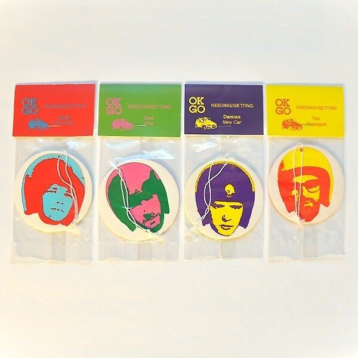

Современные поклонники хотят не просто сувениры, а что-то более практичное. Например, \*Fall Out Boy\* запустили линейку товаров для дома. Этот подход позволяет объединить фанатов и бренд даже в быту. Информацию об этом вы можете прочитать в статье ниже.

### **Где продавать мерч и как это организовать**

Чтобы продажа мерча на ивентах приносила максимальную выручку, важно правильно организовать его реализацию. Вот несколько вариантов:

1\. На своих сайтах. Создайте раздел для заказа мерча и предложите доставку.

2\. Через маркетплейсы. Это расширяет аудиторию и упрощает логистику.

3\. На мероприятиях.

### **Проблемы с продажей мерча на мероприятиях и как их решить**

**Организаторы сталкиваются с рядом трудностей при продаже мерча на ивентах:**

— Сколько производить? Если сделать мало, вы потеряете возможную прибыль. Если слишком много, могут возникнуть проблемы с недостаточным объемом продаж на мероприятии, и, соответственно, дальнейшими перевозкой, складированием, продажами того, что осталось.

— Запреты площадок. Иногда арендуемые стадионы или театры не разрешают продажу.

— Не вснегда уместно создавать очереди на плащадках.

— Деньги на месте. У многих посетителей может не оказаться с собой наличных для покупки мерча.

**Решения:**

1\. Предпродажа вместе с билетами. Так вы сможете предложить эксклюзивные коллекции, которые нельзя будет купить после ивента, спрогнозировать спрос, произвести то количество, на которое получили предоплаты.

2\. Лимитированные серии. Это создаёт дефицит и поднимает интерес.

Пример стратегии: после покупки билета пользователь попадает на страницу успешной оплаты, где ему сразу предлагают купить эксклюзивный мерч. После оплаты он получит второй электронный билет на выбранный товар, который можно забрать на мероприятии.

### **Качество как тренд 2024 года**

Сегодня зрители стали более разборчивыми: дешёвый и некачественный мерч уже не вызывает восторга. Люди хотят, чтобы футболки и худи сохраняли цвет и форму, а материалы были долговечными. Например, такие артисты, как \*Бейонсе\* и \*Канье Уэст\*, выпускают коллекции одежды высокого качества, создавая ощущение эксклюзивности.

Вкладывайтесь в качество, рассказывайте историю вашего бренда через мерч, и ваши фанаты будут готовы платить за этот опыт.

### **Почему мерч нужен каждому организатору**

Мерч — это не только способ увеличения доходов, но и возможность сделать ваше мероприятие незабываемым. Он дарит эмоции, создаёт ощущения причастности и продолжает работать на вас даже после завершения события. В мире, где опыт и впечатления становятся всё более важными, мерч — это канал связи с вашими посетителями, зрителями и поклонниками, который стоит использовать по максимуму.

Не упустите шанс стать ближе к вашей аудитории и при этом повысить прибыль!

### **Для нажатия кнопки КРЕАТИВНОСТЬ в ваших сердцах и умах еще примеры необычного мерча:**

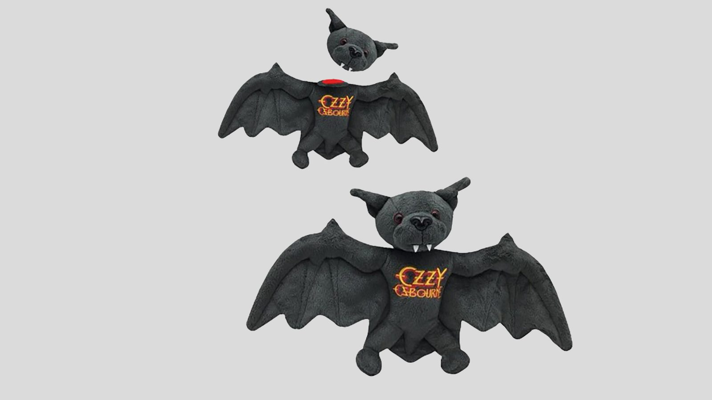

Легендарная история о том, как **Оззи Осборн** случайно откусил голову летучий мыши прямо во время концерта, нашла воплощение в мягком сувенире от Князя Тьмы.

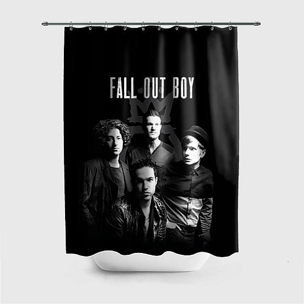

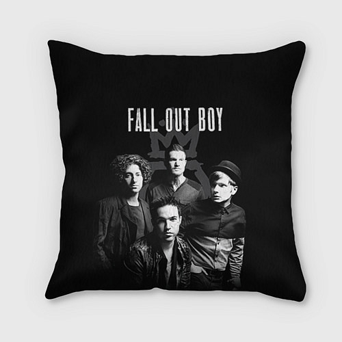

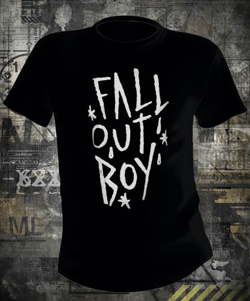

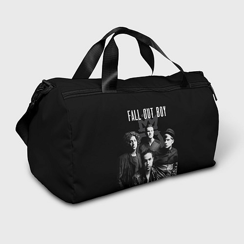

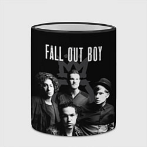

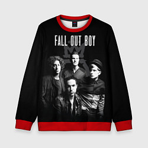

**Fall Out Boy** – выпускает целую линейку товаров для дома и повседневного использования – подушки, шторки для ванной, сумки, худи и ….даже бомбочки для ванны

«Они вкусно пахнут, но есть их нельзя!» – Предупреждает лидер группы Fall Out Boy Патрик Стамп. Ребята сделали не просто мыло, а бомбочки для ванны – кто как не рокер знает, как расслабиться после продолжительных туров в ванной с запахом лаванды.

**Weezer – Snuggie**

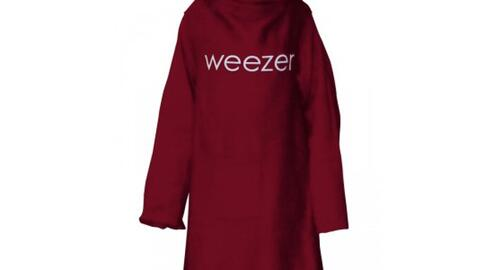

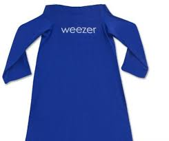

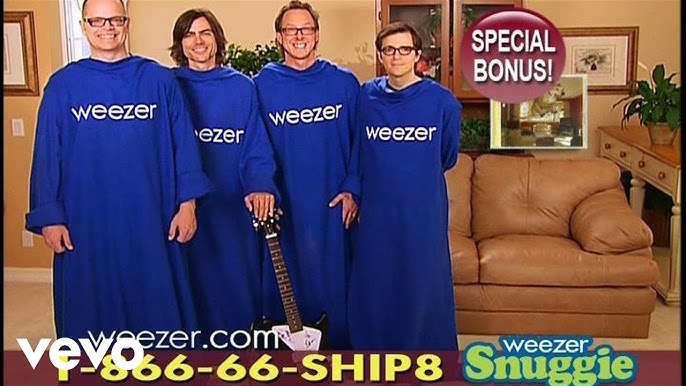

Необычная пижама от **рокеров Weezer** – что-то среднее между пледом и домашним костюмом. Музыканты специально сняли рекламу-презентацию в худших традициях «Магазина на диване». Получилось наглядно и круто. Согласитесь, вещь полезная

**Tenacious D – медиатор судьбы**

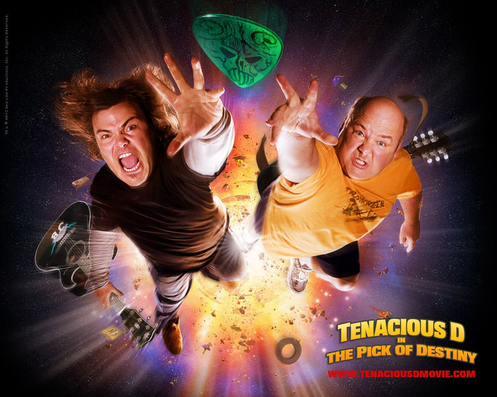

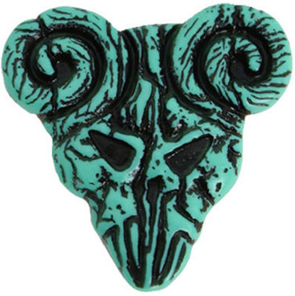

Неизвестно, насколько удобно играть на гитаре такой штукой. Но раз уж это сам медиатор судьбы, то есть вероятность, что откроются чакры и новые способности

**Элис Купер** – Шоколадное молоко имени себя

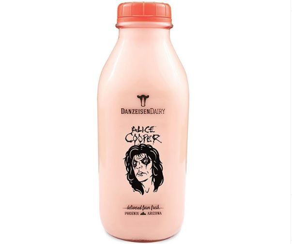

**Мерч с карманом для кота или собачки**

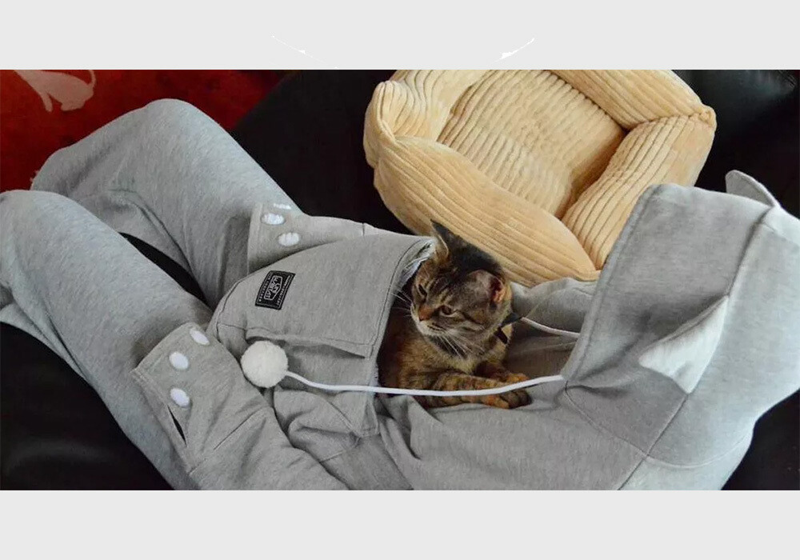

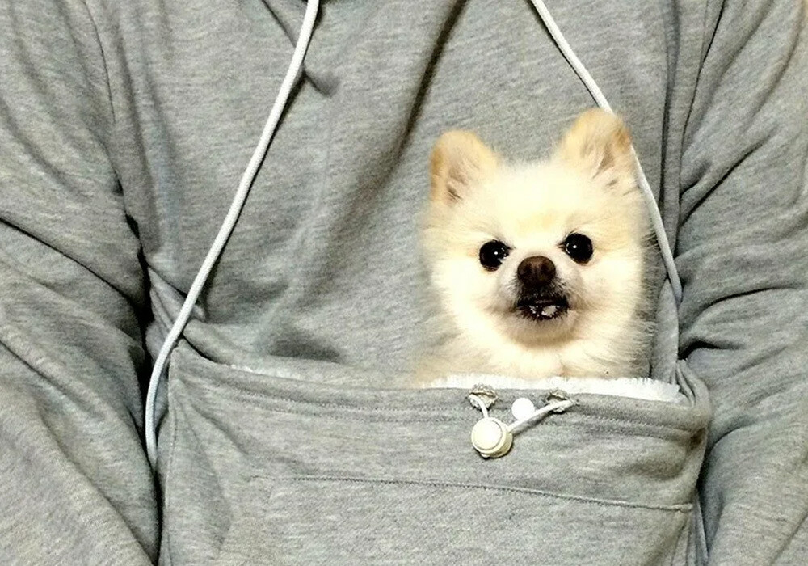

Ваши фанаты много сидят за компьютером и у них нет времени для обнимашек со своими питомцами? Все решаемо : )

Теперь питомец не будет лезть на клавиатуру и мешать печатать или играть. Он будет мирно спать в кармане худи, согреваясь теплом своего хозяина. Ну и ваша карма в порядке — котика не обидел, время и внимание уделил!

**Мерч со сменными стикерами**

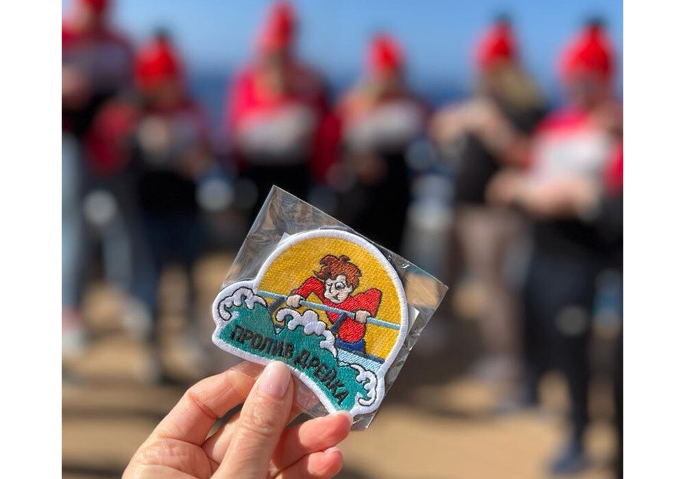

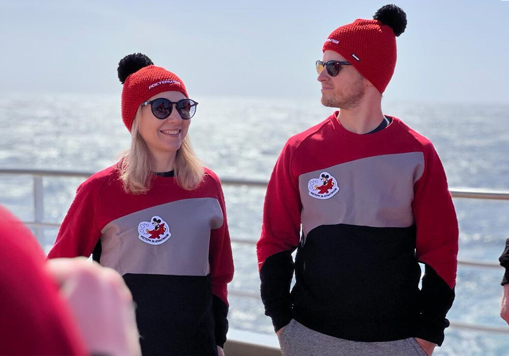

Идея со сменными стикерами открывает простор для фантазии. Можно создавать вещи в ваших фирменных цветах бренда, а к ним наклеивать разные надписи — в честь праздников, каких-то важных мероприятий или даже просто с логотипом бренда. А зону липучки можно сделать на разных вещах — худи, свитшотах, футболках, кепках, поясных сумках. Выбор за вами.

Также смненные стикеры можно еще и отдельно продавать в вашем интернет магазине.

Или делать уникальные для каждого концерта, фестиваля, мероприятия

**Мерч с мемами**

Мерч с мемами — классный способ выделиться из толпы и выразить свою индивидуальность. И всегда популярны также мемы, которые отражают актуальные события, их интерпретацию и комментарии. Люди могут использовать такой мерч для выражения своих эмоций и отношения к происходящему.

**Deadmau5 Наушники для кошек**

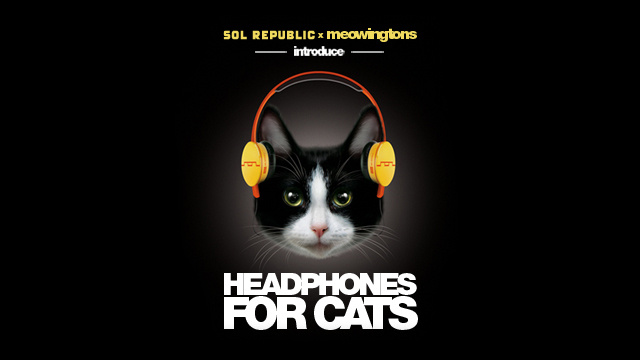

Deadmau5 совсем не наш персонаж, но мы очень любим животных и не можем не поддержать такое начинание. Канадский диджей позаботился о своем питомце и о многих других усатых и выпустил наушники, которые помогают им наслаждаться любимой музыкой вместе с хозяевами. Ну, возможно, не о многих других, ведь этот мерч выпускался ограниченным тиражом и стоил очень приличных денег

**Чемодан от AC/DC.**

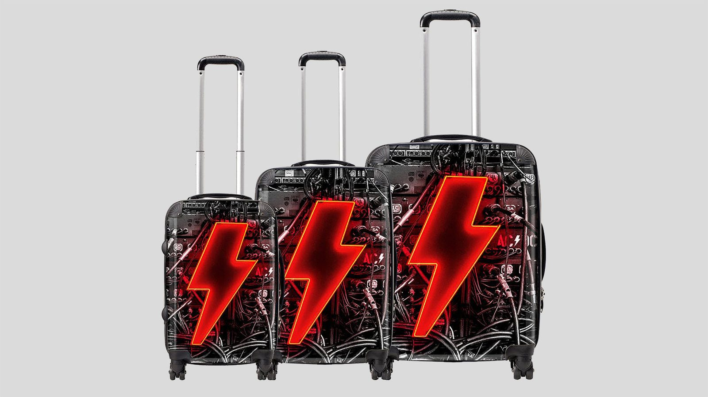

***Ваша фантазия может быть безграничной, важно, чтобы ваши посетители и фанаты чувствовали вашу заботу и хотели использовать тот мерч, который вы им будете предлагать***

### **И еще несколько хороших идей, которые мне встречались в этом году**

**ВАУ-эффект** от стильного, оригинального или остроумного подарка участникам делает его виральным. Фотографией с таким хочется поделиться в социальных сетях и отправить во все чаты.

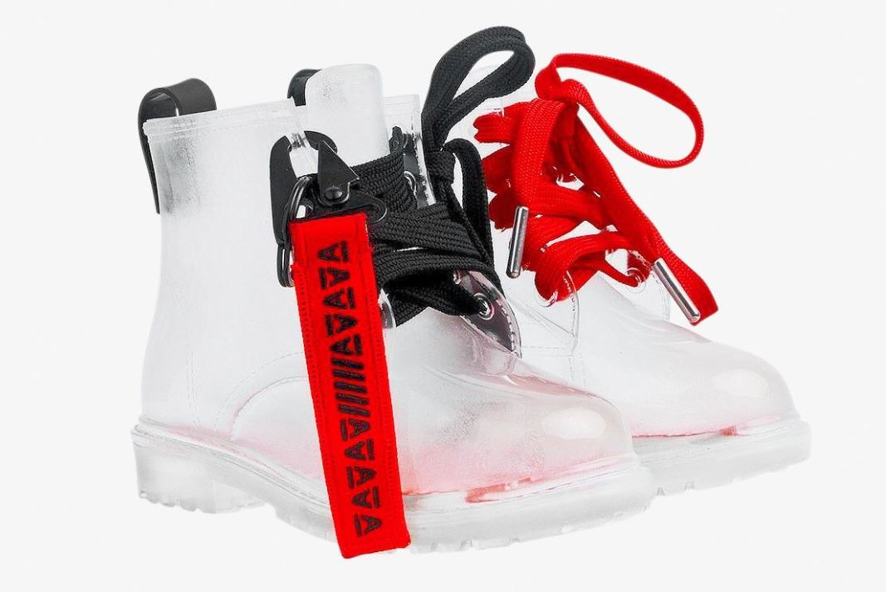

Прозрачные ботинки и дождевик – был просто лидером продаж для одного из организаторов с серией фестивалей.

**Мерч, созвучный** участникам, характеру, стилю и зрителю

Йога фестиваль радовал покупателей билетов брендированными ковриками для йоги, ароматическими маслами и аромолампами, солями для ванны и прочими антистресс предметами.

Для гастрольного тура фламенко одновременно с билетами можно было купить шали, кастаньеты, веера, элементы костюма. Представляете сколько фотографий вывесили в интернет те, кто купил?!!!! Думаю, все женщины, дети, и даже мужчины ждали и сфотографировались с такой красотой! Хорошо, что у организатора была заранее точная информация о количестве каждого наименования мерча, которую купили, заплатив предоплату, организатор не только получил предоплату, но и знал сколько нужно было привезти в каждый город, где проходили концерты этого тура. На предпродаже этого мерча организатор заработал почти столько же сколько и на продаже билетов. Это дополнительный доход организатора, это всегда важно.

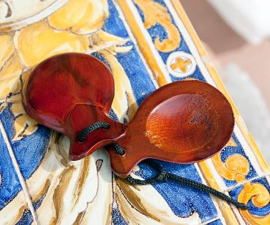

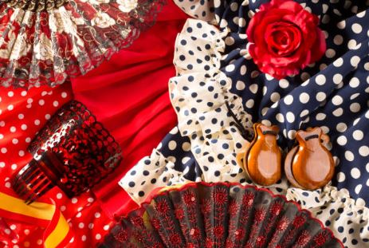

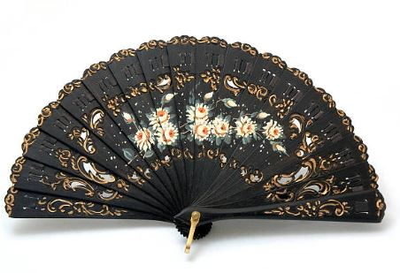

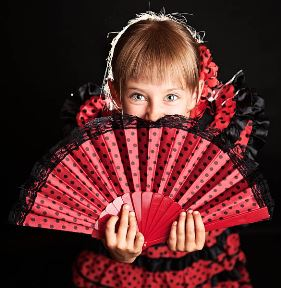

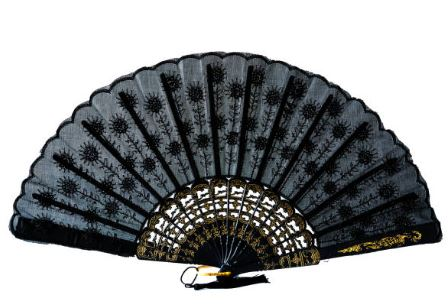

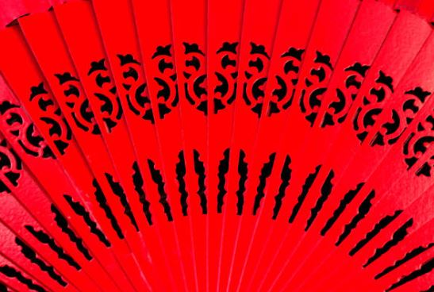

**Экомерч**

«Зеленый» тренд задал новые стандарты для мерча — никаких одноразовых вещей. Ручки и блокноты из переработанных материалов, спанбодовые или холщовые сумки, многоразовые бутылки для воды или металлические кружки с крышками.

**Временные татуировки**. Хороший способ идентификации своих интересов.

**Всегда интересен мерч с ироничными фразами**

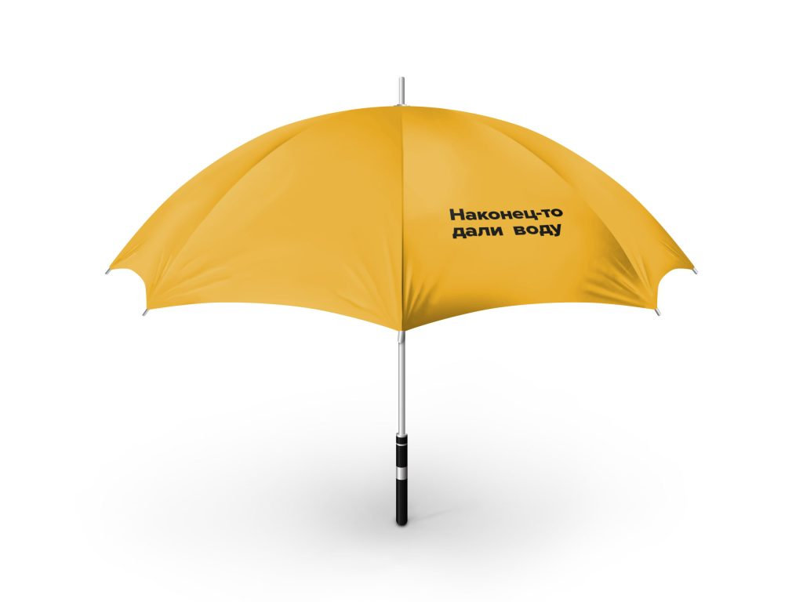

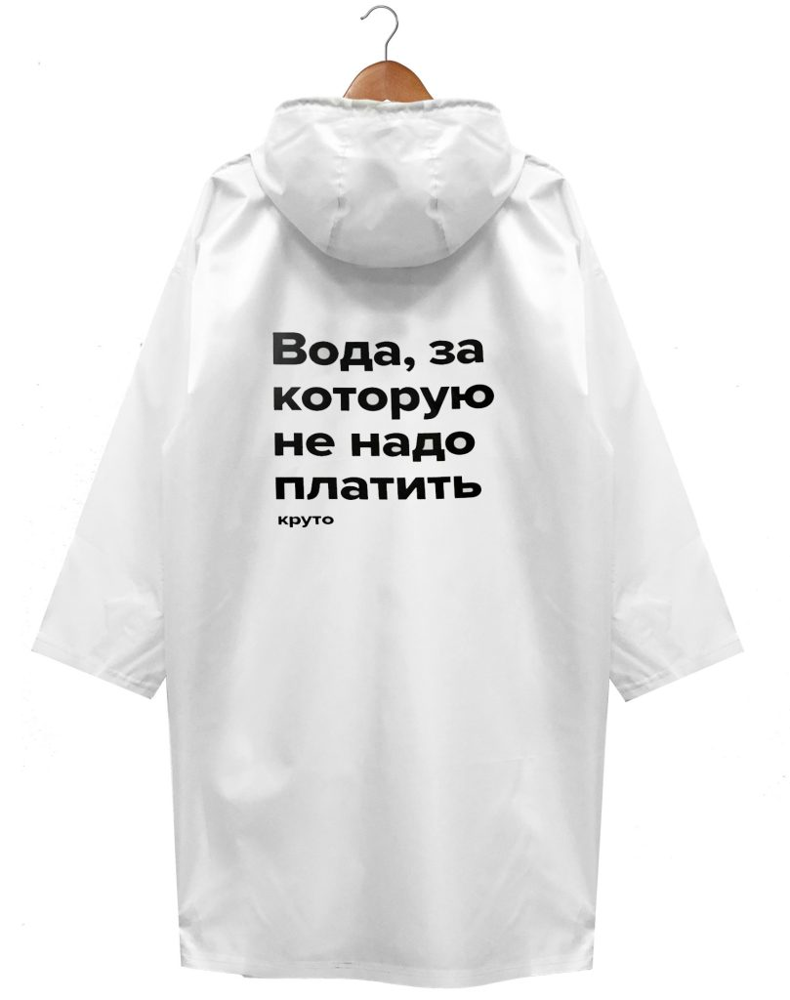

***Ваш креатив может быть бесконечен. И вы сможете благодаря отличному мерчу не только заработать, а также создать у ваших посетителей волшебное настроение и самые теплые впечатления о вашем мероприятии.***

И, конечно, о работе с билетной платформой для организаторов мероприятий, театров:

Все эти варианты вы можете легко реализовать, если вы работаете на билетной платформе ArenaSoldOut.com , Одновременно с продажей билетов на мероприятия вы можете продавать товары и услуги.

Если у вас есть вопросы, свяжитесь с нами через форму на сайте

*Автор: Марина Баканова, Co-Founder ArenaSoldOut.com*

[ВЕРНУТЬСЯ К СПИСКУ ПОЛЕЗНЫХ СТАТЕЙ](/ru/blog)
