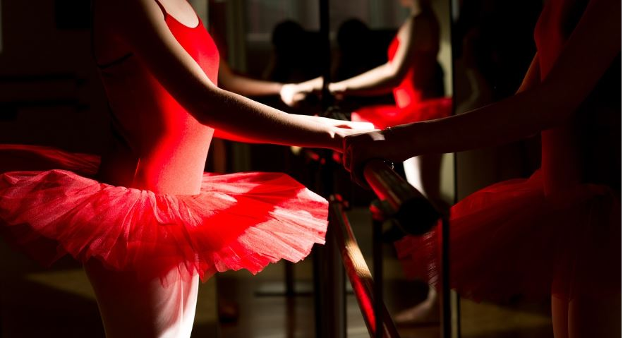
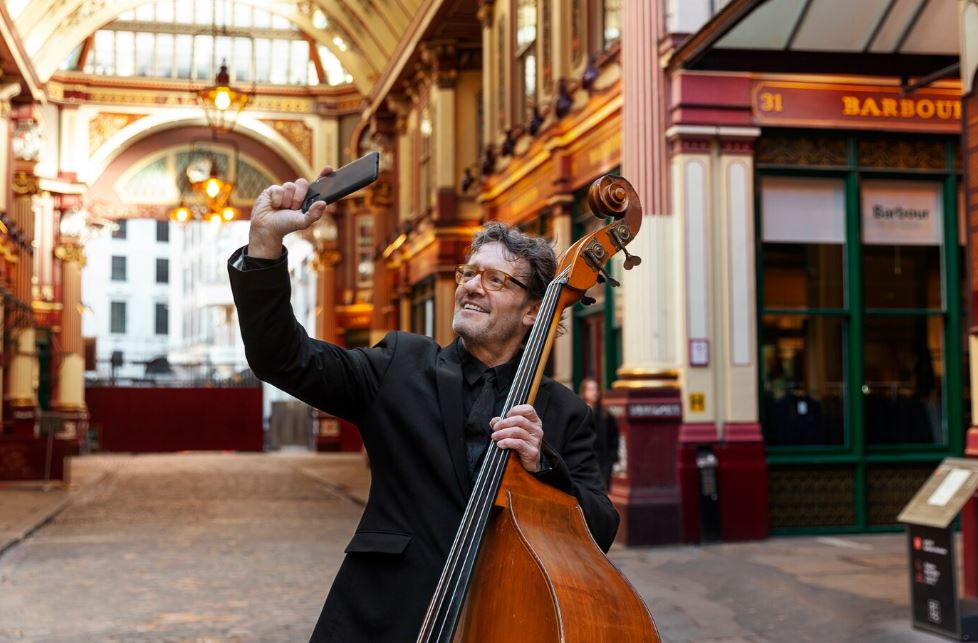

В мире развлечений искусство привлечения внимания к концертам и фестивалям неизменно эволюционирует. 2022 и 2023 годы принесли с собой ряд изменений в маркетинге и рекламе, повлиявших на различные музыкальные искусства и шоу-программы.

## **Классика и Балет: Элегантность в Каждом Движении**

Для концертов классической музыки и балета стали характерными тщательно выстроенные маркетинговые кампании, объединяющие элегантность и утонченность. Продажи билетов увеличиваются за счет уникальных подходов к рекламе, таких как трансляции пробных выступлений и дневные мероприятия вокруг театров и филармоний.

### ***Приведем несколько примеров:***

*Создатель Гала вечера звезд балета организовал «Танцевальный Челлендж», призывая зрителей создавать короткие танцевальные видео под определенный хореографический момент из предстоящего спектакля. Лучшие работы награждались билетами и встречей с артистами. Эта акция широко рекламировалась в соцсетях и привлекала как юных танцовщиков, так и родителей с детьми.*

*Организатор другого Гала Концерта предоставил бесплатные видео-уроки от знаменитых балерин и балетмейстеров, транслировал сюжеты из закулисья, привлекая аудиторию со всего мира.*

#### **Опера и Драма: Искусство во Всей Своей Красе**

Оперные представления и театральные постановки используют высококачественные видеоматериалы и фотосессии, чтобы донести красоту искусства до широкой аудитории. Партнерства с региональными бизнесами привлекают в театры новых фанатов.

***Один из европейских театров создал уникальную маркетинговую кампанию****, интегрировав сцены из спектакля в рекламные ролики для местных кафе и магазинов.*

#### **Уличные Перформансы и Сюрпризы: От Площадей к Продажам**

Уличные выступления стали не только искусством, но и эффективным маркетинговым ходом. Исполнение на улицах создает атмосферу участия, что влияет на продажи билетов.

***Пример: Оперная звезда, выступив на площади одного из мегаполисов****, сняла это выступление и, разместив в соцсетях,  привлекла внимание тысяч прохожих и зрителей социальных сетей. Этот живой и неожиданный контент стал мощным рекламным сигналом, вызывая спрос на предстоящие концерты.*

#### **Музыкальные Видео-Эксперименты: Звуки, Виды, и Билеты**

Видео-ролики с музыкантами, снятые в уникальных местах, привлекают внимание и вдохновляют зрителей. Это создает ассоциацию с живым выступлением и, соответственно, увеличивает продажи билетов.

***Пример: Музыкальные видео, снятые на природе или в исторических местах****, стали успешными аттракторами внимания. Они стимулировали продажи билетов на выступления музыкантов, распространяясь в соцсетях практически вирусно,  создавая необычное, но единое восприятие музыки и окружения.*

#### **Мюзиклы, Ледовые Шоу, Цирк и Танец: Эмоциональные Перформансы**

Эти виды искусства ориентированы на эмоции. Видеообзоры лучших моментов, онлайн-мастер-классы, backstage репортажи и танцевальные челленджи создают близость к артистам.

*Пример: Мировое турне ледового шоу включило челлендж для фанатов – Катание — воссоздайте лучшие движения на коньках, сделайте видео на коньках, или на роликах, Рисование – рисуйте картины о фигурном катании и поделитесь ими в соцсетях, чтобы принять участие в розыгрыше бесплатных билетов.*

#### **Поп-Музыка и K-pop: Социальные Сети и Виртуальные Встречи**

В этом сегменте важен активный онлайн-присутствие. Кампании в социальных сетях, интерактивные концерты, челленджи и виртуальные встречи с артистами – все это активно привлекает молодую аудиторию.

*Пример: K-pop группа провела онлайн-концерт с использованием расширенной реальности, где зрители могли взаимодействовать с артистами и окружающим миром через мобильные устройства.*

#### **Рок и Джаз: Сценическая Энергия и Импровизация**

Мир рока и джаза остается местом, где сценическая энергия требует выделенного подхода в маркетинге. Креативные видеоролики, виртуальные экскурсии по студиям и беседы с музыкантами привлекают публику. Оптимизированные цифровые кампании с использованием аудио и визуальных материалов становятся важными элементами.

*Пример: Рок-фестиваль в США запустил серию коротких роликов «За кулисами» в социальных медиа, предоставляя фанатам уникальный взгляд на подготовку к мероприятию и общение с артистами*.

#### **Какие Маркетинговые Акции Работают?**

Каждая из перечисленных маркетинговых акций оказала значительное воздействие на продажи билетов. Эффект участия, создание уникальности – вот ключевые элементы успешных маркетинговых акций в мире искусства. Подобные подходы делают искусство неотъемлемой частью повседневной жизни, что приводит к росту интереса и спроса на концерты и спектакли. Организаторы мероприятий могут успешно адаптировать эти стратегии, чтобы не только привлечь внимание, но и увеличить численность своей аудитории.

**Онлайн-трансляции классов балета, уличные перформансы оперных звезд, и музыкальные видео-эксперименты – искусство начало выходить за границы театральных стен, завоевывая внимание аудитории новыми творческими форматами.** 

**В 2022 и 2023 годах маркетинг и реклама мероприятий выходят на новый уровень, сочетая творчество и стратегические подходы. Артисты и организаторы активно используют креативность и средства онлайн-коммуникации, чтобы поддерживать востребованность искусства в динамичном мире развлечений.**
