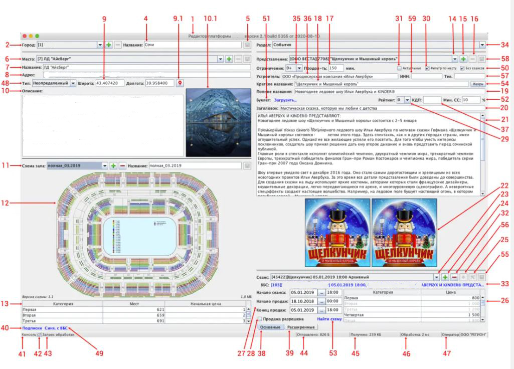

## «Хочу свой сайт для продажи билетов…»

Часто вижу проекты создания сайтов и мобильных приложений для продажи билетов на различные события, в том числе и размещенные на фриланс-биржах. По роду своей деятельности, я знаю немало реализаций таких проектов, в том числе и разочаровавших как заказчиков, так и исполнителей. Эта статья – краткий гайд по теме создания таких сайтов, написанная на основе личного опыта.

#### Заказчики, кто они?

Во-первых, сайт по продаже билетов нужен организаторам мероприятий. Ход мысли прост – зачем платить вознаграждение билетным агентам и операторам, если можно продать большую часть билетов самостоятельно. Экономика организаторов довольно жесткая, расходов полно: гонорар артиста, аренда зала, реклама, транспорт и т.п. А из доходов – только продажа билетов.

Во–вторых, это SEO-специалисты и интернет-маркетологи, которые решили применить свой опыт и попробовать силы в этой области. Ведь продажа билетов сильно зависит от позиции в поисковой выдаче Гугла.

В-третьих, владельцы площадок, мест проведения различных событий, которые хотят зарабатывать и на продаже билетов в том числе.

В-четвертых, это артисты, желающие продавать билеты самостоятельно.

Всех заказчиков можно разделить на две неравные части: тех, у кого уже есть опыт работы с различными билетными системами, и тех, кто имеет отдаленное представление о том, что это такое. Интересно, что последних все еще больше, чем первых.

#### Исполнители

В абсолютном большинстве случаев за изготовление таких сайтов берутся веб-студии, digital-агентства, фрилансеры и т.д. Названий много – суть одна: это команда или один веб-разработчик, которые сосредоточены на изготовлении «фронтенд» части и стараются не втягиваться в разработку «бэкенда». Часто, это их первый сайт подобной направленности.

#### Постановка задачи

Если упрощенно. Заказчик говорит: «…хочу сайт по продаже билетов, чтобы были карточки мероприятий, афиши, описания и схемы залов, где покупатель может выбрать места и оплатить их банковской картой, а так же хочу админку, чтобы эти мероприятия заводить и ими управлять. Хочу получать отчеты о продажах. Еще хочу, чтобы ссылки на мой сайт были в топе выдачи Гугл. При необходимости, хочу иметь возможность открыть продажу билетов для других билетных операторов и агентов, в режиме реального времени, из единого источника, без использования квот.»

Ну, или просто: «Хочу сайт по продаже билетов на мероприятия, а вы там придумайте, что да как…»

Удивительно, что находятся исполнители, которые берутся за такую работу именно как за создание сайта, а не как за создание билетной системы. При этом соглашаются реализовать проект за неадекватные количеству работы время и деньги. О бэкенде и процессинге билетов в этот момент никто не думает. Подразумевается, что «сделаем все сами».

#### Что нужно для продажи билетов?

1\. Схема зала, с местами или без (входные билеты). Места на схеме, как правило, с разными ценовыми категориями и тарифами (взрослый, детский и т.д.). На основе схемы необходимо создать событие с сеансами, у которых есть дата и время начала. Сохранить все в базе данных.

*Редактор событий платформы TixGear - ArenaSoldOut.com*

2\. Билетный процессинг, который будет принимать и обрабатывать заказы покупателей билетов, контролировать оплату, выпускать и отправлять покупателю билеты в электронном виде, со штрихкодами и QR-кодами, которые понадобиться на входном контроле. При необходимости осуществлять возврат билетов, с возвращением мест в продажу. Процессинг управляет статусами заказов, мест и билетов.

3\. Дополнительные сервисы: система отчетности, функционал для выгрузки билетов в Систему Контроля Доступа (СКД) площадки, выпуска и реализации промокодов, и т.д.

Около 80% кода для вышеперечисленного функционала реализуется на сервере (бэкенде), а не на сайте (фронтенде). В этом месте подход «сделаем все сами» превращает проект создания сайта в проект создания билетной системы, с неизбежными разговорами с заказчиком про деньги. Ведь дело в том, что заказчику нужен был сайт, а не очередная билетная система, и он не готов финансировать «изобретение велосипеда».

#### Оптимальный подход

Большинство успешных сайтов и мобильных приложений по продаже билетов имеют в качестве бэкенда билетную систему и работают с ней по API. В этом случае событие создается в билетной системе, используется ее процессинг, эквайринг, отчетность. Современные билетные системы имеют шлюзы в другие системы, что позволяет открыть продажи билетов для широкого круга билетных операторов и агентов.

При работе с билетной системой по API, исполнитель не ограничен в выборе дизайнерских решений для сайта, может создавать собственный удобный интерфейс и навигацию. Но самая важная и сложная часть при таком подходе: корректная и оптимальная реализация API билетной системы. А это, как показывает практика, доступно не всем веб-разработчикам.

#### Как выбрать билетную систему и исполнителя

Заказчик будет заводить свои события в билетную систему, и от ее функционала и удобства зависит многое. Стоит присмотреться к системам со следующими возможностями:

-   Использование открытого и развитого API.
-   Возможность для заказчика использовать собственный интернет-эквайринг
-   Возможность использования шлюзов в другие билетные системы.

При выборе исполнителя для создания сайта следует обратить особое внимание на наличие у него опыта реализации API, не обязательно «билетного». Для многих разработчиков сайтов реализация API – это сложно и неоправданно дорого. При выходе за рамки стандартной шаблонной разработки и необходимости реализовать даже простейший API, цена проекта может увеличиться в разы, а качество итогового продукта оставит желать лучшего.

#### В итоге

Разработать сайт или мобильное приложение для продажи билетов – задача несложная, но с нюансами. Для ее решения важно выбрать удобную билетную систему и качественно реализовать ее API. Все остальные вопросы менее значимы и решаются быстро.

Александр Орлов  
Software architect and team lead TixGear — ArenaSoldOut.com

ВАМ ТАКЖЕ МОЖЕТ БЫТЬ ИНТЕРЕСНО:

[Как начать продавать билеты на своем сайте. Пошаговый гайд](/ru/blog/kak-nachat-prodavat-bilety-na-svoem-sajte-poshagovyj-gajd) 

[Прочитать больше о том как сделать эффективный сайт для продажи билетов на мероприятия вы можете здесь](/ru/blog/11-sekretov-kak-sdelat-naibolee-privlekatelnuyu-i-prodayushhuyu-straniczu-vashego-meropriyatiya) 

Share this article with a friend

[ПредПриложения ArenaSoldOut.com. Краткий гайд.](/ru/blog/prilozheniya-arenasoldout-com-kratkij-gajd)

[Увеличение продаж на мероприятиях: инновационные шаги с ArenaSoldOut.comСледующая](/ru/blog/increasing-sales-at-events-innovative-steps-with-arenasoldout-com)
