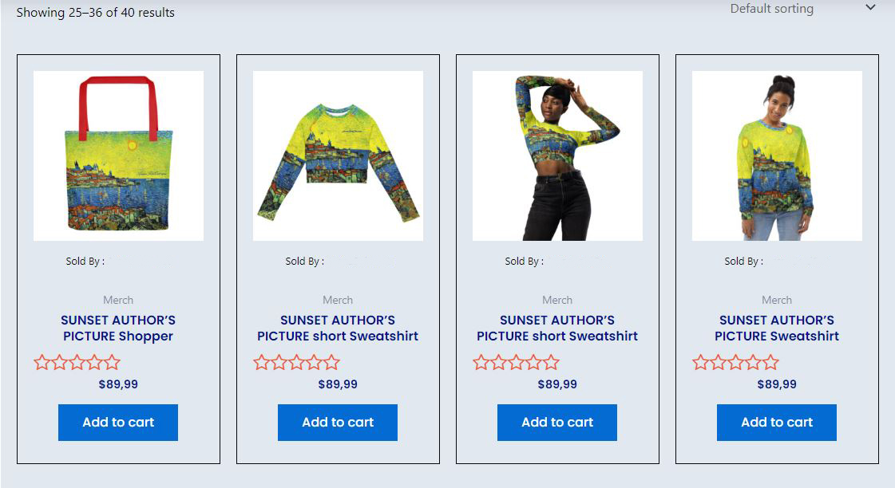

Если фраза «увеличение выручки и продаж» заставляет ваше сердце биться быстрее, пришло время сосредоточиться на этом, изучить возможности и выбрать подходящие для ваших мероприятий.

Вот 7 рекомендуемых нами методов максимально эффективно использовать возможности ArenaSoldOut.com и превратить каждое ваше мероприятие в наиболее прибыльное для вас.

## **Увеличивайте скорость продаж билетов**

Создавайте ажиотаж перед продажей. Анонсируйте момент начала продаж на своем сайте и в соцсетях.

**Запуск продаж – значимое событие, сделайте так, чтобы ваши клиенты ждали этого момента!**

Используйте все методы работы с Early Bird покупателями билетов, чтобы получить максимально возможные продажи на этом этапе.

Используйте ваши соцсети, создавайте там ажиотаж, делайте ограниченные предложения, чтобы ваша аудитория ожидала с нетерпением момент, когда вы откроете продажи и они смогут не только купить Early Bird, но и получить дополнительные бонусы, или Limited Edition предложения.

Многие организаторы беспокоятся о том, чтобы не слишком часто делать публикации в соцсетях. Конечно, если идет поток каждые 3 минуты, это может быть чрезмерным.

**Однако, когда речь идет о ваших мероприятиях, демонстрируйте то, что у вас есть!**  Большинство социальных сетей основаны на алгоритмах, поэтому вам придется публиковать сообщения несколько раз, чтобы вас заметили.

Информируйте свою аудиторию обо всех изменениях и предложениях. Создавайте ажиотаж и дефицит, часто даже намек на специальные предложения, или дефицит может становиться катализатором срочных продаж.

[Статью о методах эффективного запуска ранних продаж вы можете прочитать здесь](/ru/blog/8-shagov-dlya-zapuska-rannih-prodazh)

## **Подключайте партнеров к продажам**

Вы можете подключить к продажам билетов на каждое мероприятие нелимитированное количество партнеров и блогеров

Вы можете подключить к каждому мероприятию:

-   **Доверенных агентов**, позволить им собирать оплату за проданные билеты, и они будут расплачиваться с вами согласно вашим контрактам и договоренностям.

-   **Простых агентов**. В этом случае деньги за проданные агентами билеты будут поступать на ваш счет, и вы сами будете расплачиваться агентами этого типа согласно вашим контрактам и договоренностям.

-   Агентов, которые будут продавать за наличные и расплачиваться с вами согласно вашим контрактам и договоренностям (**Онлайн касса**).

Вы можете сами определять каковы условия вашего сотрудничества с каждым агентом, а также, например, какие размеры сервис сборов могут дополнительно ставить ваши партнёры по продажам, каждый партнер для каждого вашего мероприятия.

Также вы можете создавать индивидуальные виджеты продаж для каждого вашего партнера, или блогера и видеть сколько продаж принес вам каждый их них. Это сделает ваши расчеты с партнерами понятными и прозрачными.

**Приведу несколько примеров:**

-   Концертное агентство, работающее в разных странах, в каждой локации подключает афиши и сми, в том числе радиостанции, которые не только рекламируют событие, но и продают билеты на него на своих сайтах и в соцсетях.

-   Кабаре, работающее для туристов, подключило к продажам местные турагентства, киоски по продаже книг, журналов и киоски по продаже экскурсий, отели, которые стали продавать билеты на ежедневное шоу.

-   Организатор джазового фестиваля подключал к продажам отели своего города, туристические агентства, танцевальные студии, экскурсоводов, компании аренды яхт.

-   Организатор фестиваля латиноамериканских танцев активно продавал билеты через подключение к продажам отелей, радиостанций, блогеров, а также косметических и парикмахерских салонов своего города. В результате весь город танцевал на фестивале!

-   А туристический фестиваль подключал к продажам магазины снаряжения, туристической одежды, клубы спортивной ходьбы, ориентирования, фитнес центры и книжные магазины.

В этом направлении можно креативить почти бесконечно, важно, чтобы агенты знали вашу целевую аудиторию и контактировали с ней.

И еще один важный аспект должна упомянуть. Подключение агентов уменьшает ваши рекламные затраты, так как агенты становятся сами заинтересованы в продаже, и вы получаете контакты с представителями целевой аудитории без рекламных вложений.

## **Выбирайте наиболее эффективных партнеров по продажам и предлагайте им лучшие условия**

Ключ к росту ваших продаж заключается в идентификации наиболее прибыльных каналов, приносящих вам максимум продаж.

**Отличная новость заключается в том, что с помощью приложения Репортер ArenaSoldOut.com вы можете не только отслеживать все ваши продажи в реальном времени, но и узнавать, откуда пришли ваши покупатели.**

Это дает вам возможность увидеть, какие партнеры и блогеры сделали ваше мероприятие популярным, какие были успешны, а какие нет. Благодаря уникальной архитектуре платформы каждый Организатор может создавать неограниченное количество персонифицированных виджетов продаж – для каждого канала продаж индивидуально, или «Фронт-Эндов», как их чаще всего называют.

В отличие от Google Analytics, где основное внимание уделяется количеству кликов и переходов, на платформе ArenaSoldOut.com вы видите реальные продажи и их источники. Это позволяет вам точно настроить маркетинговые и рекламные стратегии, опираясь на полученные данные.

Используя в дополнение традиционные системы аналитики, вы сможете анализировать количество переходов и разрабатывать комплексный подход к аналитике, что значительно увеличит эффективность ваших маркетинговых и рекламных кампаний.

## **Пишите яркие мейлы своим покупателям**

С помощью ArenaSoldOut.com каждый организатор имеет возможность накапливать базу данных покупателей по всем местам проведения своих мероприятий. В эру приложений и социальных медиа email-маркетинг для событий продолжает оставаться эффективным инструментом.

Не надейтесь на память ваших клиентов, не ограничивайтесь одним письмом, которое вы высылаете за полгода до мероприятия, а также на ленты новостей соцсетей, пишите эмоциональные письма, чтобы ваши клиенты стали взволнованы возможностью успеть купить билеты на ваши новые мероприятия и ожидали старта продаж, чтобы узнавали об изменениях и ваших специальных предложениях.

## **Используйте сервис сбор для увеличения выручки**

В организации мероприятий каждый цент имеет значение. Организатор сталкивается с множеством издержек, но также может увеличить свой доход. На сегодняшний день покупатели билетов привыкли к сервисному сбору, и вы можете использовать это.

ArenaSoldOut.com позволяет настраивать сервисный сбор для каждого мероприятия и партнера по продаже индивидуально.

При продаже через ваш сайт вы также можете взимать сервисный сбор. Покупатели уже привыкли платить сервисный сбор, поскольку большинство билетных сервисов включают этот сбор за обработку и оформление билетов онлайн.

Используя нашу доступную цену и зная среднюю стоимость эквайринга, вы можете устанавливать комиссию, которая позволит не только окупить издержки, но и заработать дополнительно.

Продажа билетов направлена на получение прибыли. Мы видим, что ряд клиентов зарабатывает на этом не мало, интеллигентно управляя размером сервисного сбора.

Дополнительный заработок может сделать вас успешным организатором, который будет продолжать эффективную работу, в отличие от тех, кто вынужден покинуть рынок.

Разумно увеличивайте размер сервисного сбора.

Важно не утопать в сервисных сборах, как это делают некоторые билетные системы, которые завышают цену на билеты на 100%. Установите разумный сервисный сбор, который увеличит ваш доход, не потеряв при этом лояльность ваших клиентов.

## **Продавайте товары и услуги своим посетителям**

Если вы не предоставляете дополнительные возможности для покупок, вы упускаете возможность дополнительного заработка )) Многие эффективные, успешные организаторы зарабатывают на продажах дополнительных товаров и услуг не меньше, чем на продаже билетов.

Более 15% посетителей будут приобретать дополнительные товары, если им будет предложено.

Предлагайте товары, VIP-услуги, закуски, напитки, развлечения и многое другое, чтобы сделать ваше мероприятие наиболее привлекательным и вдохновляющим для гостей.

Посетители уже на вашем сайте, значит, многие из них воодушевлены, заинтересованы и готовы потратить деньги.

Помимо билетов, предложите дополнительные варианты, например, приобрести оригинальные или уникальные футболки, свитшоты, сумки или оригинальные сувениры, например, с автографами, или высказываниями артистов.

Вы можете также продать дополнительные билеты на встречу с знаменитостью, на фотосессию,  на оригинальную акцию, или даже на парковку; ваши возможности ограничены лишь вашей фантазией и организационными возможностями.

Предварительная продажа пары бокалов пива, бокалов шампанского, сладостей или попкорна поможет сократить очереди на мероприятии.

**Получать дополнительную предоплату всегда приятно, верно?** Особенно если, например, футболки выпускаются ограниченным тиражом, что повышает их привлекательность для покупателей, но при этом позволяет вам избежать излишних затрат на производство, ведь вы заранее будете знать количество футболок, которое вам необходимо произвести.

После совершения предварительной покупки посетители становятся более склонными к тратам на самом мероприятии после того, как они получили продукт, купленный ранее. Это психологически облегчает расходы в день мероприятия и стимулирует дальнейшие покупки на мероприятии.

## **Привлекайте спонсоров и рекламодателей**

Кроме того, что вы можете предлагать спонсорам и рекламодателям размещение их логотипов на рекламе, на вашей странице мероприятия, а также в месте проведения, проведение различных акций, вы также можете располагать информацию о спонсорах и логотипы на билетах.

ArenaSoldOut.com предоставляет вам возможность создавать билеты с индивидуальным дизайном и разными размерами для каждого мероприятия.

Размещение логотипа спонсора и информации о спонсоре, или рекламодателе на билетах — это самая очевидная выгода, ведь каждый покупатель увидит билет несколько раз – после получения, перед мероприятием, когда будет проверять не утерян ли билет, а также прямо на входе,  в отличие от того, что на больших плакатах, или на сайте в нижней части сайта посетитель может просто не увидеть информацию о спонсоре.

***Пока вы являетесь организатором мероприятий, у вас есть множество способов увеличить продажи и выручку. Никогда не сдавайтесь!*** ***Идите только вперед и расширяйте свой бизнес!***

***Мы здесь и мы работаем для того, чтобы ваши мероприятия были всегда успешными!***

*Искренне ваши,*

*Марина и команда ArenaSoldOut.com*

### Вам также может быть интересно:

[Организаторы мероприятий в центре событий: блестящий переход к прямому доступу к выручке](/ru/blog/organizatory-meropriyatij-v-czentre-sobytij-blestyashhij-perehod-k-pryamomu-dostupu-k-vyruchke)

[8 шагов для запуска ранних продаж. Когда посетители мероприятия покупают билеты заранее, это не только упрощает процесс планирования и увеличивает продажи, а также дает вам бонус в виде раннего поступления денежных средств!](/ru/blog/8-shagov-dlya-zapuska-rannih-prodazh)

[Увеличение продаж на мероприятиях: инновационные шаги с ArenaSoldOut.com](/ru/blog/increasing-sales-at-events-innovative-steps-with-arenasoldout-com)

[11 секретов как сделать наиболее привлекательную и продающую страницу вашего мероприятия](/ru/blog/11-sekretov-kak-sdelat-naibolee-privlekatelnuyu-i-prodayushhuyu-straniczu-vashego-meropriyatiya)

[База Покупателей: ключевой актив организаторов мероприятий](/ru/blog/baza-pokupatelej-klyuchevoj-aktiv-organizatorov-meropriyatij-na-biletnyh-platformah)
