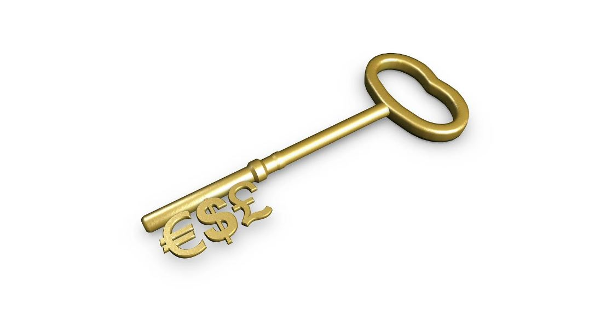

В динамичном мире управления событиями способы доступа организаторов к выручке от продажи билетов претерпевают существенные изменения. Последние годы свидетельствуют о значительном сдвиге в предпочтении организаторов в пользу прямого подключения к продажам и мгновенного получения средств от каждого проданного билета на свои счета. Этот переход – не просто каприз, а стратегическая необходимость, устраняющая риски, связанные с финансовыми неопределенностями посредников в отрасли.

## **Плавание в финансовых бурях: Опасности, связанные с Билетными Операторами и Платформами**

Организаторы сталкиваются с тревожными ситуациями, когда билетные операторы и платформы, ответственные за сбор выручки от продажи билетов, либо банкротятся, либо задерживают выплаты. Эти сценарии не только подчеркивают риски, присущие зависимости от посредников для ключевой выручки от продажи билетов, но и могут повлечь за собой серьезные последствия для организаторов.

### **Опасные Последствия для Организаторов**

Возможные последствия от остановок выплат или задержек в оплате многогранны. Организаторы, инвестирующие существенные ресурсы в планирование, маркетинг и проведение мероприятий, оказываются в непростом финансовом положении, когда финансы оказываются под вопросом. От сбоев в операционной деятельности до компрометации качества мероприятий из-за бюджетных ограничений – последствия подобных ситуаций могут быть серьезными. Кроме того, репутационный ущерб может потребовать много времени на восстановление.

### **Прямой Доступ к Выручке: Стратегическая Необходимость**

Призывы организаторов к прямому подключению к продажам и мгновенному получению средств на свои счета от организаторов– это не просто логистическое предпочтение; это стратегическая необходимость. Платформы, предоставляющие эту функцию, предлагают организаторам серьезное преимущество, которое охватывает как краткосрочное, так и долгосрочное планирование.

### **Прямое получение средств от продажи билетов организатором как Тактическое Преимущество**

На тактическом уровне прямой доступ к выручке решает проблемы кассовых разрывов, позволяя организаторам быстро получать и эффективно распределять средства. Это обеспечивает бесперебойное проведение мероприятий без тревог, связанных с задержками в выплатах. Организаторы могут уверенно выполнять финансовые обязательства – от выплат поставщикам до маркетинговых инициатив, обеспечивая более плавную операционную деятельность и повышение качества мероприятий.

### **Стратегические Преимущества: Доверие и Стабильность**

Со стратегической точки зрения платформы, обеспечивающие прямое подключение к платежам за проданные организаторами билеты, играют важную роль в построении доверия. Организаторы могут полагаться на стабильные финансовые основы, повышая свою способность инвестировать в будущие мероприятия и расширять деятельность своего бренда. Прозрачность и финансовая устойчивость, предоставляемые такими платформами, становятся основой для долгосрочных партнерств и сотрудничества.

### **ArenaSoldOut.com: Поднятие Прямого Доступа к Выручке на Новый Уровень**

В контексте билетных платформ ArenaSoldOut.com выделяется, революционизируя концепцию прямого доступа к выручке. Каждый организатор на этой платформе подключен к своим счетам (эквайрингам) для каждого мероприятия, что позволяет им прямо получать средства от покупателей за каждый проданный билет. Эта функция добавляет беспрецедентную ценность, гарантируя, что финансовый успех каждого мероприятия остается твердо в руках его организатора.

## **Вывод: Прямой Доступ к Выручке – Краеугольный Камень Преимущества**

В заключение  — **требование прямого подключения к продажам** и мгновенного получения средств организаторам отражает себя в существенном изменении финансового ландшафта отрасли. Это не просто удобство – это **мощное преимущество для организаторов мероприятий.** Платформы, которые имеют возможность работать таким способом, не только тактически усиливают деятельность своих клиентов, но и стратегически способствуют доверию и стабильности. В отрасли, где финансовые неопределенности подстерегают на каждом шагу, способность обеспечить прямой доступ к выручке – это не просто функция. Это изменение правил игры, которое определяет успех и стойкость организаторов мероприятий.

##### Вам также может быть интересно:

[Не очевидные, но эффективные методы увеличения выручки и продаж организаторами мероприятий](/ru/blog/ne-ochevidnye-no-effektivnye-metody-uvelicheniya-vyruchki-i-prodazh-organizatorami-meropriyatij) *Если фраза «увеличение выручки и продаж» заставляет ваше сердце биться быстрее, пришло время сосредоточиться на этом*

[Увеличение продаж на мероприятиях: инновационные шаги с ArenaSoldOut.com](/ru/blog/increasing-sales-at-events-innovative-steps-with-arenasoldout-com)

[11 секретов как сделать наиболее привлекательную и продающую страницу вашего мероприятия](/ru/blog/11-sekretov-kak-sdelat-naibolee-privlekatelnuyu-i-prodayushhuyu-straniczu-vashego-meropriyatiya)

[База Покупателей: ключевой актив организаторов мероприятий](/ru/blog/baza-pokupatelej-klyuchevoj-aktiv-organizatorov-meropriyatij-na-biletnyh-platformah)

[Как начать продавать билеты на своем сайте. Пошаговый гайд](/ru/blog/kak-nachat-prodavat-bilety-na-svoem-sajte-poshagovyj-gajd)

[25 вариантов скидок для повышения продаж билетов на мероприятия](/ru/blog/25-variantov-skidok-dlya-povysheniya-prodazh-biletov-na-meropriyatiya)

[Как превратить мерч в инструмент продвижения и увеличения дохода: гид для организаторов мероприятий](/ru/blog/kak-prevratit-merch-v-instrument-prodvizheniya-i-uvelicheniya-dohoda-gid-dlya-organizatorov-meropriyatij)

[Организаторы мероприятий в центре событий: блестящий переход к прямому доступу к выручке](/ru/blog/organizatory-meropriyatij-v-czentre-sobytij-blestyashhij-perehod-k-pryamomu-dostupu-k-vyruchke)

[11 секретов как сделать наиболее привлекательную и продающую страницу вашего мероприятия](/ru/blog/11-sekretov-kak-sdelat-naibolee-privlekatelnuyu-i-prodayushhuyu-straniczu-vashego-meropriyatiya)

[Не очевидные, но эффективные методы увеличения выручки и продаж организаторами мероприятий](/ru/blog/ne-ochevidnye-no-effektivnye-metody-uvelicheniya-vyruchki-i-prodazh-organizatorami-meropriyatij)

[Работа с клиентами – залог успешности вашего бизнеса, или зачем и как поддерживать связь с клиентами](/ru/blog/rabota-s-klientami-zalog-uspeshnosti-vashego-biznesa-ili-zachem-i-kak-podderzhivat-svyaz-s-klientami)

[Сервисный сбор при продаже билетов: Управление стоимостью и лояльностью покупателей](/ru/blog/servisnyj-sbor-pri-prodazhe-biletov-upravlenie-stoimostyu-i-loyalnostyu-pokupatelej)

[8 шагов для запуска ранних продаж](/ru/blog/8-shagov-dlya-zapuska-rannih-prodazh)

[Билеты с местами или без: что лучше для вашего мероприятия и как это влияет на продажи?](/ru/blog/bilety-s-mestami-ili-bez-chto-luchshe-dlya-vashego-meropriyatiya-i-kak-eto-vliyaet-na-prodazhi)
