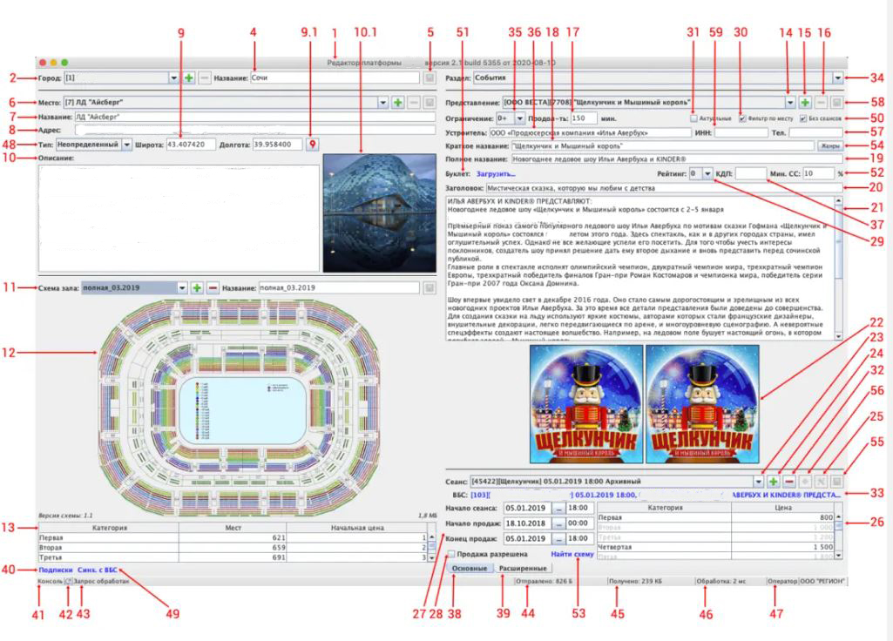
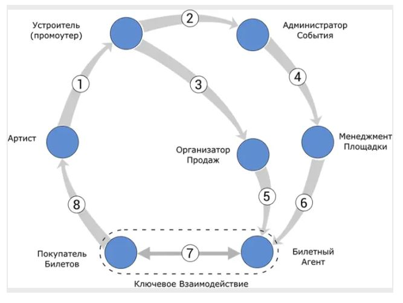

## Быстро создать собственную билетную платформу. Возможно ли это?

В статьях [«Классика жанра»](/ru/blog/classics-of-the-genre-or-make-me-a-site-for-selling-tickets-quickly)  и [«Хочу свой сайт для продажи билетов…»](/ru/blog/my-own-site-for-tickets-sold)  я уже описывал разработку сайтов, отталкиваясь от множества однотипных заказов, размещаемых на фриланс-биржах. В этой статье хочу уделить внимание смежному множеству задач из тех же краев. Речь пойдет о создании билетных платформ, по усредненной постановке:

*«Хочу свою собственную платформу, как Eventbrite или Ticketmaster, бюджет – 1000 баксов».*

#### Зачем эта статья?

Думаю, что заказчики платформ в массе своей профессионалы с опытом организации событий и продажи билетов через свои и чужие сайты, мобильные приложения, социальные сети. Они уже использовали системы основных участников рынка, и этот опыт привел их к желанию создать собственную платформу для управления событиями и продажами. Как правило, они хорошо понимают, как все устроено организационно, и не осознают, как все работает технически. И это причина неверной оценки работы по созданию платформы в начале проекта, и фрустрации в конце.

Чтобы предупредить, предостеречь и предотвратить, а также, дабы не рассказывать много раз одно и то же устно, я решил написать эту статью.

#### Что нам стоит дом построить. Нарисуем - будем жить

Сравним, хотя бы приблизительно, создание сайтов (frontend) и платформы (backend) со строительством домов в городе. Предположим, у профессионального застройщика уже есть несколько зданий (сайтов), удачно построенных и подключенных к коммуникациям, таким как электроэнергия, тепло, вода, канализация. Эти дома приносят прибыль, но за коммуникациями виднеется Power Plant и элекстрическая компания (платформа), которой надо постоянно платить.

В какой-то момент, застройщик решает, что ему нужна собственная Power Plant, чтобы класть деньги за «коммуналку» в свой карман, и не только от своих жильцов, но и от жильцов других домов, построенных другими заказчиками. Мыслится так: «Круто же! Кто как не я, съевший собаку на строительстве и обустройстве города, достоин собственной Power Plant». Добавляет масла в огонь то, что с улицы Power Plant выглядит просто «коробкой», даже поменьше тех, что заказчик уже строил. Вот так, по внешнему виду здания Power Plant и определяется ее цена — пресловутая тысяча баксов.

*Power Plant как backend*

Что ускользнуло от внимания заказчика? Верно, вся начинка Power Plant, которая сильно сложнее, технологичнее, и, как следствие, дороже его домов-сайтов. Заказчика не смущает, что здания (сайты) ему собрали на одной из популярных CMS за неделю, а Power Plant строят олго и специализированные компании. Ему не важно, что Power Plant бесконечно эволюционирует в руках опытных разработчиков. Заказчик — умный, и найдет «свободного каменщика» на фриланс-бирже, который за пару недель построит ему «вот точно такую Power Plant, только меньше и другую».

#### Продолжая метафору. Что под капотом?

Обычному жильцу дома, совершенно не видно и абсолютно не интересно откуда в его квартире берется тепло, горячая вода и электроэнергия. Очевидно, у среднестатистического пользователя околонулевые знания как о внутреннем устройстве Power Plant, так и о том, как «коммуналка» поступает в его квартиру по API. Жильцу главное, чтобы было бесперебойно тепло, светло и сухо, чтобы телевизор, компьютеры и вся бытовая техника работали. Точно также, и покупателю билетов нужно быстро и за минимум кликов купить билеты на понравившиеся места, без изучения внутреннего строения платформы.

Проблема в том, что «тысячедолларовый заказчик» смотрит на платформу как обычный покупатель билетов, ошибочно полагая, что сайт (frontend) – это и есть большая часть платформы, и представляя, что чем меньше кликов – тем проще система. А это совсем не так. Во-первых, frontend обычно составляет не более 20% проекта, тогда как backend – 80% и более.

А во-вторых, чем меньше кликов делает пользователь, тем больше действий делает за него платформа. В итоге выходит, что центральный сервер платформы — сложная штука, которая старается сделать все сама, уменьшив количество действий пользователей всех ролей до возможного минимума.

Обрисую крупными мазками некоторые процессы в билетной платформе, которые надо бы реализовать за 1000 USD:

**Продажа билета** – это ключевое взаимодействие платформы, то, ради чего все и затевалось. Чтобы продать даже один, самый маленький билетик, надо дать возможность пользователю выбрать событие и сеанс, показать ему схему зала, где у каждого места есть координаты (сектор, номер ряда, номер места), статус (свободно, забронировано, продано), ценовая категория, тариф (например, взрослый или детский). Наглядно понять, сколько параметров и настроек нужно задать и сохранить (в быстрой СУБД) для вывода события в продажу можно по скриншоту главного окна Редактора Событий платформы TixGear — ArenaSoldOut.com .

*Редактор событий платформы TixGear - ArenaSoldOut.com*

Центральный сервер платформы должен уметь отдавать по API актуальную на данный момент схему зала сотням, и даже тысячам покупателей билетов одновременно. При этом покупатели буду конкурентно резервировать желаемые места на время совершения покупки, оформлять их в заказ и оплачивать его через интернет-эквайринг. Для этого, на сервере должен работать мощный процессинг, корректно выполняющий и, при необходимости, откатывающий назад транзакции множества покупателей, действующих в одно и то же время. Это технологически непростая задача, и да, здесь есть много возможностей сделать все плохо.

После успешной оплаты, необходимо выпустить билет по созданному организатором шаблону, разместить на нем штрихкод и/или QR-код для системы контроля доступа. Часто, данные билета, штрихкод и QR-код нужно своевременно получить из внешней системы. После формирования билета, егот необходимо отправить покупателю на email или в мобильный мессенджер. А если пользователь захочет вернуть билет, то нужно присвоить билету статус «возвращен» и вернуть в продажу место, на которое он был куплен.

#### Роли пользователей и их взаимодействие.

Любая платформа – это, прежде всего, про роли пользователей, их взаимодействие в экосистеме и сетевые эффекты. Основные роли пользователей в платформе для билетного рынка — это Организатор, Агент и Покупатель билетов.

*Цикл взаимодействия пользователей*

В арсенале платформы должны быть инструменты для организаторов, позволяющие разрешать или запрещать агентам продавать билеты на события через их собственный интернет-эквайринг и кассы. Для агентов нужны инструменты управления продажами: настройки интерфейсов, эквайринга, сервисного сбора и т.п. Для покупателей билетов необходим личный кабинет.

**API экономика (API Economy)** – важнейшая часть мира платформ, или наоборот (как кому нравится). С помощью API билетные платформы как получают информацию о событиях, сеансах, схемах, местах и ценах, так и отдают её. Создание современной платформы без собственного API и реализации множества API сторонних систем – довольно бессмысленное занятие.

Все вышеописанные процессы никак не впихнуть в 1000 USD. В этом смысле сделать за тысячу практически равно сделать бесплатно. Но стоит понимать, что всегда найдутся альтернативно одаренные фрилансеры, которые пообещают, и даже сделают платформу за указанную цену. Но она точно не понравится заказчику, да и, фактически, не будет являться платформой.

#### Как мы создаем платформу и сколько уже потратили

Мы, как команда разработчиков, создаем платформу TixGear — ArenaSoldOut.com с 2015 года. Уже потрачено около 40 000 нормо-часов, и платформа продолжает эволюционировать с ускорением. Исходя из рыночной стоимости нормо-часа опытного разработчика, можно прикинуть, во сколько реально обходится только создание (не эксплуатация) такой платформы.

Очень хочется свою платформу. Как быть?  
Воспользовавшись услугой [Собственная платформа](/blog/platform-as-a-service-paas) , можно сразу начать работать, подключать клиентов и оттачивать бизнес-процессы, пропустив длительный и затратный этап разработки. С этой услугой, заказчик-застройщик сразу получает собственную «виртуальную Power Plant», подключает к ней свои и чужие дома-сайты. С полной техподдержкой. Довольно удобно, если не сказать больше.

Александр Орлов  
Software architect and team lead TixGear — ArenaSoldOut.com

ВАМ ТАКЖЕ МОЖЕТ БЫТЬ ИНТЕРЕСНО:

[Собственная билетная платформа. Как ее создать](/ru/blog/sobstvennaya-biletnaya-platforma-kak-ee-sozdat)

[Как начать продавать билеты на своем сайте. Пошаговый гайд](/ru/blog/kak-nachat-prodavat-bilety-na-svoem-sajte-poshagovyj-gajd)

Share this article with a friend

[ПредЧем Билетная платформа отличается от Билетной системы](/ru/blog/chem-biletnaya-platforma-otlichaetsya-ot-biletnoj-sistemy)

[Собственная билетная платформа. Как ее создать.Следующая](/ru/blog/sobstvennaya-biletnaya-platforma-kak-ee-sozdat)
