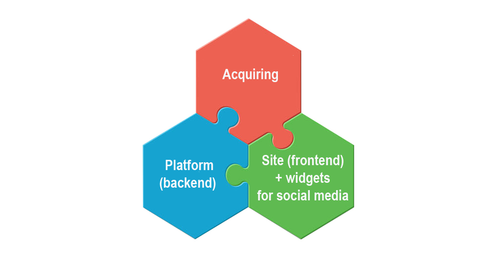
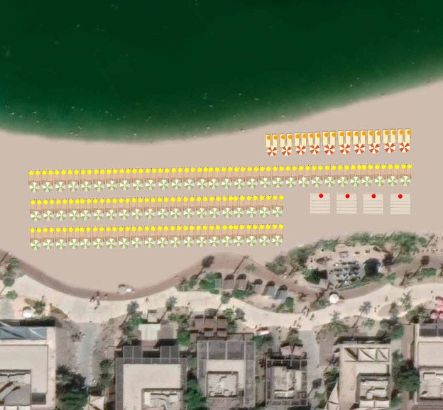
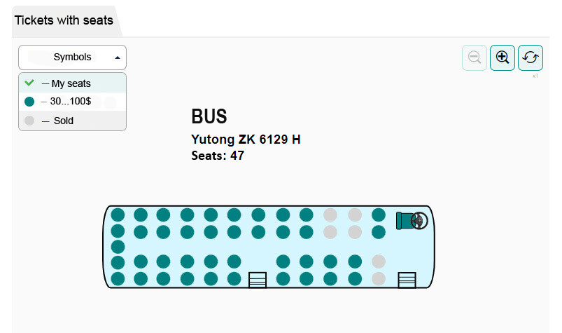
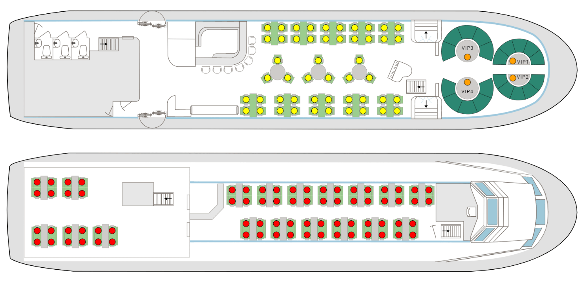

### Вывод экскурсий в продажу: способы, инструменты, пошаговые инструкции

*Многие сайты и мобильные приложения, где предлагается посетить экскурсии разных видов, не предусматривают оплату экскурсий с помощью банковской карты, через интернет-эквайринг. Не предусматривают такую оплату, где весь процесс автоматизирован и происходит без участия продавца. Наверное, у создателей этих сайтов и приложений есть много причин, чтобы заставлять клиента оставлять заявку, заказывать звонок, нагружать сотрудников общением с каждым клиентом, но есть ощущение, что эта технология продаж устарела. Если можно предложить посетителю сайта сразу оплатить понравившуюся экскурсию, а также дополнительные товары и услуги, то почему этого не сделать? Зачем все эти заявки и звонки? Нормально взять деньги ДО экскурсии, ведь не принято брать деньги ПОСЛЕ.*

И еще о важном. Хорошо, когда с экскурсией можно продать сопутствующие товары и услуги, например, еду, напитки, сувениры и атрибутику. Предложить туристам всего и побольше. Для этого, неплохо бы знать, сколько понадобится «Паэльи, бургеров и футболок». И приготовить все в необходимом количестве, в нужное время, после предоплаты.

Далее в статье опишу с примерами и инструкциями как создавать и выводить в продажи экскурсии с помощью платформы TixGear — ArenaSoldOut.com

## Способы вывода в продажу: быстрый и правильный

**Быстрый способ** вывести экскурсию в продажу подойдет для «проверки гипотезы», чтобы понять, как будет продаваться экскурсия, насколько она станет популярной. Быстрый способ минимизирует временные затраты на подготовку и вывод экскурсии в продажу. Если экскурсия, по тем или иным причинам, не будет пользоваться популярностью, можно легко свернуть этот проект. За экономию времени и сил придется платить. Для быстрого вывода необходимо применять стороннюю инфраструктуру: интернет-эквайринг, сайт, приложение, свои каналы в соцсетях и т.д.

**Правильный способ** подходит для «промышленной» продажи экскурсий. В этом случае необходимо решить вопросы с эквайрингом, либо воспользоваться предложенным нами эквайрингом международной платежной системы Strope. Далее своими силами загрузить экскурсию в платформу TixGear — ArenaSoldOut.com и вывести в продажу на своем сайте

*Для продажи экскурсий нужно собрать пазл: платформа (backend) + эквайринг + сайт (frontend)*

#### Инструменты платформы: что можно сделать?

В тестовой зоне платформы TixGear — ArenaSoldOut.com примеры экскурсий, созданных нами для для вас.

Приведу несколько примеров:

#### Экскурсия на водопады Lowry в Altepra (тестовая зона платформы).

Реализована продажа билетов по разным тарифам, оплата дополнительной услуги (обеда в горах) и сопутствующего товара (футболки). Для удобства организатора информация об оплаченных заказах отправляется в телеграм чат. Таким образом, организатор экскурсии заранее знает, сколько еды и футболок необходимо приготовить.

#### Visit La MerMer Beach

Проблемой этого пляжа является овербукинг. На входе можно оплатить вход нга пляж, но это не гарантирует, что для посетителя будет свободный лежак. 

Схема пляжа с лежаками и продажа «билетов» на них решают эту проблему. Можно оплатить конкретный лежак и занять именно его. Дополнительно можно заказывать и оплачивать еду и напитки.

#### ЭКСКУРСИЯ "BEACHES AND WATERFALLS OF COSTA BLANCA" (Испания)

Эта экскурсия — пример реализации билетов в экскурсионный автобус с указанием конкретных мест.

#### Просто, удобно, выгодно

**Покупатель экскурсии** в одном заказе оплачивает и экскурсию, и что он желает поесть/попить, и что он хочет купить как сувениры для себя, семьи и друзей. Кроме этого, турист может выбрать несколько экскурсий, создать собственный «пакетный тур», оплатить его одним заказом и получить скидки

**Для организатора**, современный подход к продажам дает много преимуществ. Ограничения вместимости автобусов, джипов, прогулочных катеров не позволят продать больше билетов, чем необходимо.

*Схема экскурсионного кораблика*

Даже если на прогулочный\\экскурсионный корабль продаются детские и взрослые «входные билеты» (без указания мест), то обе ценовые категории (детский и взрослый) можно объединить одним лимитом вместимости, например, 100 мест. В этом случае гарантировано продастся не более 100 билетов, неважно, в какой пропорции взрослый/детский.

Организатор может не только продавать экскурсии, сопутствующие товары и услуги, но и создавать пакетные туры, где турист может сразу оплатить проживание, питание, SPA, трансфер и т.д. Инструменты платформы TixGear — ArenaSoldOut.com позволяют легко и гибко комбинировать различные товары и услуги в одном пакете.

Виджеты для продажи экскурсий можно размещать везде: на сайтах, в социальных сетях, в приложениях. Вы, ваши партнеры и агенты по продажам сможете продавать экскурсии в любом мете – в местах скопления туристов, в отелях, в киосках, на пляжах и набережных, на стойках, в местах скопления потенциальных покупателей. Для этого понадобится только мобильный телефон.

Никому из агентов не нужно выдавать «квоты», все продажи осуществляются конкурентно, в режиме реального времени, из одного источника, со всеми ограничениями по вместимости. Организатор управляет конфигурацией экскурсий онлайн. Например, если изменить цены в Редакторе платформы, они изменятся сразу и на сайте, и в кассах, и у всех агентов и реализаторов в «поле». При таких продажах можно исключить телефонные звонки и записную книжку как средство ведения бизнеса, как инструмент управления и отчетности.

Купленные билеты и квитанции об оплате присылаются на email покупателя в формате pdf и содержат криптозащищенный QR-код. Эти билеты и квитанции можно проверить приложением Мобильная Система Контроля Доступа (МСКД). Распечатывать их не нужно, покупателю достаточно предъявить их на экране мобильного телефона. Через какие бы каналы не продавались экскурсии, МСКД исключит неточности и злоупотребления. На экскурсию попадут только те, кто заплатил.

#### В итоге

**Невозможно в одной статье описать все инструменты платформы и варианты организации продаж как экскурсий, так и сопутствующих продуктов. Туристический бизнес очень индивидуален, имеет множество особенностей и нюансов. Могу только надеяться, что приведенные примеры натолкнут участников рынка на мысли, как можно улучшить и автоматизировать свой бизнес, повысить его прибыльность и эффективность.**

Александр Орлов  
Software architect and team lead TixGear — ArenaSoldOut.com

[Прочитать новую статью и  дополнительную информацию об автоматизации продажи туров и экскурсий вы можете здесь](/ru/blog/vpered-v-budushhee-avtomatizacziya-prodazh-turov-novye-gorizonty-v-industrii-puteshestvij)

Share this article with a friend

[Subscribe](#elementor-action%3Aaction%3Dpopup%3Aopen%26settings%3DeyJpZCI6MTM0LCJ0b2dnbGUiOmZhbHNlfQ%3D%3D)

[ПредКак начать продавать билеты на своем сайте. Пошаговый гайд](/ru/blog/kak-nachat-prodavat-bilety-na-svoem-sajte-poshagovyj-gajd)

[Вы все еще продаете по телефону? Тогда мы идем к вам!Следующая](/ru/blog/are-you-still-selling-over-the-phone-then-we-go-to-you)
