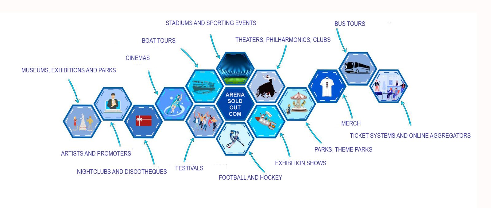
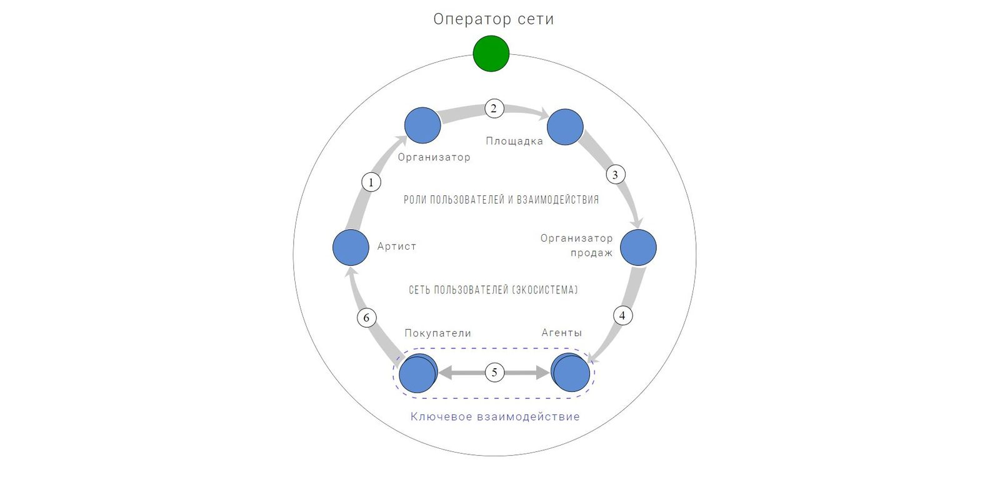

Профессионалы из разных сфер деятельности могут получить уникальную услугу – собственную платформу на основе концепций PaaS (платформа как услуга) и White Label. Они прекрасно знают, какое решение им нужно, и в состоянии сконфигурировать и эксплуатировать платформу под своим собственным брендом.

Можно организовывать свои билетные системы, мероприятия, проводить экскурсии, продавать билеты, туры, товары и услуги — собственная платформа нужна, чтобы собрать пользователей разных ролей и объединить их в одной экосистеме. И лучше получить готовую платформу, чем долго и дорого изобретать и разрабатывать еще один «велосипед» с нуля. Разработка платформы по принципу «быстро и дёшево» — это потеря денег. Подробнее об этом в статье [«Быстро создать собственную билетную платформу. Возможно ли это?»](/ru/blog/quickly-create-your-own-ticketing-platform-is-it-possible)

Услуга «Собственная платформа» — это полнофункциональное решение, где получатель услуги имеет статус Оператора (максимальные права), и может привлекать в свою платформу пользователей: Организаторов, Агентов, Покупателей. Такая платформа – это сеть, находящаяся под полным контролем Оператора, который управляет и развивает её как экосистему для всех участников рынка.

Следует отметить, что платформа подходит для применения на самых разных рынках. Примеры использования.

## **ПЛАТФОРМА КАК УСЛУГА**

Концепция «Платформа как услуга» доказывает свою эффективность во многих сферах бизнеса. В рамках этой концепции, центральный сервер ArenaSoldOut.com находятся у провайдера (супервизора) платформы. Оператору сети, как потребителю услуги «Собственная платформа», не требуется устанавливать у себя какое-либо программное или аппаратное обеспечение. При этом, все пользователи видят платформу, как собственную систему Оператора. Они используют всегда её последнюю, хорошо протестированную, надежную версию. Оператор получает техническую поддержку от ArenaSoldOut.com и не должен содержать собственную IT-инфраструктуру: разработчиков, различных IT специалистов. Благодаря такому подходу, Оператор может сосредоточиться на вопросах ведения и развития бизнеса, и не тратить ресурсы на техническую сторону дела.

## **КОНЦЕПЦИЯ WHITE LABEL**

Концепция «White Label» предусматривает возможность использования платформы ArenaSoldOut.com под брендом Оператора сети. Оператор может подключать Организаторов и Агентов, которые будут загружать и продавать собственные события, товары и услуги, воспринимая платформу как собственную систему Оператора.

Продажи могут осуществлятся как через один интернет-эквайринг Оператора, так и через множество эквайрингов Агентов. Правила работы платформы устанавливает оператор, и он же контролирует их выполнение.

## **ПЛАТФОРМЕННАЯ БИЗНЕС-МОДЕЛЬ**

Платформенная бизнес-модель создает экосистему для взаимодействия участников рынка. Это в полной мере актуально и для сети Оператора, в которой действует стандартный для ArenaSoldOut.com цикл взаимодействия:

Платформа позволяет совмещать роли пользователей. Например, организатор фестивалей, или  артист, организатор экскурсий, музей, организатор выставок, парк, или поставщик любой другой услуги может все организовать и продавать самостоятельно. В этом случае, он одновременно является и Устроителем, и Организатором продаж, и Агентом.

## **ПОЧЕМУ ЭТО ВЫГОДНО?**

Платформа ArenaSoldOut.com прошла долгий путь эволюционного развития и является удобным, эффективным и сбалансированным решением для билетного рынка. Разработчиками платформы накоплен огромный опыт автоматизации бизнес-процессов для подобных решений. Они продолжают развивать и совершенствовать ArenaSoldOut.com.

Очевидно, что нет смысла «изобретать велосипед», создавать свою собственную систему с тем же функционалом, надеяться, что она будет заметно лучше, удобнее, быстрее и надежнее существующей. Как минимум, это дорого и долго. Гораздо целесообразнее воспользоваться услугой «Собственная платформа» и получить решение здесь и сейчас. Если цель зарабатывать деньги, то экономически не оправдано нанимать команду разработчиков и удерживать их в долгосрочном проекте. Гораздо проще быстрее и эффективнее воспользоваться готовой платформой, став Оператором сети.

Платформа является бэкендом для сайтов и приложений ее пользователей, основой для интеграции с другими системами. Получив собственную платформу как услугу, Оператор и его пользователи могут сосредоточить усилия и ресурсы на создании сайтов и приложений, интеграции с различными системами через API. Все они получают фору для создания собственных решений и вывода их на рынок.

## **ОТЧЕТЫ И РАСЧЕТЫ В СЕТИ**

Оператор сети может подключить один или несколько интернет-эквайрингов, с помощью которых его Агенты будут продавать билеты. Оператор устанавливает правила, по которым будут работать пользователи его платформы, в том числе: настроить автоматическую отчетность, прописать ее использование в типовых договорах, сконфигурировать рассылки по email, сформировать правила подлиски на события и многое другое.

Приложение Репортер позволяет получать данные о продаже билетов и эксплуатационные показатели платформы в режиме реального времени.

## **КАК СТАТЬ ОПЕРАТОРОМ СЕТИ**

Платформенная модель бизнеса создает экосистему для всех пользователей: Организаторов, Агентов и, даже для Операторов. Одна из основных задач любой платформы избежать негативных эффектов, связанных с манипулированием рынком, с деструктивной конкуренцией среди пользователей.

Цитата из книги «Революция платформ» (Geoff rey G. Parker, Marshall W. Van Alstyne, Sangeet Paul Choudary):

*«Конкурентная стратегия платформы напоминает стратегии традиционных компаний примерно так же, как трехмерные шахматы напоминают обычные. Внутри экосистемы лидирующая компания борется за динамические преимущества, включая конкуренцию на трех уровнях: платформа против платформы, платформа против партнера и партнер против партнер»а.*

Несомненно, что эффективно использовать платформу в качестве Оператора могут лишь немногие опытные участники рынка, которые обладают знаниями и ресурсами для создания, поддержания и развития экосистемы для всех остальных. Если ваша компания обладает ресурсами, компетенциями и желанием использовать платформу как собственную систему – присылайте заявку с вашими данными и информацией о вашей компании адрес support(.)arenasoldout.com

**Подробнее** **о** **том****,** **как** **устроены** **сайты** **для** **продажи** **билетов****,** **читайте** **в** **статьях****:**

[Классика жанра или «Сделайте мне быстро сайт для продажи билетов»](/ru/blog/classics-of-the-genre-or-make-me-a-site-for-selling-tickets-quickly)

[Быстро создать собственную билетную платформу. Возможно ли это?](/ru/blog/quickly-create-your-own-ticketing-platform-is-it-possible)

[«Хочу свой сайт для продажи билетов»](/ru/blog/my-own-site-for-tickets-sold)

[Как начать продавать билеты на своем сайте. Пошаговый гайд](/ru/blog/kak-nachat-prodavat-bilety-na-svoem-sajte-poshagovyj-gajd)

[Создание сайтов для продажи билетов, туров, экскурсий, товаров и услуг](/ru/blog/sozdanie-sajtov-dlya-prodazhi-biletov-turov-ekskursij-tovarov-i-uslug)
