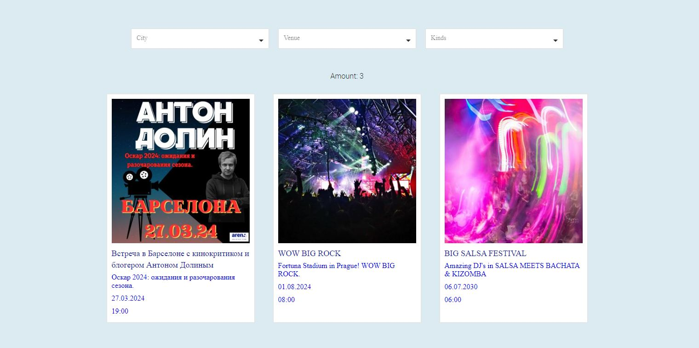
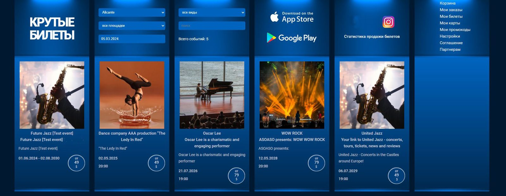
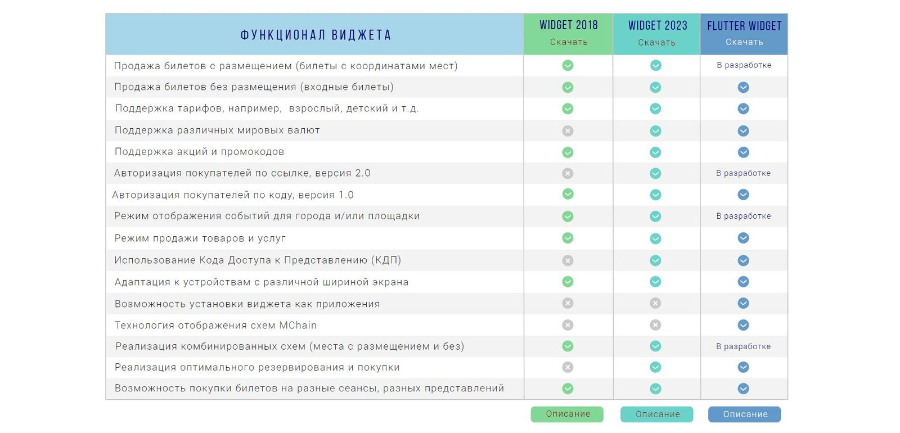

Существует много сайтов для продажи билетов, лучшие из которых позволяют быстро выбрать события и места, легко купить на них билеты. При внешней простоте этих сайтов, за ними стоят сложные взаимосвязанные системы: билетный процессинг, API шлюзы, интернет-эквайринги, система отчетности, онлайн касса и многих других функций. Этот “backend” не заметен со стороны покупателя билетов, и мнимая простота существующих сайтов часто вводит в заблуждение как заказчиков, так и разработчиков новых решений.

Вне зависимости от выбора CMS или framework’а для создания сайта (клиентской части), необходимо осознавать наличие сложного функционала на его «серверной стороне». На backend’е сосредоточена основная часть системы продажи билетов. Оптимально, когда функции backend’а берет на себя одна из множества билетных платформ.

Чтобы не идти сложным путем, не совершать ошибок и не «изобретать велосипед», стоит изучить собранный на этой странице опыт создания сайтов для продажи билетов клиентами платформы ArenaSoldOut.com

## **СТАТЬИ О СОЗДАНИИ САЙТОВ**

**Рекомендуем прочитать статьи о создании сайтов для продажи билетов:**

[Быстро создать собственную билетную платформу. Возможно ли это?](/ru/blog/quickly-create-your-own-ticketing-platform-is-it-possible)

[Собственная билетная платформа. Как ее создать](/ru/blog/sobstvennaya-biletnaya-platforma-kak-ee-sozdat)

[Как начать продавать билеты на события «с нуля». Пошаговый гайд](/ru/blog/kak-nachat-prodavat-bilety-na-svoem-sajte-poshagovyj-gajd)

[Классика жанра или «Сделайте мне быстро сайт для продажи билетов»](/ru/blog/classics-of-the-genre-or-make-me-a-site-for-selling-tickets-quickly)

[Хочу свой сайт для продажи билетов…](/ru/blog/my-own-site-for-tickets-sold)

[Вывод экскурсий в продажу: способы, инструменты, пошаговые инструкции](/ru/blog/release-of-excursions-for-sale-methods-tools-step-by-step-instructions)

[Вперед в будущее: Автоматизация продаж туров — новые горизонты в индустрии путешествий](/ru/blog/vpered-v-budushhee-avtomatizacziya-prodazh-turov-novye-gorizonty-v-industrii-puteshestvij)

[Собственная билетная платформа за 1000 USD. Миф или реальность?](/ru/blog/quickly-create-your-own-ticketing-platform-is-it-possible)

В платформе есть все инструменты для создания событий и управления продажами билетов. Это позволяет сэкономить время и деньги в любом проекте сайта для продажи билетов. Например, НЕТ НЕОБХОДИМОСТИ реализовывать: работу со схемой зала, корзину, интернет-эквайринг, панель администрирования (dashboard), систему отчетности и многое другое. Все это уже есть в билетной платформе.

В платформе ArenaSoldOut.com есть две зоны: Тестовая и Реальная. Все приложения платформы, включая Редактор, подключаются как к Тестовой, так и к Реальной зоне. Таким образом, можно создавать события в обеих зонах, а для разработки сайтов доступно множество событий в тестовой зоне платформы.

## **КОНСТРУКТОР САЙТОВ SOLD-OUT**

Конструктор сайтов Sold-out позволяет в считанные минуты сгенерировать сайт для продажи билетов, товаров и услуг, загруженных в платформу ArenaSoldOut.com . Сайт создается по шаблону, с простым дизайном, и может быть установлен как готовый отдельный сайт (в корневой каталог), так и в любой подкаталог, став подразделом уже имеющегося сайта.

Или\\И

Использование Sold-out – это самый простой и быстрый способ начать продавать билеты, товары или услуги, как описано в гайде Как начать продавать билеты на события «с нуля».

## **ОПТИМАЛЬНЫЕ ПУТИ СОЗДАНИЯ САЙТА**

Наиболее простой и эффективный способ создать сайт для продажи билетов – это использовать в качестве backend’а какую-либо билетную платформу. ArenaSoldOut.com предлагает для этого следующие варианты (от простого к сложному):

1\. Создать сайт с помощью проекта Sold-Out. Для создания сайта необходимо заполнить форму, скачать архив и, развернув его на собственном хостинге, приступить к продаже билетов, товаров или услуг.

2\. Использовать Скрипты интеграции с WordPress, чтобы в кратчайший срок начать продажи билетов.

Пример сайта, использующего скрипты интеграции с WordPress и подключенного к тестовой зоне платформы:

[Также вы можете посмотреть примеры по ссылке](/product/sell)

[Другой пример](/clients)

*Дизайн вы можете делать любым, используя возможности WordPress и менять его в любой момент с вашим дизайнером.*

3\. Интегрировать в создаваемый сайт виджет для продажи билетов.

4\. Реализовать на создаваемом сайте API ArenaSoldOut.com самостоятельно, создав собственное решение от начала и до конца.

## **ПОДКЛЮЧЕНИЕ ЭКВАЙРИНГА И ОНЛАЙН-КАСС**

Наличие собственного интернет-эквайринга позволяет продавать билеты, товары и услуги проще, безопаснее и эффективнее. Во многих билетных системах необходимо использовать один, «общесистемный» интернет-эквайринг, оформленный на оператора системы. Через этот эквайринг продаются все билеты, а организаторы и агенты должны ждать, когда оператор перечислит им деньги, вырученные от продаж. Так работать не удобно и не выгодно.

В платформе ArenaSoldOut.com необходимо подключить свой собственный эквайринг. В этом случае вся выручка от продажи билетов сразу поступает на ваш счет.

Сегодня на платформе ArenaSoldOut.com реализованы следующие интегрированные решения:

-   Stripe, работающий практически по всему миру

-   Эквайринг одного из банков Армении ( В данный момент идет проверка работы)

-   Эквайринг одного из банков Узбекистана. За информацией вы можете обратиться к техподдержке ArenaSoldOut.com

-   Мы можем реализовать другие эквайринги, это отдельная достаточно серьезная работа, требующая обсуждения

## **ИСПОЛЬЗОВАНИЕ ВИДЖЕТОВ**

Виджеты платформы необходимы, чтобы продавать билеты. Наиболее часто, при создании сайта ссылка на виджет устанавливается на кнопку «Купить билеты». После нажатия этой кнопки, покупатель билетов переходит в виджет, где реализованы выбор мест и оплата билетов.

## **КОНЦЕПЦИЯ WHITE LABEL**

Концепция «White Label» предусматривает возможность использования платформы ArenaSoldOut.com под вашим брендом. Вы можете загружать и продавать собственные события, товары и услуги, воспринимая платформу как собственную билетную систему. Одновременно с этим вы можете подключать к продажам различных партнеров и агентов, давая им разные роли на договорных условиях.

## **РОЛИ НА ПЛАТФОРМЕ**

Платформа позволяет совмещать роли пользователей. Например, промоутер, организатор фестиваля, или артист, организатор экскурсий или поставщик любой другой услуги может все организовать и продавать самостоятельно. В этом случае, он одновременно является и Устроителем, и Организатором продаж, и Агентом по продаже.

А также может предоставлять необходимые роли другим участникам билетного рынка.

## **ПОЧЕМУ ЭТО ВЫГОДНО?**

Платформа ArenaSoldOut.com прошла долгий путь эволюционного развития и является удобным, эффективным и сбалансированным решением для билетного рынка. Разработчиками платформы накоплен огромный опыт автоматизации бизнес-процессов для подобных решений. Они продолжают развивать и совершенствовать ArenaSoldOut.com.

Очевидно, что нет смысла «изобретать велосипед», создавать свою собственную систему с тем же функционалом, надеяться, что она будет заметно лучше, удобнее, быстрее и надежнее существующей. Как минимум, это дорого и долго. Гораздо целесообразнее воспользоваться услугой «Собственная платформа» и получить решение здесь и сейчас. Если цель зарабатывать деньги, то экономически не оправдано нанимать команду разработчиков и удерживать их в долгосрочном проекте. Гораздо проще быстрее и эффективнее воспользоваться готовой платформой и зарабатывать уже с учетом ее возможностей, своего опыта ресурсов и целей.

Платформа является бэкендом для сайтов и приложений ее пользователей, основой для интеграции с другими системами. Также когда вы можете получить собственную платформу как услугу, вы можете сосредоточить усилия и ресурсы на создании сайтов и приложений, интеграции с различными системами через API. В этом случае вы получаете отличную фору для создания собственных решений и вывода их на рынок.

*Александр* *Орлов**, Software architect and team lead TixGear — ArenaSoldOut.com*

*Марина* *Баканова**, Co-founder ArenaSoldOut.com ticketing platform for event organizers*

*ArenaSoldOut.com – Worldwide representative of TixGear*

## **Подробнее** **о** **том****,** **как** **устроены** **сайты** **для** **продажи** **билетов****,** **читайте** **в** **статьях****:**

[Классика жанра или «Сделайте мне быстро сайт для продажи билетов»](/ru/blog/classics-of-the-genre-or-make-me-a-site-for-selling-tickets-quickly)

[Быстро создать собственную билетную платформу. Возможно ли это?](/ru/blog/quickly-create-your-own-ticketing-platform-is-it-possible)

[«Хочу свой сайт для продажи билетов»](/ru/blog/my-own-site-for-tickets-sold)

[Как начать продавать билеты на своем сайте. Пошаговый гайд](/ru/blog/kak-nachat-prodavat-bilety-na-svoem-sajte-poshagovyj-gajd)

## **Вам** **также** **может** **быть** **интересно****:**

[Организаторы мероприятий в центре событий: блестящий переход к прямому доступу к выручке](/ru/blog/organizatory-meropriyatij-v-czentre-sobytij-blestyashhij-perehod-k-pryamomu-dostupu-k-vyruchke)

[8 шагов для запуска ранних продаж. Когда посетители мероприятия покупают билеты заранее, это не только упрощает процесс планирования и увеличивает продажи, а также дает вам бонус в виде раннего поступления денежных средств!](/ru/blog/8-shagov-dlya-zapuska-rannih-prodazh)

[Ценовые стратегии мероприятий: Тактики и Практики](/ru/blog/czenovye-strategii-meropriyatij-taktiki-i-praktiki)

[Увеличение продаж на мероприятиях: инновационные шаги с ArenaSoldOut.com](/ru/blog/increasing-sales-at-events-innovative-steps-with-arenasoldout-com)
