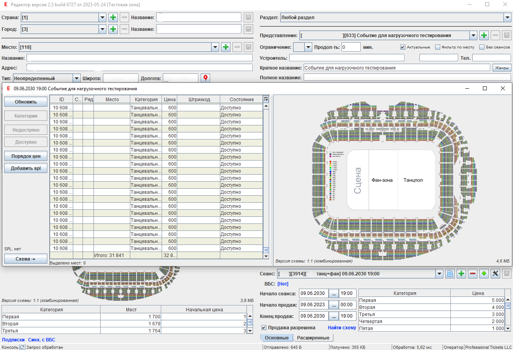
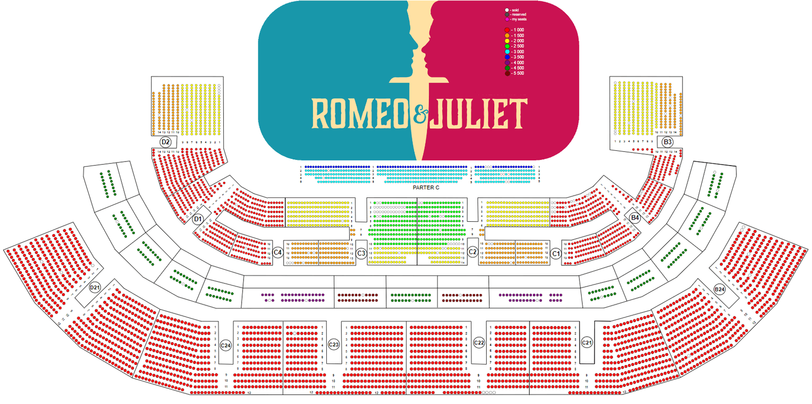

## НАГРУЗОЧНОЕ ТЕСТИРОВАНИЕ (STRESS TESTING). Технический отчет

#### Table of Contents

Для нагрузочного тестирования платформы была выбрана следующая методика: эмуляция ситуации, когда известны дата и время открытия продаж на популярное событие, которое произойдет на большом стадионе. Предполагается, что в момент открытия продаж множество людей попытается одновременно приобрести билеты. Для этого, им нужно получить схему стадиона с актуальными статусами мест. Схема стадиона является самой «тяжелой» частью покупки, непосредственно влияющей на возможность купить билеты и UX|UI. Таким образом, тест определяет, какому максимальному числу пользователей доступна загрузка схемы с актуальными статусами мест (далее Актуальной схемы) в рамках стандартного таймаута платформы – 30 секунд.

Для нагрузочного тестирования было создано событие на Стадион 1 в тестовой зоне платформы. Всего на стадионе:

Места с размещением (на трибунах) – 25 841  
Места без размещения (Фан-Зона, Танцпол) – 6 000  
Итого: 31 841

*TixGear Platform Editor - ArenaSoldOut.com*

Для нагрузочного тестирования была создана утилита, которая эмулирует одновременную деятельность заданного количества покупателей. В ходе первых тестов выяснилось, что поведение платформы для площадок с большим количеством мест кардинально отличается от поведения для небольших залов (менее 5000) мест. Исходя из этого, дальнейшие тесты проводились только с со схемой этого, достаточно большого стадиона. По результатам тестов в платформу добавлены механизмы оптимизации и ускорения работы, которые срабатывают при продажах в залах вместимостью более 5000 человек, так как для залов меньшей емкости эти механизмы неэффективны.

#### Методика тестирования

Первым и важнейшим шагом при продаже билетов является необходимость показать покупателю схему стадиона с АКТУАЛЬНЫМИ на данный момент статусами мест (свободно, занято, забронировано). Покупатель сможет зарезервировать места на схеме и купить билеты на них лишь в том случае, если он увидит схему зала. Подготовка и отправка схемы стадиона большому количеству покупателей является для сервера самой ресурсоемкой задачей. Тестирование возможностей платформы по одновременной отправке Данных схемы с актуальными статусами мест (далее Актуальная схема) большому количеству покупателей стало основным предметом тестирования.

Получать Актуальную схему по API можно двумя способами:

1.  Получение Актуальной схемы по ссылке (placementUrl). Актуальная схема в формате SVG подготавливается центральным сервером TixGear – ArenaSoldOut.com в виде, готовом для показа покупателю билетов.
2.  Получение с использованием двух команд:

GET\_SCHEMA — метод возвращает информацию обо всех местах с размещением, с координатами каждого места, включая координаты x,y. Метод дает возможность построить собственную схему зала.

GET\_SEAT\_LIST – получение списка мест по ID сеанса. Этот способ НЕ предусматривает передачу Актуальной схемы в формате SVG, и предполагает, что из ответов этих команд такая схема будет самостоятельно построена средствами внешней, клиентской билетной системы.

Дальнейшее тестирование проводилось отдельно для каждого из вышеперечисленных способов. Все испытания проводились без использования Внешних билетных систем (событие загружено в TixGear – ArenaSoldOut.com), так как Внешние билетные системы работают медленнее TixGear – ArenaSoldOut.com, и замерять скорость их работы не являлось целью данных тестов.

Для данного Стадиона 1 объем ответа на команду GET\_SCHEMA — без сжатия 2,25 Мб, сжатый 307 Кб. Объем ответа накоманду GET\_SEAT\_LIST – без сжатия 4 Мб, сжатый 180 Кб. Объем схемы в формате SVG — без сжатия 4,8 Мб, сжатый 435 Кб. Тестирование с одного компьютера уже на двухстах покупателях приводит к полной утилизации сетевого канала пропускной способностью 100 Мб/с. Очевидно, что в реальной жизни 1000 покупателей будут использовать 1000 каналов и 1000 компьютеров. Чтобы обойти ограничение скорости сети и создать максимальную нагрузку на сервер, дальнейшее тестирование производилось по локальной сети, в которой расположен сервер. Это не исключает возможность запуска утилиты тестирования на многих компьютерах в сети интернет.

По умолчанию, платформа TixGear – ArenaSoldOut.com использует сжатие передаваемых данных с помощью gzip. Это очень эффективно сжимает данные в формате JSON. Однако, для продажи стадионов наибольшему числу покупателей сжатие быстро приводит к 100% загрузке всех ядер процессоров сервера. Для преодоления этой проблемы при получении ответа на GET\_SCHEMA используется pre-compressed кэш (сжатие происходит однократно). В остальном, сжатие gzip продолжает являться ограничителем производительности сервера.

#### Утилита тестирования

Для тестов была создана специальная программа – утилита тестирования. Утилита создает указанное количество соединений с центральным сервером TixGear – ArenaSoldOut.com (эмулирует количество одновременных покупателей) и тестирует возможность сервера показать им Актуальную схему первым или вторым способом. Результаты тестирования выводятся в консоль. Пример выдачи в консоль теста для первого способа (передача схемы в формате SVG), произведенного после применения механизмов оптимизации и ускорения в тестовую зону платформы:

Zone: test  
FID: 1264  
ActionEventId: 3914  
Preparing…  
Free seats: 25841  
Clients: 1000  
Tickets per client: 4  
Request timeout: 30 s  
Value | Create user | Loading SVG | Booking | Create order| Pay order  
success | 0 | 1000 | 0 | 0 | 0  
timeouts | 0 | 0 | 0 | 0 | 0  
wait min | | 0.191 ms | | |  
wait avg | | 8734 ms | | |  
wait max | | 16192 ms | | |  
exec min | | 72.4 ms | | |  
exec avg | | 234 ms | | |  
exec max | | 1194 ms | | |  
total min| | 1944 ms | | |  
total avg| | 18076 ms | | |  
total max| | 29579 ms | | |

Total time: 30.93 s

Из данных консоли следует:

1.  Тест проводился в тестовой зоне платформы на следующих условиях: ID сеанса 3914, в продаже 25841 свободное место, количество пользователей, одновременно начавших покупать билеты – 1000, каждый пользователь покупает 4 билета, таймаут – 30 секунд.
2.  Тест выполнялся 30,93 секунды. Все 1000 пользователей получили Актуальную схему в формате SVG.
3.  В результатах теста указываются несколько параметров — wait, exec, total, их минимальное, среднее и максимальное значения в секундах. Чтобы объяснить эти параметры воспользуемся аналогией. Представим, что покупатели билетов выстроились в несколько очередей, к нескольким окошкам касс. Время, которое проводит каждый покупатель в очереди – это параметр wait. Время, которое затрачивается на обслуживании в окошке кассы – это параметр exec. Параметр total – это общее время, затраченное на обслуживание клиентов. В ходе тестов было подобрано оптимальное количество касс (потоков), обслуживающих клиентов за минимальное время исходя из имеющихся ресурсов системы.

**Результат данного теста показывает, что за 30.93 секунды одна тысяча покупателей гарантировано получает Актуальную схему большого стадиона.**

#### Результаты тестирования

При первых запусках утилиты тестирования платформа смогла обслужить только около 130 пользователей за 30 секунд. После применения разработанных в ходе тестов механизмов оптимизации и ускорения, достигнуты следующие показатели:

**Первый способ (передача схемы в формате SVG)**

Zone: test  
FID: 1264  
ActionEventId: 3914  
Preparing…  
Free seats: 25841  
Clients: 1000  
Tickets per client: 4  
Request timeout: 30 sv  
Time| Create user | Loading SVG | Booking | Create order | Pay order 1 | 0% | 0% | 0% | 0% | 0%  
2 | 0% | 0% | 0% | 0% | 0%  
3 | 0% | 0% | 0% | 0% | 0%  
4 | 0% | 1% | 0% | 0% | 0%  
5 | 0% | 2% | 0% | 0% | 0%  
6 | 0% | 2% | 0% | 0% | 0%  
7 | 0% | 3% | 0% | 0% | 0%  
8 | 0% | 5% | 0% | 0% | 0%  
9 | 0% | 9% | 0% | 0% | 0%  
10 | 0% | 12% | 0% | 0% | 0%  
11 | 0% | 16% | 0% | 0% | 0%  
12 | 0% | 19% | 0% | 0% | 0%  
13 | 0% | 22% | 0% | 0% | 0%  
14 | 0% | 27% | 0% | 0% | 0%  
15 | 0% | 32% | 0% | 0% | 0%  
16 | 0% | 37% | 0% | 0% | 0%  
17 | 0% | 41% | 0% | 0% | 0%  
18 | 0% | 46% | 0% | 0% | 0%  
19 | 0% | 50% | 0% | 0% | 0%  
20 | 0% | 54% | 0% | 0% | 0%  
21 | 0% | 58% | 0% | 0% | 0%  
22 | 0% | 63% | 0% | 0% | 0%  
23 | 0% | 67% | 0% | 0% | 0%  
24 | 0% | 71% | 0% | 0% | 0%  
25 | 0% | 75% | 0% | 0% | 0%  
26 | 0% | 79% | 0% | 0% | 0%  
27 | 0% | 83% | 0% | 0% | 0%  
28 | 0% | 87% | 0% | 0% | 0%  
29 | 0% | 92% | 0% | 0% | 0%  
30 | 0% | 95% | 0% | 0% | 0%  
30 | 0% | 100% | 0% | 0% | 0%  
Value | Create user | Loading SVG | Booking | Create order| Pay order  
success | 0 | 1000 | 0 | 0 | 0  
timeouts | 0 | 0 | 0 | 0 | 0  
wait min | | 0.191 ms | | |  
wait avg | | 8734 ms | | |  
wait max | | 16192 ms | | |  
exec min | | 72.4 ms | | |  
exec avg | | 234 ms | | |  
exec max | | 1194 ms | | |  
total min| | 1944 ms | | |  
total avg| | 18076 ms | | |  
total max| | 29579 ms | | |  
Total time: 30.93 s

**Второй способ (ответы команд GET\_SCHEMA и GET\_SEAT\_LIST)**

Zone: test  
FID: 1264  
ActionEventId: 3914  
Preparing…  
Free seats: 25841  
Clients: 1800  
Tickets per client: 4  
Request timeout: 30 s

Time|Create user| Schema | Seat list | Booking | Order | Pay order  
1 | 0% | 0% | 0% | 0% | 0% | 0%  
2 | 0% | 0% | 0% | 0% | 0% | 0%  
3 | 0% | 0% | 0% | 0% | 0% | 0%  
4 | 0% | 1% | 0% | 0% | 0% | 0%  
5 | 0% | 3% | 0% | 0% | 0% | 0%  
6 | 0% | 3% | 0% | 0% | 0% | 0%  
7 | 0% | 5% | 0% | 0% | 0% | 0%  
8 | 0% | 5% | 0% | 0% | 0% | 0%  
9 | 0% | 6% | 0% | 0% | 0% | 0%  
10 | 0% | 6% | 0% | 0% | 0% | 0%  
11 | 0% | 7% | 0% | 0% | 0% | 0%  
12 | 0% | 8% | 0% | 0% | 0% | 0%  
13 | 0% | 8% | 0% | 0% | 0% | 0%  
14 | 0% | 8% | 0% | 0% | 0% | 0%  
15 | 0% | 8% | 0% | 0% | 0% | 0%  
16 | 0% | 9% | 0% | 0% | 0% | 0%  
17 | 0% | 11% | 0% | 0% | 0% | 0%  
18 | 0% | 12% | 0% | 0% | 0% | 0%  
19 | 0% | 13% | 1% | 0% | 0% | 0%  
20 | 0% | 15% | 3% | 0% | 0% | 0%  
21 | 0% | 17% | 5% | 0% | 0% | 0%  
22 | 0% | 21% | 6% | 0% | 0% | 0%  
23 | 0% | 24% | 7% | 0% | 0% | 0%  
24 | 0% | 31% | 8% | 0% | 0% | 0%  
25 | 0% | 42% | 9% | 0% | 0% | 0%  
26 | 0% | 53% | 11% | 0% | 0% | 0%  
27 | 0% | 63% | 12% | 0% | 0% | 0%  
28 | 0% | 70% | 13% | 0% | 0% | 0%  
29 | 0% | 81% | 15% | 0% | 0% | 0%  
30 | 0% | 90% | 17% | 0% | 0% | 0%  
31 | 0% | 96% | 20% | 0% | 0% | 0%  
32 | 0% | 98% | 23% | 0% | 0% | 0%  
33 | 0% | 99% | 33% | 0% | 0% | 0%  
34 | 0% | 99% | 56% | 0% | 0% | 0%  
34 | 0% | 99% | 99% | 0% | 0% | 0%  
Value | User | Schema | Seat list| Booking | Order | Pay order  
success | 0 | 1793 | 1793 | 0 | 0 | 0  
timeouts | 0 | 7 | 0 | 0 | 0 | 0  
wait min | | 0.012 ms | 0.014 ms | | |  
wait avg | | 1453 ms | 511 ms | | |  
wait max | | 4575 ms | 4551 ms | | |  
exec min | | 1.22 ms | 5.58 ms | | |  
exec avg | | 6.64 ms | 22.3 ms | | |  
exec max | | 319 ms | 281 ms | | |  
total min| | 2393 ms | 343 ms | | |  
total avg| | 22576 ms | 7775 ms | | |  
total max| | 32361 ms | 21073 ms | | |  
Total time: 34.80 s

#### Результаты:

**В первом способе (передача схемы в формате SVG) за 30.93 секунды 1000 покупателей (из 1000) успешно получили Актуальную схему. При втором способе (использование команд GET\_SCHEMA и GET\_SEAT\_LIST) за 34.80 секунды 1793 покупателя (из 1800) успешно получили данные Актуальной схемы.**

Следует отметить, что результаты тестирования проводились в более жестких условиях (одновременный доступ пользователей, локальная сеть) чем условия, складывающиеся при реальном ажиотажном спросе, когда покупатели разнесены во времени и пространстве. Можно предположить, что в условиях реальных продаж сервер обслужит несколько больше покупателей, чем при описанных тестах.

#### Оптимизация и ускорение

Использование утилиты для нагрузочного тестирования сразу выявило места возникновения перегрузки системы (бутылочные горлышки), которые были последовательно преодолены через внедрение следующих механизмов оптимизации и ускорения:

1.  Динамическое кэширование GET\_SEAT\_LIST позволило поддерживать в кэше актуальные статусы мест и мгновенно отдавать их клиентам. Это достигается за счет возможности «точечных» изменений статусов конкретных мест в тот же момент, когда они меняются в платформе. Таким образом, в отличие от статического кэша, динамический кэш способен отдавать максимально актуальные данные о свободных, проданных зарезервированных местах.
2.  Удалось преодолеть потери при преобразовании объектов в формат JSON путем внедрения нового, значительно более быстрого конвертера в этот формат, а также его «ручного программирования». Скорость конвертации объемных данных ответов на команды GET\_SCHEMA и GET\_SEAT\_LIST увеличилась в 3-4 раза.
3.  Кэширование pre-compressed данных для ответов команд GET\_SCHEMA, GET\_FILTER, GET\_ALL\_ACTIONS.
4.  Ускорение обработки (заполнения статусами мест) схемы стадиона в формате SVG за счет использования Streaming API for XML (StAX) API вместо более медленного интерфейса DOM.
5.  Использование динамического кэша GET\_SEAT\_LIST (пункт 1) вместо СУБД, как источника данных для заполнения статусами мест Актуальной схемы в формате SVG.

**Эти механизмы позволили увеличить производительность платформы при ажиотажном спросе и больших схемах примерно в 10 раз. При использовании схем меньшего размера и отсутствии ажиотажного спроса прирост производительности предсказуемо оказался менее значительным, но заметным.**

#### Полный цикл продажи билетов

В предыдущих нагрузочных тестах внимание уделялось возможности платформы показать Актуальную схему наибольшему количеству пользователей. Это важнейшая часть процесса приобретения билетов, но не единственная. Для полного оформления процесса покупки билетов используются следующие команды:

RESERVATION (Booking) – команда резервирования мест на период покупки, чтобы покупатель был уверен, что это место не приобретет кто-то другой, пока он оформляет заказ.

CREATE\_ORDER\_EXT– команда создания заказа из зарезервированных мест.

PAY\_ORDER – команда оплаты заказа, после успешного выполнения которой на места из заказа выпускаются билеты.

Тестирование производится с помощью интерфейса типа «Билетная система», что позволяет исключить процесс использования интернет-эквайринга, ожидания ввода данных банковской карты, оплаты заказа в банке.

Результаты продажи билетов на тестовое событие на данном стадионе:

Zone: ext0  
FID: 1264  
ActionEventId: 3914  
Preparing…  
Free seats: 25833  
Clients: 1000  
Tickets per client: 4  
Request timeout: 30 s  
Time| Create user | Loading SVG | Booking | Create order | Pay order  
1 | 0% | 0% | 0% | 0% | 0%  
2 | 1% | 0% | 0% | 0% | 0%  
3 | 3% | 0% | 0% | 0% | 0%  
4 | 4% | 0% | 0% | 0% | 0%  
5 | 5% | 0% | 0% | 0% | 0%  
6 | 9% | 0% | 0% | 0% | 0%  
7 | 19% | 4% | 0% | 0% | 0%  
8 | 20% | 8% | 2% | 0% | 0%  
9 | 20% | 11% | 3% | 1% | 0%  
10 | 20% | 15% | 4% | 2% | 1%  
11 | 20% | 18% | 6% | 3% | 2%  
12 | 24% | 22% | 7% | 4% | 2%  
13 | 28% | 26% | 9% | 4% | 2%  
14 | 31% | 30% | 11% | 6% | 3%  
15 | 42% | 33% | 11% | 6% | 3%  
16 | 42% | 37% | 13% | 7% | 3%  
17 | 42% | 40% | 15% | 8% | 4%  
18 | 46% | 45% | 16% | 9% | 5%  
19 | 49% | 48% | 18% | 10% | 5%  
20 | 53% | 52% | 20% | 11% | 6%  
21 | 57% | 56% | 22% | 12% | 6%  
22 | 63% | 60% | 23% | 13% | 6%  
23 | 65% | 64% | 25% | 13% | 7%  
24 | 69% | 68% | 26% | 14% | 7%  
25 | 72% | 71% | 28% | 15% | 7%  
26 | 77% | 75% | 29% | 15% | 8%  
27 | 80% | 79% | 31% | 16% | 8%  
28 | 84% | 83% | 33% | 17% | 8%  
29 | 88% | 87% | 34% | 18% | 9%  
30 | 100% | 89% | 38% | 19% | 9%  
31 | 100% | 93% | 41% | 21% | 10%  
32 | 100% | 97% | 43% | 22% | 11%  
33 | 100% | 100% | 56% | 26% | 13%  
34 | 100% | 100% | 71% | 30% | 16%  
35 | 100% | 100% | 88% | 36% | 19%  
36 | 100% | 100% | 99% | 44% | 22%  
37 | 100% | 100% | 100% | 56% | 26%  
38 | 100% | 100% | 100% | 70% | 30%  
39 | 100% | 100% | 100% | 83% | 34%  
40 | 100% | 100% | 100% | 93% | 38%  
41 | 100% | 100% | 100% | 98% | 43%  
42 | 100% | 100% | 100% | 100% | 49%  
43 | 100% | 100% | 100% | 100% | 54%  
44 | 100% | 100% | 100% | 100% | 59%  
45 | 100% | 100% | 100% | 100% | 64%  
46 | 100% | 100% | 100% | 100% | 69%  
47 | 100% | 100% | 100% | 100% | 73%  
48 | 100% | 100% | 100% | 100% | 78%  
49 | 100% | 100% | 100% | 100% | 82%  
50 | 100% | 100% | 100% | 100% | 86%  
51 | 100% | 100% | 100% | 100% | 90%  
52 | 100% | 100% | 100% | 100% | 94%  
53 | 100% | 100% | 100% | 100% | 98%  
53 | 100% | 100% | 100% | 100% | 100%  
Value | Create user | Loading SVG | Booking | Create order| Pay order  
success | 1000 | 1000 | 1000 | 1000 | 1000  
timeouts | 0 | 0 | 0 | 0 | 0  
wait min | 0.038 ms | 0.020 ms | 0.034 ms | 0.245 ms | 0.064 ms  
wait avg | 13250 ms | 589 ms | 8860 ms | 5068 ms | 7129 ms  
wait max | 23372 ms | 3736 ms | 24710 ms | 24606 ms | 24505 ms  
exec min | 1.42 ms | 74.8 ms | 7.88 ms | 7.34 ms | 13.3 ms  
exec avg | 57.2 ms | 149 ms | 50.7 ms | 53.7 ms | 121 ms  
exec max | 642 ms | 468 ms | 367 ms | 305 ms | 372 ms  
total min| 517 ms | 192 ms | 19.5 ms | 21.1 ms | 47.4 ms  
total avg| 17314 ms | 1128 ms | 8945 ms | 5136 ms | 7262 ms  
total max| 29311 ms | 5070 ms | 24747 ms | 24650 ms | 24559 ms

Total time: 53.62 s

#### Результаты:

**1000 пользователей смогли приобрести 4000 билетов за 53,62 секунды. Таким образом, при среднем количестве 4 билета на один заказ и при ажиотажном спросе, 25-тысячный стадион будет распродан примерно за 6 минут после старта продаж.**

#### Тестирование на событии И и Стадион 2

Как указывалось ранее, созданные в результате тестов механизмы оптимизации и ускорения срабатывают для залов вместимостью более 5000 мест. Для примера и тестирования мы взяли другой стадион **(Стадион 2)**. В данной конфигурации для шоу в нём 5261 мест. Для тестирования создано событие в этом стадионе, на котором 5137 свободных мест.

#### Результаты тестирования отображения Актуальной схемы:

**Первый способ (передача схемы в формате SVG)**

Zone: test  
FID: 1264  
ActionEventId: 2571  
Preparing…  
Free seats: 5137  
Clients: 2800  
Tickets per client: 1  
Request timeout: 30 s

Time| Create user | Loading SVG | Booking | Create order | Pay order  
1 | 0% | 1% | 0% | 0% | 0%  
2 | 0% | 3% | 0% | 0% | 0%  
3 | 0% | 4% | 0% | 0% | 0%  
4 | 0% | 5% | 0% | 0% | 0%  
5 | 0% | 7% | 0% | 0% | 0%  
6 | 0% | 12% | 0% | 0% | 0%  
7 | 0% | 12% | 0% | 0% | 0%  
8 | 0% | 13% | 0% | 0% | 0%  
9 | 0% | 13% | 0% | 0% | 0%  
10 | 0% | 14% | 0% | 0% | 0%  
11 | 0% | 14% | 0% | 0% | 0%  
13 | 0% | 14% | 0% | 0% | 0%  
13 | 0% | 14% | 0% | 0% | 0%  
14 | 0% | 14% | 0% | 0% | 0%  
15 | 0% | 14% | 0% | 0% | 0%  
16 | 0% | 28% | 0% | 0% | 0%  
17 | 0% | 31% | 0% | 0% | 0%  
18 | 0% | 31% | 0% | 0% | 0%  
19 | 0% | 31% | 0% | 0% | 0%  
20 | 0% | 36% | 0% | 0% | 0%  
21 | 0% | 42% | 0% | 0% | 0%  
22 | 0% | 49% | 0% | 0% | 0%  
23 | 0% | 50% | 0% | 0% | 0%  
24 | 0% | 53% | 0% | 0% | 0%  
25 | 0% | 59% | 0% | 0% | 0%  
26 | 0% | 64% | 0% | 0% | 0%  
27 | 0% | 73% | 0% | 0% | 0%  
28 | 0% | 78% | 0% | 0% | 0%  
29 | 0% | 86% | 0% | 0% | 0%  
30 | 0% | 94% | 0% | 0% | 0%  
31 | 0% | 99% | 0% | 0% | 0%  
31 | 0% | 99% | 0% | 0% | 0%  
Value | Create user | Loading SVG | Booking | Create order| Pay order  
success | 0 | 2782 | 0 | 0 | 0  
timeouts | 0 | 18 | 0 | 0 | 0  
wait min | | 0.006 ms | | |  
wait avg | | 475 ms | | |  
wait max | | 2090 ms | | |  
exec min | | 18.0 ms | | |  
exec avg | | 59.6 ms | | |  
exec max | | 504 ms | | |  
total min| | 219 ms | | |  
total avg| | 17831 ms | | |  
total max| | 27790 ms | | |

Total time: 31.21 s

**Второй способ (ответы команд GET\_SCHEMA и GET\_SEAT\_LIST)**

Zone: test  
FID: 1264  
ActionEventId: 2571  
Preparing…  
Free seats: 5137  
Clients: 3200  
Tickets per client: 1  
Request timeout: 30 s

Time|Create user| Schema | Seat list | Booking | Order | Pay order  
1 | 0% | 1% | 0% | 0% | 0% | 0%  
2 | 0% | 6% | 3% | 0% | 0% | 0%  
3 | 0% | 9% | 7% | 0% | 0% | 0%  
4 | 0% | 11% | 8% | 0% | 0% | 0%  
5 | 0% | 11% | 8% | 0% | 0% | 0%  
6 | 0% | 14% | 9% | 0% | 0% | 0%  
7 | 0% | 14% | 9% | 0% | 0% | 0%  
9 | 0% | 14% | 9% | 0% | 0% | 0%  
9 | 0% | 14% | 9% | 0% | 0% | 0%  
10 | 0% | 14% | 10% | 0% | 0% | 0%  
11 | 0% | 15% | 10% | 0% | 0% | 0%  
12 | 0% | 19% | 11% | 0% | 0% | 0%  
13 | 0% | 19% | 11% | 0% | 0% | 0%  
14 | 0% | 20% | 11% | 0% | 0% | 0%  
15 | 0% | 20% | 13% | 0% | 0% | 0%  
16 | 0% | 26% | 14% | 0% | 0% | 0%  
17 | 0% | 26% | 14% | 0% | 0% | 0%  
18 | 0% | 26% | 14% | 0% | 0% | 0%  
19 | 0% | 26% | 14% | 0% | 0% | 0%  
20 | 0% | 26% | 14% | 0% | 0% | 0%  
21 | 0% | 27% | 14% | 0% | 0% | 0%  
22 | 0% | 27% | 15% | 0% | 0% | 0%  
23 | 0% | 28% | 17% | 0% | 0% | 0%  
24 | 0% | 32% | 19% | 0% | 0% | 0%  
25 | 0% | 41% | 24% | 0% | 0% | 0%  
26 | 0% | 56% | 26% | 0% | 0% | 0%  
27 | 0% | 73% | 26% | 0% | 0% | 0%  
28 | 0% | 87% | 26% | 0% | 0% | 0%  
29 | 0% | 95% | 27% | 0% | 0% | 0%  
30 | 0% | 98% | 27% | 0% | 0% | 0%  
31 | 0% | 99% | 27% | 0% | 0% | 0%  
32 | 0% | 99% | 27% | 0% | 0% | 0%  
33 | 0% | 99% | 28% | 0% | 0% | 0%  
34 | 0% | 99% | 30% | 0% | 0% | 0%  
35 | 0% | 99% | 34% | 0% | 0% | 0%  
36 | 0% | 99% | 42% | 0% | 0% | 0%  
37 | 0% | 99% | 61% | 0% | 0% | 0%  
37 | 0% | 99% | 99% | 0% | 0% | 0%  
Value | User | Schema | Seat list| Booking | Order | Pay order  
success | 0 | 3199 | 3199 | 0 | 0 | 0  
timeouts | 0 | 1 | 0 | 0 | 0 | 0  
wait min | | 0.015 ms | 0.005 ms | | |  
wait avg | | 1904 ms | 356 ms | | |  
wait max | | 5641 ms | 5634 ms | | |  
exec min | | 1.17 ms | 2.18 ms | | |  
exec avg | | 5.20 ms | 6.64 ms | | |  
exec max | | 181 ms | 182 ms | | |  
total min| | 73.3 ms | 18.5 ms | | |  
total avg| | 17407 ms | 9163 ms | | |  
total max| | 29827 ms | 15186 ms | | |

Total time: 37.71 s

Проведем сравнение результатов тестов события на **Стадионе 1** (25 841 место) и события на **Стадионе 2** (5137 мест).

**При первом способе (получение SVG схемы):**  
**Стадион 1 — за 30.93 сек. 1000 покупателей (из 1000) успешно получили Актуальную схему.**  
**Стадион 2 – за 31.21 сек. 2782 покупателя (из 3000) успешно получили Актуальную схему.**

**При втором способе (ответы команд GET\_SCHEMA и GET\_SEAT\_LIST):**  
**Стадион 1 — за 34.80 сек. 1793 покупателя (из 1800) успешно получили данные Актуальной схемы.**  
**Стадион 2 – за 37.71 сек. 3199 покупателей (из 3200) успешно получили данные Актуальной схемы.**

Share this article with a friend

[Subscribe](#elementor-action%3Aaction%3Dpopup%3Aopen%26settings%3DeyJpZCI6MTM0LCJ0b2dnbGUiOmZhbHNlfQ%3D%3D)

[ПредЗащита от ботов и массового бронирования](/ru/blog/zashhita-ot-botov-i-massovogo-bronirovaniya)

[Зачем нужно проводить нагрузочное тестирование билетных платформ: выгода для организаторов и покупателейСледующая](/ru/blog/why-the-tickets-platform-need-pay-load-tests-ru)
