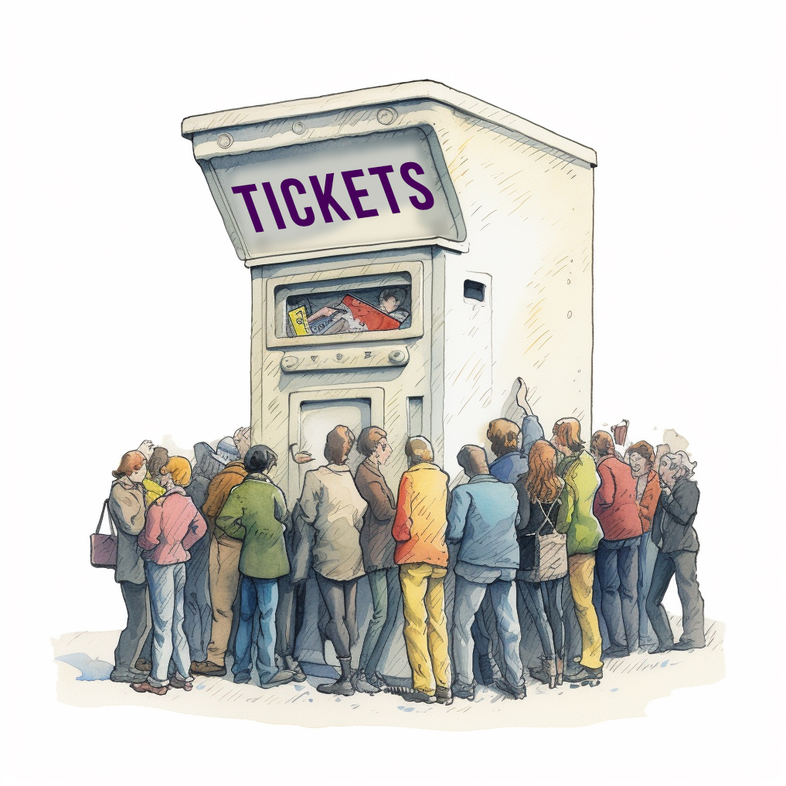
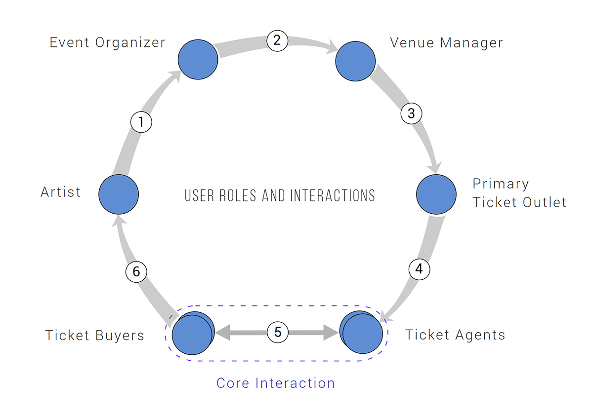
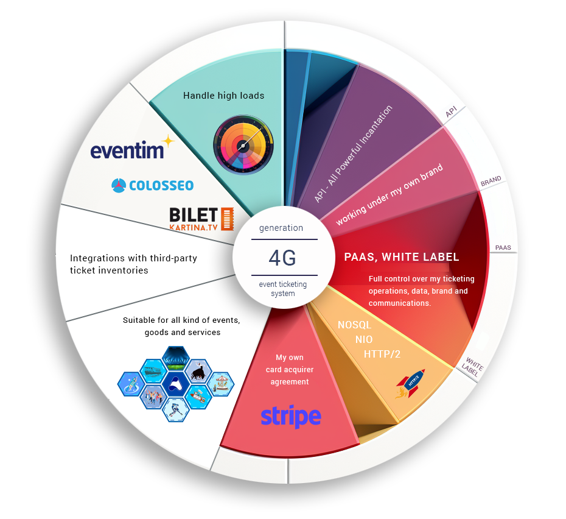

## Эволюция билетных платформ. Пять поколений.

Первые системы для продажи билетов появились вместе с персональными компьютерами, локальными сетями и Интернет. Сегодняшние билетные платформы создаются в сильно изменившемся мире, они радикально отличаются от первых систем. Посмотрев на путь развития билетного ПО, можно выделить пять поколений систем со схожими функционалом, архитектурой и характеристиками. Календарный период проектирования этих систем соответствует единому мировому уровню развития информационных технологий.

Предлагаемая далее группировка в поколения условна, так как отдельные системы могут иметь функционал разных поколений, цикл их разработки не укладывается в четкие временные рамки. Например, система второго поколения могла создаваться уже в период существования систем третьего поколения. Некоторые системы первых поколений, постоянно дорабатываясь, дошли до наших дней с функционалом из разных периодов времени, накопленным legacy и технологическим долгом.

#### Первое поколение, 1990-е годы

Примеры: Компьютерная билетная система «Basis», Ticketron

Системы первого поколения создавались в мире, где покупка билетов на веб-сайтах еще не была распространена. Системы ориентировались на продажу билетов в кассах, на прием и обработку заявок в оффлайн режиме. В них использовались характерные для того времени архитектурные решения. Системы создавались с помощью популярных в то время средств разработки, например, Borland Delphi. В первом поколении систем не использовали принципы открытой архитектуры: возможность простого добавления, обновления или замены компонентов.

#### Второе поколение, 2000-е годы

Пример: Системы TicketSoft, Eventim

Системы второго поколения чаще всего устанавливались локально на объектах, в местах проведения мероприятий (театрах, концертных залах, на стадионах), в городских кассах. Так как каналы Интернет не обладали в то время достаточной надежностью и пропускной способностью, для бесперебойной продажи билетов, системы устанавливались в локальной сети какого-либо объекта.

Объектовые системы обычно интегрировались Системой Контроля Доступа (СКД). Пользователями этих систем были сотрудники площадки и/или касс, а не покупатели билетов. Основная масса продаж шла через кассы, но появились и первые сайты, как альтернативный канал продажи билетов.

#### Третье поколение, начало 2010-х

Примеры: Ticketscloud, Radario, Intickets, Tixly, Eventix, Ticketebo 

Третье поколение билетных систем – это веб-платформы, в которых в разной степени реализована платформенная бизнес-модель. Для пользователей в платформах появились роли: организатор событий, билетный агент, покупатель билетов и т.д. Платформы этого поколения ориентированы на продажу билетов через веб-сайты и мобильные приложения, продажи в оффлайн-кассах значительно уменьшились. С ростом надежности и скорости каналов Интернет, площадки и кассы стали использовать платформы как облачные, а не объектовые решения.

Платформы этого поколения обзавелись API и шлюзами в другие билетные системы. Появилась концепция конкурентной продажи билетов множеством агентов по API-шлюзам из «единого билетного поля» и в режиме реального времени. Продажа билетов по квотам быстро ушла в прошлое. Для оплаты билетов веб-платформы используют один общесистемный интернет-эквайринг. Характерной особенностью платформ этого поколения стало наличие инструментов интернет-маркетинга и SEO.

Для создания как фронтенда, так и бэкенда платформ третьего поколения широко использовались средства веб-разработки и бесплатные реляционные СУБД. В результате этого, платформы испытывают проблемы с производительностью, масштабируемостью и надежностью при пиковых нагрузках.

#### Поколение "Три плюс", 2010-е годы

Пример: Eventbrite

Являясь веб-платформой, Eventbrite формально относится к третьему поколению билетных систем. Однако, Eventbrite использует промышленные решения и процессинг, более характерные для полнофункциональных платформ четвертого поколения.

#### Четвертое поколение, конец 2010-х годов

Пример: ArenaSoldOut.com , VBotickets 

В четвертом поколении билетных систем появились полнофункциональные платформы, созданные с использованием современных средств и технологий разработки программного обеспечения, например, таких как промышленные NOSQL СУБД. Характерной особенностью этих платформ стало наличие быстрого и надежного многопоточного процессинга, способным держать высокие нагрузки (что недоступно большинству веб-платформ предыдущего поколения).

Платформы четвертого поколения изначально создавались для использования большого количества двусторонних шлюзов в другие билетные системы, для применения организаторами и агентами множества собственных интернет-эквайрингов. Проектирование этих платформ «с нуля» радикально отличалось от доработки уже существующих систем предыдущих поколений. Благодаря этому, платформы четвертого поколения избавлены от legacy, технологического долга и ошибок систем прошлого. Высокие характеристики платформ этого поколения, их скорость и надежность, подтверждаются нагрузочными испытаниями.

Технологическими отличиями платформ четвертого поколения является использование более современных технологий: асинхронной сетевой модели (буфер-ориентированный, неблокирующий (асинхронный) ввод/вывод, NIO), протокола HTTP\\2 (мультиплексирования запросов и ответов), концепций Platform as a Service (PaaS) и White Label (рис.3). Для платформ этого поколения характерен высокий уровень самообслуживания.

#### Пятое поколение, 2020-е годы

Платформы пятого поколения в настоящий момент еще только создаются, но уже понятны их отличительные черты. Например, обновление статусов мест на схемах залов и стадионов в режиме реального времени без перезагрузки всей схемы («живые схемы»). Наличие встроенных no-code конструкторов сайтов и приложений для продажи билетов, что сделает вывод событий в продажу быстрым и дешевым.

В этом поколении увеличиваются количество и качество интеграций с внешними системами: CRM, онлайн-бухгалтерией, системами аналитики. Развивается экосистема, в платформах появляются новые роли пользователей, например, страховые компании, продавцы сопутствующих событию товаров и услуг (HoReCa, мерч, питание и т.д.), формируется инструментарий для пакетных предложений.

Alex Orlov, Software architect and team lead ArenaSoldOut.com 

ВАМ ТАКЖЕ МОЖЕТ БЫТЬ ИНТЕРЕСНО:

[Собственная билетная платформа. Как ее создать](/ru/blog/sobstvennaya-biletnaya-platforma-kak-ee-sozdat)

Share this article with a friend

[ПредРабота с клиентами – залог успешности вашего бизнеса, или зачем и как поддерживать связь с клиентами](/ru/blog/rabota-s-klientami-zalog-uspeshnosti-vashego-biznesa-ili-zachem-i-kak-podderzhivat-svyaz-s-klientami)

[Защита от ботов и массового бронированияСледующая](/ru/blog/zashhita-ot-botov-i-massovogo-bronirovaniya)
