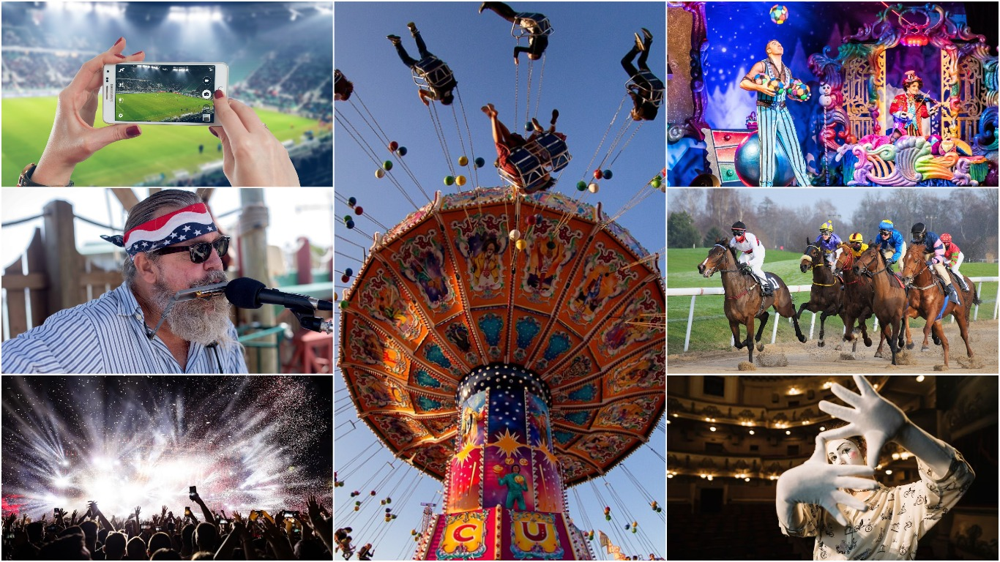

## Представьте себе мир, где организация мероприятий становится более удобной, эффективной и прибыльной

*В нашем быстром мире организации мероприятий продажа билетов с эффективностью и максимизацией прибыли может быть сложной задачей. Традиционные системы продажи билетов часто имеют ограничения и высокие комиссионные сборы, что заставляет организаторов мероприятий искать более эффективные решения. Вот где появляется **ArenaSoldOut.com** – революционная платформа продажи билетов, предлагающая множество преимуществ для организаторов мероприятий по всему миру. В этой статье мы рассмотрим типичные проблемы, с которыми сталкиваются организаторы мероприятий, инновационные решения, предлагаемые ArenaSoldOut.com, и объясним, почему именно она является прорывом, на который вы так долго ждали.*

#### Проблема 1: Высокие комиссионные сборы и посредники:

Одна из основных проблем для организаторов мероприятий – это значительные комиссионные сборы, взимаемые билетными операторами всех стран. Другой проблемой часто является то, что билетные операторы принимают деньги за билеты на свой счет и организатор получает эти деньги с задержками в то самое время, когда оборотные средства ему нужны максимально.  
Также в большинстве случаев именно билетный оператор имеет полный контроль над вашими билетами, вы не можете оперативно менять цены, тарифы, залы проведения (в случаях, когда это необходимо) и многое другое.  
Чаще всего получается так, что вы за свой счет рекламируете сайт билетного оператора, а не себя, но не имеете полного управления своими билетами.

#### Решение: Продавайте напрямую, максимизируйте прибыль:

ArenaSoldOut.com предлагает революционное решение, позволяющее организаторам мероприятий продавать билеты напрямую через свои собственные веб-сайты и социальные медиа. Избавьтесь от посредников и уплачивайте меньшие комиссионные сборы, сохраняя большую часть заработанной прибыли.  
Меняйте тарифы онлайн и накапливайте информацию о покупателях. Возьмите под контроль продажи билетов и верните себе полный контроль над успехом вашего мероприятия.

#### Проблема 2: Ограниченные данные о клиентах и возможности маркетинга:

 Традиционные системы продажи билетов часто ограничивают доступ к ценным данным о клиентах, что мешает организаторам мероприятий создавать качественную базу клиентов и проводить целевые маркетинговые кампании. Это ограничение препятствует связи с предыдущими посетителями и эффективному продвижению будущих мероприятий.  
И для последующей работы с покупателями ваших же билетов вам необходимо снова платить билетному оператору.

#### Решение: Создавайте базу клиентов, повышайте популярность своих мероприятий:

С помощью **ArenaSoldOut.com** организаторы мероприятий могут создавать подробную базу данных о клиентах, что позволяет им вести прямое общение с посетителями, уже приобретавшими билеты. Это открывает неограниченные возможности для маркетинга, позволяя направлять рекламу будущих мероприятий прямо целевой аудитории, что приводит к увеличению посещаемости и общему успеху всей совокупности ваших мероприятий.

#### Проблема 3: Ограничения и потеря контроля:

Ограничение использования только одного билетного оператора может ограничить возможности организатора мероприятий и сократить выбор маркетинговых каналов. Полное полагание на сторонние платформы может затруднить видимость бренда и ограничить использование других каналов продаж.

#### Решение:

**Несколько каналов продаж, полный контроль:** ArenaSoldOut.com позволяет организаторам мероприятий продавать билеты не только через свой сайт и социальные сети, но и через несколько билетных операторов, сохраняя при этом полный контроль над своим брендом, ценами и маркетинговыми усилиями. Рекламируйте свои собственные каналы и веб-сайт, расширьте свою аудиторию и установите свой бренд мероприятия как успешный и востребованный.

#### Проблема 4:

Большинство билетных операторов имеет основной функцией продажу билетов и не предоставляет возможности продажи сопутствующих сервисов и товаров.

#### Решение:

Используя платформу для организаторов мероприятий ArenaSoldOut.com вы можете кратно увеличивать прибыль за счет одновременной с билетами продажи, например:

-   Парковочных мест на время проведения мероприятия
-   Мерч – продавайте футболки-толстовки-кружки-кепки-рюкзаки и все, что вам необходимо, с логотипами вашего мероприятия, или со специальным дизайном,
-   Напитков еды, которые посетители могут получить в антракте вне очереди
-   Любых других сопутствующих товаров и услуг

Невозможно в одной статье описать все возможные проблемы и решения, сейчас я описала те, о которых организаторы мероприятий говорят наиболее часто.

**Вывод: ArenaSoldOut.com переворачивает представление о продаже билетов на мероприятиях, предлагая ряд решений для преодоления распространенных проблем, с которыми сталкиваются организаторы мероприятий. Продавайте билеты напрямую, максимизируйте прибыль, создавайте базу клиентов и контролируйте каналы продаж – все это поможет вам повысить уровень ваших мероприятий на новую высоту успеха. Не ограничивайтесь традиционными системами продажи билетов, которые ограничивают ваш потенциал. Воспользуйтесь возможностями ArenaSoldOut.com и откройте новый мир возможностей для своих мероприятий. Почувствуйте будущее продажи билетов на мероприятия уже сегодня.**

Marina Bakanova  
ArenaSoldOut.com Co-Founder

Share this article with a friend

[ПредМаркетинг и Реклама Мероприятий: Трансформации 2022-2023](/ru/blog/marketing-i-reklama-meropriyatij-transformaczii-2022-2023)

[Классика жанра или «Сделайте мне быстро сайт для продажи билетов»Следующая](/ru/blog/classics-of-the-genre-or-make-me-a-site-for-selling-tickets-quickly)
